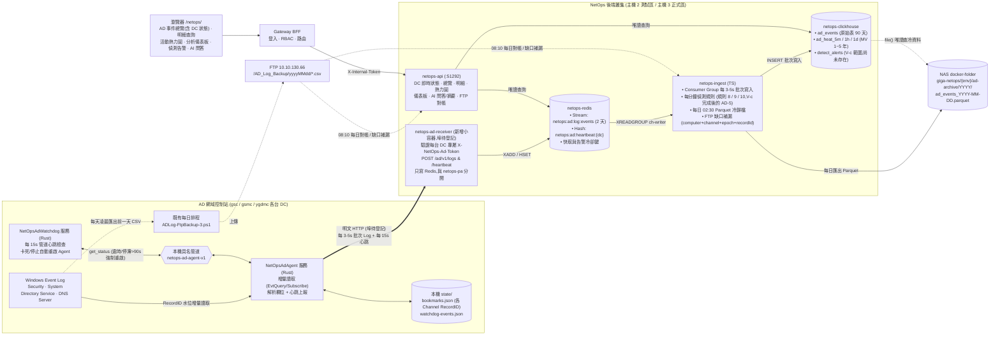
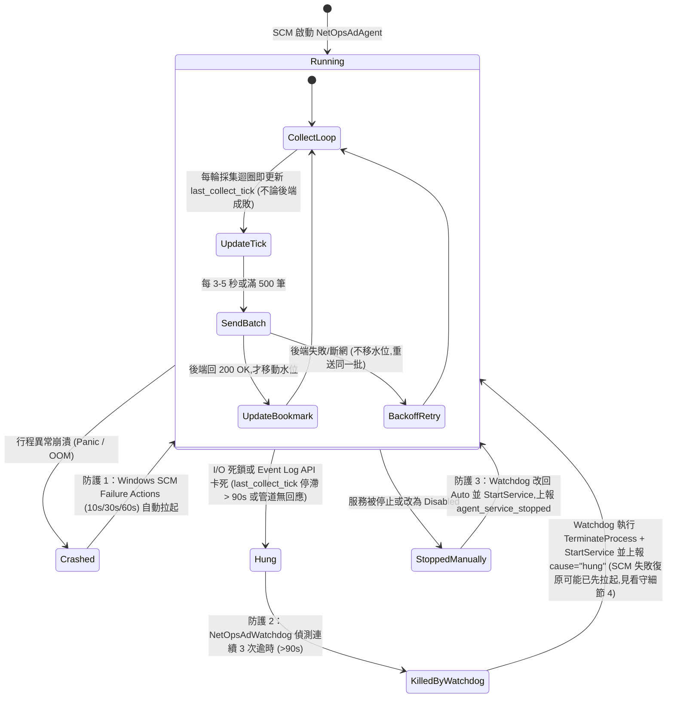

# NetOps AD Log 即時收集 Agent 與高吞吐架構計畫(AD-1 ~ AD-5)

> **狀態**:計畫已定案(需求方 2026-11-20 決定 AD1–AD10「全部依建議」)。**時程以 NexusPlan 甘特圖為準**,本文件只記架構、規格、工作分批與完成標準。
> **2026-11-23 依審查 `docs/reviews/2026-11-23-ad-agent-plan.md` 修正**:需求方對 H1–H4 的決定與 M1–M8、L1–L5 已寫入本文件;決策同步登記為 [ARCHITECTURE.md](ARCHITECTURE.md) **D49**。下文標「2026-11-23 審查補充」處是這次新增或改寫的內容。
> **分工(依 `AGENT.md`「AI 分工」節與 `HANDOFF.md` 2026-11-20 決定)**:本計畫與後續 `AD-1` ~ `AD-5` 實作由 **Gemini** 撰寫並開立 MR,由 **Claude** 進行審查(審查意見寫在 `docs/reviews/YYYY-MM-DD-ad-<批>.md` 或 MR 評論)。動到 Compose、`.env*` 範本、ClickHouse DDL / migration、`gateway-rbac.yaml`、CI/CD 等敏感變更,合併前必須有 Claude 的審查紀錄。
> **相關文件**:[ARCHITECTURE.md](ARCHITECTURE.md)(D19–D45)、[PA-LIVE-PLAN.md](PA-LIVE-PLAN.md)(收集器與 Redis 鍵設計)、[PA-LOG-CLICKHOUSE-GUIDE.md](PA-LOG-CLICKHOUSE-GUIDE.md)(ClickHouse 寫入、去重與 Parquet 冷歸檔)、[VIZ-RULES-DESIGN.md](VIZ-RULES-DESIGN.md)(熱力圖、儀表板與 V-d 規則 8 / 9 預留)、`../RustIt/docs/P5-MONITOR-DESIGN.md`(Windows 服務 + Watchdog 具名管道互相看守範本)。

---

## 目錄

1. [背景與需求方決策(AD1–AD10)](#1-背景與需求方決策ad1ad10)
2. [整體架構與流程圖](#2-整體架構與流程圖)
3. [AD Agent 與 Watchdog 常駐自癒設計(Rust)](#3-ad-agent-與-watchdog-常駐自癒設計rust)
4. [後端接收、Redis 緩衝與 ClickHouse 資料層](#4-後端接收redis-緩衝與-clickhouse-資料層)
5. [FTP 每日對帳與缺口自動補漏](#5-ftp-每日對帳與缺口自動補漏)
6. [API 設計、V-d 視覺化與偵測規則引擎](#6-api-設計v-d-視覺化與偵測規則引擎)
7. [安全與權限規範](#7-安全與權限規範)
8. [工作分批與完成標準(AD-1 ~ AD-5)](#8-工作分批與完成標準ad-1--ad-5)
9. [AD-6 擴充收集的事件範圍(2026-11-24)](#9-ad-6-擴充收集的事件範圍2026-11-24)

---

## 1. 背景與需求方決策(AD1–AD10)

### 1.1 現況與痛點

目前 AD 網域控制站(DC)事件由每台 DC 每天凌晨執行排程腳本 [`scripts/dc/ADLog-FtpBackup-3.ps1`](../scripts/dc/ADLog-FtpBackup-3.ps1),匯出前一天的 `Security`(23 種稽核事件)、`System`、`Directory Service`、`DNS Server` 為 CSV 到 FTP(`10.10.130.66:/AD_Log_Backup/yyyyMMdd/`),再由 `netops-api`([`backend/src/modules/ad/importer.ts`](../backend/src/modules/ad/importer.ts))在每日對帳後(08:10,AC1)同步到本機 `adlogs/yyyyMMdd.json`。

既有做法有三個主要限制:
1. **T+1 天延遲**:當天發生的暴力破解(4625 / 4771)、帳號鎖定(4740)、特權群組異動(4728 / 4732 / 4756)、稽核記錄清除(1102)無法即時在 NetOps 看到或問 AI,也無法執行即時偵測規則(V-d 規則 8、9)。
2. **DC 本機 Security Log 覆蓋風險**:若 DC 的 `Security.evtx` 容量上限不足,未到隔天凌晨匯出前就已被新事件覆蓋(wrap)。
3. **無常駐看守與健康監控**:排程腳本若失敗或卡住,直到隔天對帳才發現缺檔。

### 1.2 需求方 2026-11-20 決定(AD1–AD10,全部照建議)

| # | 決策主題 | 決定內容(2026-11-20 定案) | 對齊既有決策 |
| --- | --- | --- | --- |
| **AD1** | **納管 AD 主機範圍** | 先在 1 台主力 DC(如 `GSMC-DC1`)試裝驗證,通過後推廣至三網域(`gsc` / `gsmc` / `ygdmc`)全部 DC。後端資料表與心跳一律以 `computer`(DC 主機名稱)+ `domain` 區分,支援多台 DC 並行回傳。**DC 總台數尚未確認**(容量估算先以 3 台計,見 §4.3.1,2026-11-23 審查補充 L4) | — |
| **AD2** | **Agent 語言與架構** | 採用 **Rust**(放本 repo `ad-agent/` 目錄,與 `frontend/`、`backend/`、`pa-collector/` 平行)。編譯單一靜態執行檔 `netops-ad-agent.exe`,以參數 `--mode agent` 與 `--mode watchdog` 註冊為兩個 Windows 服務(`NetOpsAdAgent`、`NetOpsAdWatchdog`) | 複用 `RustIt` Windows Service + Watchdog 模式與主機 2 `host2-windows` Runner |
| **AD3** | **常駐、心跳與停止回應(Hang)自動重啟** | **三層防護**:<br/>① **Windows SCM 失敗復原**:行程 Crash 時 10 / 30 / 60 秒自動重啟。<br/>② **Watchdog 具名管道看守(防 Hang / 卡死)**:`NetOpsAdWatchdog` 每 15 秒經本機具名管道 `\\.\pipe\netops-ad-agent-v1` 詢問 `get_status`,檢查 Agent 內部 `last_collect_tick` 與 `last_send_tick`。若管道逾時(5 秒)或 tick 停滯 **> 90 秒**,Watchdog 強制終止 Agent PID(`TerminateProcess`)並由 SCM 重啟,同時向後端上報 `agent_restarted (cause: "hung")`。被手動停止或改啟動類型時自動恢復並上報 `agent_service_stopped`;Agent 每 60 秒亦反向看守 Watchdog。<br/>③ **後端心跳 TTL 監控**:Agent 每 15 秒送心跳到後端 更新 `netops:ad:heartbeat:{computer}`,超過 **90 秒**(設定名稱 `AD_HEARTBEAT_STALE_SEC=90`)未更新畫面即顯示「DC 資料停止更新」,超過 **3 分鐘**(`AD_HEARTBEAT_OFFLINE_SEC=180`)觸發離線告警(規則 10);§1.2、§4.2、§6.3 一律引用這兩個設定名稱(2026-11-23 審查補充 L5) | 比照 `RustIt` P5-2、`PA-LIVE-PLAN` §3.1 |
| **AD4** | **後端接收通道與認證**(**2026-11-23 依審查 H1、H3 改寫**) | **AD 接收獨立成小容器 `netops-ad-receiver`(暫名)**,只寫 `netops-redis`,**不放進 `netops-pa`、不改 `pa-collector/`**:接收 `POST /ad/v1/logs` 與 `POST /ad/v1/heartbeat`。理由:AD 接收程式在 AD-1 ~ AD-3 會反覆修改,若放進 `netops-pa`,每次部署都重建 `netops-pa`,PA-560 的 Syslog 連線會斷、要網通在場重新 Commit(`deploy/RUNBOOK-prod.md` §8)。**埠號:新增,需在 Gateway `BACKEND-GUIDE` §3.3 登記後再定**(不使用 `:51293`)。<br/>**傳輸維持明文 HTTP**(需求方 2026-11-23 決定,不加 TLS)。**認證(2026-11-23 審查補充 H3)**:**每台 DC 一把獨立 Token**(標頭 `X-NetOps-Ad-Token`,與 PA HTTP Token 分離),伺服器端由 Token 對應該 DC 的 `computer` / `domain`,payload 自填的值與 Token 對應不一致即拒收(403);不再共用單一 `AD_AGENT_TOKEN_FILE`。**來源限制寫在主機 Windows 防火牆規則(列出各 DC IP)**;**不使用 `AD_ALLOWED_SOURCES`**——容器在 Docker 發佈埠後看到的來源是閘道 IP(正式區 PA 端為 `192.168.64.1`),不是 DC IP,擋不住也認不出 | 對齊 D19、D24、D26(內網 HTTP + 獨立 Token + 防火牆白名單);D49 |
| **AD5** | **收集的 Channel 與事件範圍** | 收集 `Security`、`System`、`Directory Service`、`DNS Server`(未裝 DNS 角色自動略過)。`Security` 預設白名單收既有 v3 的 **23 種稽核事件** + **`4672`**(特殊權限登入,排除 `*$ / SYSTEM / LOCAL SERVICE / NETWORK SERVICE`)+ **`4776`**(NTLM 認證失敗)+ **`4768`**(只收失敗 `ResultCode != 0x0`);提供 `include_user_logon_4624` 設定開關(預設 `false`,開啟時只收非 `$` 結尾的真人帳號 `4624`) | 沿用 `adlog.js` 事件定義並補齊 V-d 需求 |
| **AD6** | **回傳頻率與本機離線水位續傳** | 每 **3–5 秒**(或滿 500 筆)批次 `POST /ad/v1/logs`,每 **15 秒** `POST /ad/v1/heartbeat`。本機 `state\bookmarks.json` 記錄各 Channel 已獲後端 HTTP 200 ACK 的最後 `RecordID` 與**世代 `log_epoch`**(2026-11-23 審查補充 H4);斷線重連後直接以 `EventRecordID > last_acked_record_id` 從 Windows Event Log 增量補讀。**未 ACK 前重送「同一批」,不加入新事件**(M2,見 §4.3.1) | — |
| **AD7** | **資料儲存與保留期限** | **核准 AD 事件進 Redis、ClickHouse 與 NAS Parquet 冷歸檔**(為 `AGENT.md` §7.2 與 D20 / D36 的正式核准例外):<br/>• `netops-redis` Stream `netops:ad:log:events`:保留 **2 天**<br/>• `netops-clickhouse` 原始表 `netops.ad_events`:正式區保留 **90 天**、測試區 **3 天**<br/>• `netops-clickhouse` 彙總表 `ad_heat_5m` / `1h` / `1d`:正式區保留 **1 年 / 5 年 / 5 年**、測試區 **3 天**<br/>• NAS Parquet 冷歸檔 `/mnt/nas-docker/giga-netops/{env}/ad-archive/YYYY/`:每日 02:30 匯出前一天,正式區保留至少 **1 年**、測試區 **14 天** | 對齊 D21、D27–D30、D34–D36 |
| **AD8** | **FTP 排程降級為對帳與補漏** | DC 上的 `ADLog-FtpBackup-3.ps1` 每日排程保留;每天 08:10 對帳排程自動比對 FTP `/AD_Log_Backup/yyyyMMdd/` 與 ClickHouse `ad_events` 每台 DC 各 Channel 筆數,有缺口時由 `netops-ingest` 自動從 FTP 補寫缺漏的 `(computer, channel, log_epoch, record_id)`(世代欄位見 §4.3.1,2026-11-23 審查補充 H4);對帳範圍只比對 FTP 腳本涵蓋的事件(見 §5) | 對齊 D33、D43 |
| **AD9** | **一併打通 V-d(熱力圖、儀表板、規則 8 & 9)** | 分階段納入本計畫(`AD-3` ~ `AD-5`):既有 AD 頁面改查 ClickHouse + 結合 IP 對照表(AC3)→ 解鎖熱力圖 `metric=ad` 與 AD 時段明細熱/冷路由 → 解鎖分析儀表板「AD 網域」Tab → 啟用偵測規則 8、9 與規則 10(DC Agent 健康告警)。**2026-11-23 審查補充(H2,需求方同意)**:`AD-5` **等 V-c 偵測規則引擎完成後才做**(V-c 尚未實作,見 §6.3);`AD-1` ~ `AD-4` 不受影響 | 實踐 D36、VIZ-RULES-DESIGN §5.8 |
| **AD10** | **Agent 部署與更新方式** | 第一版提供發佈資料夾 + PowerShell 一鍵安裝/升級腳本 `Install-NetOpsAdAgent.ps1`(建立目錄、鎖定 `SYSTEM`/`Administrators` ACL、寫入 `agent.toml` 與該 DC 專屬 Token 檔、註冊雙服務與 SCM 復原原則)。**2026-11-23 審查補充(M6)**:Rust Windows 建置在 `host2-windows` Runner 新增 job(CI 屬敏感變更,需 Claude 審查紀錄);DC 是最高權限主機,執行檔沿用 `RustIt` S1 簽章流程,**安裝腳本安裝 / 升級前必須驗證執行檔簽章或 SHA-256 雜湊**,驗證失敗即中止 | DC 台數少,腳本部署最直接 |

---

## 2. 整體架構與流程圖

### 2.1 資料流向與元件邊界圖



- **單一對外入口原則(D24)**:瀏覽器與 BFF 只連 `netops-api (:51292)`;`netops-pa`、`netops-ad-receiver`、`netops-ingest`、`netops-clickhouse`、`netops-redis` 均不註冊為 Gateway 上游(`netops-ad-receiver` 只供 DC Agent 直連)。
- **讀寫分離原則(D27)**:`netops-api` 只使用 `netops_reader`(一般查詢)與 `netops_cold`(Parquet 冷查詢)唯讀帳號存取 ClickHouse;所有寫入、歸檔、補漏與規則告警均由 `netops-ingest`(`netops_writer`)執行。

---

## 3. AD Agent 與 Watchdog 常駐自癒設計(Rust)

### 3.1 目錄結構與執行模式

在 repo 根目錄新增 `ad-agent/`(獨立 Rust Cargo package):

```text
NetOps/
└─ ad-agent/
   ├─ Cargo.toml
   ├─ src/
   │  ├─ main.rs          CLI 進入點:run(前景開發)、service(--mode agent)、watchdog(--mode watchdog)
   │  ├─ config.rs        解析 agent.toml 與 token_file(拒絕預設空 token)
   │  ├─ winlog.rs        Windows Event Log API(EvtQuery / EvtRender / GetLogInformation 容量與最舊事件檢查)
   │  ├─ parser.rs        Event XML + RenderingInfo Message 解析,對齊 adlog.js 欄位
   │  ├─ bookmark.rs      本機 state/bookmarks.json 原子讀寫(各 Channel 最後 ACK RecordID)
   │  ├─ sender.rs        HTTP client 批次送出 /ad/v1/logs 與 /ad/v1/heartbeat(退避重試)
   │  ├─ pipe.rs          本機具名管道 \\.\pipe\netops-ad-agent-v1(get_status / status)
   │  ├─ service.rs       Windows Service 主迴圈與 SCM 控制(windows-service crate)
   │  └─ watchdog.rs      Watchdog 看守迴圈:SCM 狀態檢查、管道探測、逾時 Kill + 重啟、事件暫存上報
   ├─ scripts/
   │  ├─ Install-NetOpsAdAgent.ps1    一鍵安裝 / 升級腳本(含目錄 ACL、服務註冊、SCM 失敗復原)
   │  └─ Uninstall-NetOpsAdAgent.ps1  移除服務腳本(保留 state/ 與 logs/);維護暫停見 §3.4
   └─ agent.toml.example
```

### 3.2 常駐與「停止回應自動重啟」狀態機



**看守細節**:
1. **本機具名管道(`\\.\pipe\netops-ad-agent-v1`)**:
   - 建立管道時以 Windows Security Descriptor (SDDL) 限制只有 `LocalSystem (SY)` 與 `Builtin Administrators (BA)` 可讀寫,防止同機一般權限行程干擾或偽造指令。
   - Watchdog 每 **15 秒**連線管道送出 `{"type":"get_status"}`(讀寫逾時 5 秒)。
   - Agent 回傳 `{"type":"status","pid":1234,"version":"0.1.0","startedAt":"...","lastCollectTickMs":1763616000000,"lastSendOkAt":"...","lastError":"","bookmarks":{...}}`。
2. **判定「停止回應(Hung)」的條件**:
   - 管道連線/讀取失敗連續 **3 次**(約 45 秒),**或**回傳的 `now - lastCollectTickMs > 90_000`(採集主迴圈已卡死超過 90 秒)。
   - 注意:**網路斷線或後端 503 不算卡死**!後端連不上時,Agent 的採集與退避迴圈仍在運作,會持續推進 `lastCollectTickMs` 並更新 `lastError`,因此 Watchdog 不會在後端停機時誤殺 Agent。
3. **強制重啟與冷卻保護**:
   - 判定 `hung` 後,Watchdog 對該 `pid` 執行 `TerminateProcess`,等待程序退出後呼叫 SCM `StartService`,並將一筆 `agent_restarted (cause: "hung", previousPid, pid)` 寫入本機 `state\watchdog-events.json`,於下次心跳附上報後端。
   - **防無限重啟風暴**:若 10 分鐘內連續強制重啟達 5 次仍失敗,Watchdog 進入 10 分鐘冷卻期並持續向後端發送 `agent_start_failed` 心跳告警,不消耗 DC CPU。
4. **Watchdog 與 SCM 同時重啟(2026-11-23 審查補充 M4)**:`TerminateProcess` 後 SCM 失敗復原(10 秒)也會拉起 Agent,Watchdog 呼叫 `StartService` 時可能回 `ERROR_SERVICE_ALREADY_RUNNING`;Watchdog 必須把此錯誤視為成功(確認新 PID 後照常上報 `hung`),不得計入重啟失敗次數。`last_collect_tick` 的更新規則以第 2 點為準:**每輪採集迴圈都更新,不論後端成敗**;寫成測試(後端回 503 時 Watchdog 不重啟 Agent)。

### 3.3 Windows Event Log 採集與水位(Bookmark)設計

1. **查詢方式**:
   - 每個採集週期(每 3 秒)對 `Security`、`System`、`Directory Service`、`DNS Server` 執行 `EvtQuery`:
     - `Security`:XPath 篩選 `*[System[(EventID=4625 or EventID=4771 or ...) and (EventRecordID > {last_record_id})]]`(因 Windows XPath 條件數上限,分 2 個查詢或以 `EventRecordID > {last_record_id}` 順序掃描並在記憶體以 `HashSet<u32>` 瞬間過濾 EventID;實測在記憶體過濾 `EventID` 比複雜 XPath 更快且不受 22 個 ID 限制)。
     - 其他 3 個 Channel:`*[System[EventRecordID > {last_record_id}]]`。
   - **首次啟動基準(2026-11-23 審查補充 M8)**:若 `bookmarks.json` 尚無該 Channel 的 `RecordID`,**預設往回推 60 分鐘**開始收(`initial_lookback_minutes = 60`,可在 `agent.toml` 調整),不採「只從最新一筆開始」。安裝當天 60 分鐘以前的事件,要到**隔天 08:10 FTP 對帳**才會補齊(安裝當天的 DC 排程會在隔天凌晨匯出整天 CSV)。
   - **Event Log 被清除(1102)或覆蓋重置的處理(2026-11-23 審查補充 H4)**:若查詢發現目前 Channel 的最大 `RecordID` 小於本機記錄的 `last_record_id`(代表 Event Log 被清空重編),Agent 將該 Channel 的**世代 `log_epoch` 加 1**、水位重設為 `0` 從頭讀取,並附帶一筆 `log_record_id_reset` 警告。`log_epoch` 寫入 `bookmarks.json`,隨每筆事件(`logEpoch`)與心跳送出,後端寫入 `ad_events.log_epoch`。去重與補漏的鍵是 `(computer, channel, log_epoch, record_id)`,清除前後同號的事件不會互相誤判。
   - **`bookmarks.json` 遺失 / 重新安裝時 `log_epoch` 怎麼延續**:**未確認**,AD-2 設計時定案(候選:由後端心跳回應帶回該 `(computer, channel)` 目前最大 `log_epoch`)。
   - **AD-2 DC 實測項目**:「清除 Security Log 後 `RecordID` 是否從 1 重新編號」要在測試 DC 實測並記錄在測試報告;實測結果決定 `log_epoch` 偵測是否足夠。
2. **Security Log 覆蓋健康度檢查(每 15 秒心跳時執行)**:
   - 讀取 `Security` Channel 的 `FileSize`、`MaxSize`(bytes)、`RecordCount`,以及最舊一筆事件的 `TimeCreated`(`EvtQuery` `EvtQueryForwardDirection` 取第 1 筆)。
   - 計算 `coverageHours = (now - oldestEventTime) / 3600`:若 `< 24` 小時,心跳標記 `wrapRisk: true`,讓網管在事件被覆蓋前就能在 NetOps 看到預警。

### 3.4 DC 維護暫停與 Agent 執行檔驗證(2026-11-23 審查補充 M5、M6)

- **維護時暫停 Agent(M5)**:Agent 服務被停會被 Watchdog 自動拉起(AD3 防護 3),因此 DC 維護(修補、重開機前、調整 Event Log 大小)不能直接停 Agent。`Install-NetOpsAdAgent.ps1` 提供 `-Pause`(先把 Watchdog 設為 Manual 並停止,再停 Agent)與 `-Resume`(依序恢復),或用 `Uninstall-NetOpsAdAgent.ps1` 移除。**暫停期間心跳中斷,超過 `AD_HEARTBEAT_OFFLINE_SEC`(180 秒)會觸發規則 10(V-c 完成後才有告警)**;規則 10 是否支援「維護中」標記以免誤報:**未確認**,列入 V-c / AD-5 設計。
- **執行檔簽章與雜湊(M6)**:見 AD10。安裝腳本驗證通過才複製執行檔、註冊服務。

---

## 4. 後端接收、Redis 緩衝與 ClickHouse 資料層

### 4.1 `netops-ad-receiver` 獨立接收容器(2026-11-23 依審查 H1 改寫)

新增獨立小容器 `netops-ad-receiver`(暫名),**只寫 `netops-redis`**,**不放進 `netops-pa`、不改 `pa-collector/`**(理由見 AD4:避免改 AD 接收時重建 `netops-pa` 而斷 PA Syslog)。反過來,PA 收集器的修改也不會讓 DC Agent 斷線。

- **埠號**:新增,需在 Gateway `BACKEND-GUIDE` §3.3 登記後再定,本計畫不自行指定。
- **傳輸**:明文 HTTP(需求方 2026-11-23 決定);來源限制由主機 Windows 防火牆列出 DC IP(見 §7)。對外暴露方式(直接發佈或經主機轉入):**未確認**,AD-1 設計時依部署環境決定。
- **實作語言與映像**:**未確認**。審查提出的候選為(a)沿用 `netops-pa` 的映像另起一個容器、(b)用 `backend/` 的 TypeScript 寫成小程式;不論哪種,都**不改 `pa-collector/` 的程式**。AD-1 開工時由實作者說明並經 Claude 審查。
- Compose 與 `.env*` 範本、機密腳本都屬敏感變更,合併前需 Claude 審查紀錄。

| 路徑 | 標頭認證 | 用途 | 寫入 Redis |
| --- | --- | --- | --- |
| `POST /ad/v1/logs` | `X-NetOps-Ad-Token: <該 DC 專屬 token>` | 批次上傳 AD 事件(單批 ≤ 1,000 筆、≤ 4 MB);payload 的 `computer` / `domain` 必須與 Token 對應的 DC 一致,否則 403 | `XADD netops:ad:log:events MINID ~ <2天前ms> * d <json>` |
| `POST /ad/v1/heartbeat` | `X-NetOps-Ad-Token: <該 DC 專屬 token>` | 每 15 秒上報 DC Agent / Watchdog 狀態與 Security Log 容量;若有 Watchdog 事件一併轉進事件流 | `HSET netops:ad:heartbeat:{computer}`、`SADD netops:ad:computers {computer}` |

**Token 對應(2026-11-23 審查補充 H3)**:每台 DC 一把 Token,接收端以 Docker secret 讀取「Token ↔ `computer` / `domain`」對應表(檔案格式與設定名稱 AD-1 定案;值不入版控、不寫進文件)。Token 遺失或 DC 汰換時只需作廢該台的 Token。

**請求 Payload 規格(`POST /ad/v1/logs`)**:

```json
{
  "computer": "GSMC-DC1",
  "domain": "gsmc.com",
  "agentVersion": "0.1.0",
  "events": [
    {
      "time": "2026-11-20T13:05:12.345+08:00",
      "channel": "Security",
      "eventId": 4625,
      "recordId": 98765432,
      "logEpoch": 0,
      "level": "Audit Failure",
      "provider": "Microsoft-Windows-Security-Auditing",
      "message": "帳戶登入失敗。..."
    }
  ]
}
```

**請求 Payload 規格(`POST /ad/v1/heartbeat`)**:

```json
{
  "computer": "GSMC-DC1",
  "domain": "gsmc.com",
  "reportedAt": "2026-11-20T13:05:15.000+08:00",
  "agentVersion": "0.1.0",
  "watchdogVersion": "0.1.0",
  "agent": {
    "pid": 4120,
    "serviceState": "running",
    "startType": "auto",
    "statusOk": true,
    "lastCollectTickAt": "2026-11-20T13:05:14.000+08:00",
    "lastSendOkAt": "2026-11-20T13:05:12.500+08:00",
    "lastError": "",
    "restarts24h": 0,
    "cpuPct": 0.4,
    "rssMb": 11.2
  },
  "channels": {
    "Security": { "lastRecordId": 98765432, "logEpoch": 0, "fileSizeMb": 1024, "maxSizeMb": 4096, "oldestEventAt": "2026-11-12T04:10:00+08:00", "coverageHours": 200.9, "wrapRisk": false },
    "System": { "lastRecordId": 451200 },
    "Directory_Service": { "lastRecordId": 12044 },
    "DNS_Server": { "lastRecordId": 88310 }
  },
  "watchdogEvents": []
}
```

### 4.2 Redis 鍵設計(補充 `PA-LIVE-PLAN.md` §4)

| 鍵 | 型別 | 內容 | 保留 / TTL |
| --- | --- | --- | --- |
| `netops:ad:log:events` | Stream | AD 事件明細 JSON(含 `computer`、`domain`、`channel`、`eventId`、`recordId`、`level`、`provider`、`message`) | **2 天**(`XADD … MINID ~`) |
| `netops:ad:log:events` group `ch-writer` | Stream group | `netops-ingest` 讀取並解析寫入 `netops.ad_events`,成功後 `XACK` | 跟 Stream |
| `netops:ad:computers` | Set | 已回報過的 DC `computer` 名稱清單 | 無。DC 下線 / 汰換時由維運人員以 `redis-cli` 清除(`SREM` 與 `DEL netops:ad:heartbeat:{computer}`),**第一版不提供管理 API**(2026-11-23 審查補充 L3) |
| `netops:ad:heartbeat:{computer}` | Hash | 該台 DC 最新心跳 JSON、`updatedAt`(伺服器收到時間)、累計收到的 `received` 筆數 | 無(由 `updatedAt` 距今 > `AD_HEARTBEAT_STALE_SEC`(90 秒)畫面顯示「停止更新」、> `AD_HEARTBEAT_OFFLINE_SEC`(180 秒)判定離線,保留最後狀態供畫面顯示「最後連線於…」) |
| `netops:ad:backfill:queue` / `job:{id}` | List / Hash | AD FTP 補漏工作佇列與狀態(同 PA `netops:backfill:*` 結構) | job 7 天 TTL |

### 4.3 ClickHouse 資料表 DDL(`deploy/clickhouse/`)

#### 4.3.1 原始表 `netops.ad_events`

`netops-ingest` 讀取 `netops:ad:log:events` 時,直接呼叫既有 [`backend/src/modules/ad/core/adlog.js`](../backend/src/modules/ad/core/adlog.js) 的 `toEvent()` 與 `enrichEvent()` 抽出 `account`、`domain`、`ip`、`workstation`、`reason`、`actor`、`target`、`group`、`privileged`、`is_issue`,寫入 `netops.ad_events`:

```sql
CREATE TABLE IF NOT EXISTS netops.ad_events
(
    event_time    DateTime('Asia/Taipei')        CODEC(DoubleDelta, ZSTD(1)),
    received_at   DateTime64(3, 'Asia/Taipei')   CODEC(DoubleDelta, ZSTD(1)),
    computer      LowCardinality(String),        -- DC 主機名,例 GSMC-DC1
    ad_domain     LowCardinality(String),        -- AD 網域,例 gsmc.com / 帳戶網域
    channel       LowCardinality(String),        -- 'Security' | 'System' | 'Directory_Service' | 'DNS_Server'
    event_id      UInt32,
    log_epoch     UInt32 DEFAULT 0,              -- Event Log 世代:偵測到 RecordID 重置(清除重編)時 +1(H4)
    record_id     UInt64,                        -- Windows EventRecordID(同台 DC + Channel + log_epoch 內唯一)
    level         LowCardinality(String),        -- 'critical' | 'error' | 'warning' | 'audit_failure' | 'audit_success' | 'info'
    level_text    LowCardinality(String),
    provider      LowCardinality(String),
    account       String CODEC(ZSTD(1)),         -- 目標或登入失敗帳號
    actor         String CODEC(ZSTD(1)),         -- 執行異動的主體帳號
    target        String CODEC(ZSTD(1)),         -- 被異動對象(CN 已拆出)
    group_name    LowCardinality(String),        -- 異動的安全群組名稱
    privileged    UInt8 DEFAULT 0,               -- 1 = 特權群組異動
    is_issue      UInt8 DEFAULT 0,               -- 1 = isIssue(e) 需要注意的事件
    src_ip        IPv6,                          -- 來源 IP(無 IP 時為 '::')
    src_ip_raw    String CODEC(ZSTD(1)),         -- 原始來源位址字串(保留非標準格式)
    workstation   LowCardinality(String),        -- 來源工作站名稱
    reason        LowCardinality(String),        -- 登入失敗原因(已轉換 NTSTATUS / Kerberos 中文)
    message       String CODEC(ZSTD(3)),         -- 完整訊息(上限 3,000 字)
    source        LowCardinality(String),        -- 'agent' | 'ftp'

    INDEX idx_account account TYPE tokenbf_v1(4096, 2, 0) GRANULARITY 2,
    INDEX idx_src_ip  src_ip  TYPE bloom_filter(0.01)     GRANULARITY 1,
    INDEX idx_msg     message TYPE ngrambf_v1(3, 16384, 2, 0) GRANULARITY 4
)
ENGINE = MergeTree
PARTITION BY toYYYYMM(event_time)
ORDER BY (toStartOfHour(event_time), channel, event_id, computer, log_epoch, record_id)
TTL event_time + INTERVAL {{TTL_AD_RAW}} DELETE
SETTINGS index_granularity = 8192, ttl_only_drop_parts = 1,
         non_replicated_deduplication_window = 1000;
```

- **TTL 佔位符 `{{TTL_AD_RAW}}`**:正式區 `90 DAY`、測試區 `3 DAY`。
- **容量估算**:每台 DC 每天經過篩選的事件約 5,000–30,000 筆,3 台 DC 合計每天 < 10 萬筆;ZSTD 壓縮後每天約 **3–8 MB**,90 天不到 **500 MB**,對主機 2 / 主機 3 的記憶體與 20 GB 磁碟預留幾乎零負擔。**(2026-11-23 審查補充 L4)** 此估算以 3 台 DC 計,**實際 DC 總台數未確認**(AD1 要推到三網域全部 DC);**`include_user_logon_4624` 開啟時的事件量未估**,AD-2 在測試 DC 實測 4624 量級後再補,台數與 4624 開關確認後重算容量。
- **寫入去重(2026-11-23 審查補充 H4、M2)**:
  1. 鍵為 `(computer, channel, log_epoch, record_id)`。`netops-ingest` 每個批次以 `ad:{computer}:{channel}:{epoch}:{firstRecordId}_{lastRecordId}` 作為 `insert_deduplication_token`。
  2. **token 只擋「完全相同的批次」**。Agent 沒收到 200 重送時,若批次多了新事件、首尾 RecordID 不同,token 擋不住;`netops-ingest` 在 INSERT 後、`XACK` 前重啟也會重讀同一批。`ad_events` 是一般 MergeTree,重複列不會被合併,物化檢視(MV)也會重複計數。
  3. 因此規格要求:**Agent 在未收到 200 ACK 前,重送「同一批」(內容與範圍不變,不加入新事件)**,新事件留到下一批;並寫**重送測試**(模擬收不到 200、重送、ingest 重啟後重讀,驗證 `ad_events` 與 `ad_heat_*` 無重複)。
  4. 若 AD-1 / AD-2 實測仍無法保證,備案是 `ad_events` 改 `ReplacingMergeTree`(但 `ad_heat_*` 的 MV 仍會重複計數,須一併說明處理方式);採用哪個,在 AD-1 的 MR 說明並經 Claude 審查。

#### 4.3.2 熱力圖長期彙總表 `netops.ad_heat_5m` / `ad_heat_1h` / `ad_heat_1d`(V-d)

結構對齊 `pa_heat_*`([VIZ-RULES-DESIGN.md](VIZ-RULES-DESIGN.md) §3.1):

```sql
CREATE TABLE IF NOT EXISTS netops.ad_heat_5m
(
    bucket            DateTime('Asia/Taipei'),
    total_events      SimpleAggregateFunction(sum, UInt64),
    issue_events      SimpleAggregateFunction(sum, UInt64),   -- is_issue = 1
    fail_logons       SimpleAggregateFunction(sum, UInt64),   -- event_id IN (4625, 4771, 4776)
    lockouts          SimpleAggregateFunction(sum, UInt64),   -- event_id = 4740
    priv_changes      SimpleAggregateFunction(sum, UInt64),   -- privileged = 1 OR event_id IN (1102, 4794)
    account_changes   SimpleAggregateFunction(sum, UInt64),   -- 帳號/群組異動
    top_fail_src      AggregateFunction(topKIf(3), IPv6, UInt8),
    top_fail_account  AggregateFunction(topKIf(3), String, UInt8)
)
ENGINE = AggregatingMergeTree
PARTITION BY toYYYYMM(bucket)
ORDER BY bucket
TTL bucket + INTERVAL {{TTL_HEAT_5M}} DELETE
SETTINGS non_replicated_deduplication_window = 1000;
-- ad_heat_1h(TTL {{TTL_HEAT_1H}} = 5 YEAR)、ad_heat_1d(TTL {{TTL_HEAT_1D}} = 5 YEAR)結構相同
```

對應 3 個物化檢視 `ad_heat_5m_mv`、`ad_heat_1h_mv`、`ad_heat_1d_mv` 從 `netops.ad_events` 自動聚合。

---

## 5. FTP 每日對帳與缺口自動補漏

完全對齊 PA-560 的 `reconcile.ts` + `backfill.ts`(ARCHITECTURE D33、D43):

1. **每日 08:10 自動對帳**:
   - `netops-api` 在每日 08:10 對帳排程中,列出 FTP `/AD_Log_Backup/yyyyMMdd/` 最近 3 天(或 FTP 保留期內)的 CSV 檔。
   - 解析 CSV 計算各 `(day, computer, channel)` 的事件筆數,與 ClickHouse `netops.ad_events` 同一天同一 `(computer, channel)` 的 `count()` 比對。
   - **事件範圍要對齊(2026-11-23 審查補充 M1)**:FTP CSV 的 `Security` 只有 `ADLog-FtpBackup-3.ps1` 的 `$SecurityEventIds`(23 種);Agent 另收 `4672`、`4776`、`4768` 失敗(選用 `4624`)。**ClickHouse 端的 `count()` 只計與 CSV 同一組 EventID**(Security 限 23 種 ID,其他 Channel 以 CSV 涵蓋的為準),否則每天都對不起來。
   - **CSV 與 Agent 資料格式差異(AD-3 測試必須比對)**:已確認 CSV 有 `RecordID`、`Computer` 欄,補漏鍵可行;但 CSV 時間只到秒、沒有時區,`Message` 是 DC 本地化文字,補寫列與 Agent 寫入列的欄位值可能不同(時間精度、時區、訊息格式)。
2. **自動補漏**:
   - 若某個 `(day, computer, channel)` 在 ClickHouse 筆數少於 FTP(差異 > 0 筆),自動建立 AD 補漏工作推入 `netops:ad:backfill:queue`。
   - `netops-ingest` 讀取 FTP 上的該 CSV 檔,先向 ClickHouse 查詢該日已存在的 `(computer, channel, log_epoch, record_id)` 集合(一天幾千~幾萬個 `UInt64`,記憶體 < 1 MB),**只將缺漏的列以 `source = 'ftp'` 寫入 `netops.ad_events`**。FTP CSV 沒有 `log_epoch`:補寫列的世代怎麼判定(候選:取同 `(computer, channel)` 在該事件時間之前最近一筆 Agent 列的 `log_epoch`,查無則 0;已存在判斷可輔以 `event_time` 取到秒),**未確認**,AD-3 設計時定案並寫入測試(含 11-23 審查 H4 的「清除後重編號」情境)。
   - **補漏只寫缺漏列,`ad_heat_5m` / `1h` / `1d` 由物化檢視在 INSERT 時自然累加**(2026-11-23 審查補充 M3):**不需要、也不可以**停用或重建分桶,重建反而會重複計數。
3. **相容過渡期**:
   - 新增環境變數 `NETOPS_AD_SOURCE=clickhouse|ftp`(未設定時:測試區預設 `clickhouse`,正式區在 AD Agent 上線前預設 `ftp`)。切換為 `clickhouse` 後,AD 總覽、明細、AI 問答一律查 ClickHouse。

---

## 6. API 設計、V-d 視覺化與偵測規則引擎

### 6.1 新增與升級的後端 API(`netops-api`)

| 方法 | 對外路徑(`/api/netops/...`) | 權限 | 稽核 | 說明 |
| --- | --- | --- | --- | --- |
| GET | `/ad/agents` | `netops.ad.read` | — | **新增**:列出所有納管 DC 的 Agent / Watchdog 即時心跳狀態、各 Channel 最新 `RecordID`、Security Log 容量與 `wrapRisk`、24h 重啟次數 |
| GET | `/ad/days` | `netops.ad.read` | — | **升級**:`NETOPS_AD_SOURCE=clickhouse` 時回傳 ClickHouse 有資料的日期與每日筆數,並附 `agents` 狀態摘要 |
| GET | `/ad/overview` | `netops.ad.read` | — | **升級**:改由 ClickHouse `ad_events` 即時聚合(含今天即時資料),並在 `failIps` 等欄位透過 `preSerialization` 附帶 **IP 對照表 `names`**(AC3) |
| GET | `/ad/events` | `netops.ad-log.read` | `meta` | **升級**:改查 ClickHouse `ad_events`(支援 `computer`、`domain` 篩選,以及用 IP 對照表「員工姓名 / 部門」反查來源 IP);附帶 `names` |
| GET | `/ad/events/export` | `netops.ad-log.read` | `meta` | **升級**:從 ClickHouse 匯出 CSV,新增「來源名稱 / 部門」欄位 |
| GET | `/ad/reconcile` | `netops.ftp.read` | — | **新增**:查看 AD ClickHouse vs FTP 每日對帳結果與補漏工作狀態 |
| POST | `/ad/backfill` | `netops.ftp.write` | `body` | **新增**:手動觸發指定日期的 AD FTP 補漏 |
| GET | `/ad/heatmap` | `netops.ad.read` | — | **V-d 解鎖**:查詢 `ad_heat_5m` / `1h` / `1d`(年 / 月 / 日三級熱力圖,指標 `ad`),回傳格式同 `GET /pa/heatmap` |
| GET | `/ad/slice` | `netops.ad-log.read` | `meta` | **V-d 解鎖**:AD 時段明細(≤ 89 天查 `ad_events` 熱表,> 89 天查 NAS Parquet 冷歸檔;30 秒內同步、超過轉工作模式 `GET /ad/slices/{id}`) |
| GET | `/ad/insight` | `netops.ad.read` | — | **V-d 解鎖**:分析儀表板「AD 網域」Tab 資料(登入失敗/鎖定時序、失敗來源 IP Top 10、失敗帳號 Top 10、失敗原因分布、各 DC 事件量、特權異動清單) |

### 6.2 V-d 熱力圖「AD 異常」分級與儀表板設計

1. **熱力圖 `metric=ad` 分數與 4 階色階**:
   - 每個時間格分數:`score = priv_changes * 10 + lockouts * 5 + fail_logons * 1 + issue_events * 0.2`。
   - 分級(`level 0..4`):
     - `0`:無異常事件(`score == 0`)
     - `1`(低):有零星登入失敗或警告(`score > 0`)
     - `2`(中):單格登入失敗 ≥ 10 次
     - `3`(高):發生帳號鎖定(`lockouts > 0`)或單格登入失敗 ≥ 50 次
     - `4`(嚴重):發生特權群組異動 / 稽核清除(`priv_changes > 0`)或單格登入失敗 ≥ 200 次
   - Tooltip 顯示:總事件數、登入失敗數、帳號鎖定數、特權異動數、Top 1 失敗來源 IP(含名稱)、Top 1 失敗帳號。
2. **分析儀表板「AD 網域」Tab(解鎖 `Insight.vue` 第三個分頁)**:
   - KPI 卡片:總事件數、登入失敗數(4625/4771/4776)、帳號鎖定數(4740)、特權群組異動數、活躍 DC 數。
   - 圖表 1:**登入失敗與帳號鎖定時序圖**(雙軸或堆疊折線/長條)。
   - 圖表 2:**失敗來源 IP Top 10 排行**(自動帶出 IP 對照表姓名/部門)與**被嘗試帳號 Top 10 排行**並排比較(`GTopCompare`)。
   - 圖表 3:**失敗原因佔比環圈圖**(`GAppShare` 複用)與**最新特權/帳號異動時間軸清單**。
   - 點擊任何圖表項目均可連動開啟 `SliceDrawer`(AD 時段明細抽屜)或跳轉至 AD Log 明細查詢。
   - 支援「AI 摘要本期 AD 異常」(`POST /ai/explanations` 新增 `kind: 'ad-insight'` 與 `kind: 'ad-slice'`)。

### 6.3 V-d 偵測規則引擎(規則 8、9、10,於 `netops-ingest` 每分鐘執行)——**依賴 V-c,等 V-c 完成後才做(AD-5)**

> **2026-11-23 依審查 H2 改寫(需求方同意)**:偵測規則引擎、`netops.detect_alerts` 告警表、「偵測告警 › 告警」頁面與權限代碼 `netops.alert.read` / `netops.alert.write` / `netops.detect.read` / `netops.detect.write`,**全部是 V-c 的範圍,目前尚未存在**(`deploy/gateway-rbac.yaml` 沒有這 4 個代碼,`backend/`、`frontend/`、`deploy/` 也沒有 `detect_alerts` 或規則引擎;見 `VIZ-RULES-DESIGN.md`、`ARCHITECTURE.md` D38、D39)。下表的規則 8 / 9 / 10 因此**要等 V-c 完成才能實作**,不是「沿用既有」。`AD-1` ~ `AD-4` 照常進行。

| 規則編號 | 規則代碼 | 間隔 / 時間窗 | 觸發條件(初始門檻,可在偵測設定頁調整) | 冷卻主體 | 預設嚴重度 |
| --- | --- | --- | --- | --- | --- |
| **規則 8a** | `AD_BRUTE_FORCE_ACCOUNT` | 1 / 5 分鐘 | 單一 `account` 在 5 分鐘內登入失敗(`event_id IN (4625, 4771, 4776)`) **`>= 10` 次** | `account` | `high` |
| **規則 8b** | `AD_PASSWORD_SPRAY` | 1 / 5 分鐘 | 單一來源 `src_ip`(`!= '::'`)在 5 分鐘內嘗試登入失敗的不同帳號數 `uniqExact(account)` **`>= 5` 個** | `src_ip` | `critical` |
| **規則 9a** | `AD_ACCOUNT_LOCKOUT` | 1 / 5 分鐘 | 發生帳號鎖定(`event_id = 4740`) **`>= 1` 次** | `account` | `medium` |
| **規則 9b** | `AD_PRIVILEGED_CHANGE` | 1 / 5 分鐘 | 發生特權群組人員異動(`privileged = 1`)、DSRM 密碼變更(`4794`)或稽核日誌清除(`1102`) | `computer \| event_id \| target` | `critical` |
| **規則 9c** | `AD_OFF_HOURS_PRIV_LOGON` | 5 / 5 分鐘 | 離峰時段(預設台北時間 **01:00–05:00**,對齊規則 7 X13)發生真人帳號特殊權限登入(`event_id = 4672`)或特權帳號異動 | `actor` | `high` |
| **規則 10** | `AD_AGENT_HEALTH` | 1 / 1 分鐘 | ① 已納管 DC 心跳逾時 **`> AD_HEARTBEAT_OFFLINE_SEC`(180 秒)**(離線;畫面「停止更新」用 `AD_HEARTBEAT_STALE_SEC` = 90 秒,見 AD3)<br/>② Watchdog 上報 `agent_restarted (cause: hung / crashed)` 或 `agent_service_stopped`<br/>③ DC `Security` Log `wrapRisk = true`(最舊事件覆蓋不足 24 小時) | `computer \| subkind` | ①/② `high`<br/>③ `medium` |

- **V-c 完成後**,告警統一寫入 V-c 建立的 `netops.detect_alerts`,共用 V-c 定義的 `netops:detect:cool:{rule}:{subject}` 30 分鐘冷卻與抑制計數(`suppressed`)、IP 白名單排除,呈現在 V-c 的「偵測告警 › 告警」頁面與側欄徽章。這些都以 V-c 實作的實際結果為準,AD-5 開工前要先對照 V-c 的程式與文件,不得沿用本節假設。

---

## 7. 安全與權限規範

1. **機密管理(`AGENT.md` §7.5)**:
   - **每台 DC 一把 Token(2026-11-23 審查補充 H3)**:由需求方執行主機腳本(擴充 `deploy/host2-set-pa-secrets.sh` / `host3-set-pa-secrets.sh`,或另寫 AD 專用腳本)為每台 DC 產生 32 bytes 隨機 hex,並產生「Token ↔ `computer` / `domain`」對應表,寫入主機機密目錄,`netops-ad-receiver` 以 Docker secret / 唯讀檔案掛載;腳本隱藏輸入、不把值印在畫面或日誌。
   - DC 端 Token 存於 `%ProgramData%\GigaNexus\NetOpsAdAgent\secrets\ad_agent.token`(內容是該 DC 專屬的那一把),安裝腳本以 `icacls` 設定僅 `NT AUTHORITY\SYSTEM` 與 `BUILTIN\Administrators` 可讀,不放環境變數或命令列參數。
   - 日誌與錯誤訊息一律遮罩 Token。
   - **傳輸與來源限制(需求方 2026-11-23 決定)**:Agent → 接收端**維持明文 HTTP**,不採 TLS;Token 在內網可被擷取的風險由「每台一把、伺服器端核對 `computer` / `domain`、作廢單台」與防火牆限縮來源來降低。**來源限制寫在主機 Windows 防火牆規則,列出各 DC IP**;**不使用 `AD_ALLOWED_SOURCES`**,因為容器經 Docker 發佈埠後看到的來源是閘道 IP(正式區 PA 端 `PA_ALLOWED_SOURCES=192.168.64.1/32`),不是 DC IP。
   - **剩餘風險(已知,需求方接受)**:拿到某台 DC Token 的人仍可偽造該台 DC 的事件與心跳;偽造「正常」心跳可掩蓋 Agent 停擺。
2. **本機管道與服務防護**:
   - 具名管道 `\\.\pipe\netops-ad-agent-v1` 設定 SDDL ACL `D:(A;;GA;;;SY)(A;;GA;;;BA)`,阻絕低權限使用者連線。
   - Agent 與 Watchdog 只讀 Event Log 與發送 HTTP POST,不開放任何遠端指令執行介面。
3. **ClickHouse 查詢安全(`AGENT.md` §7.2)**:
   - 所有查詢條件一律走 `query_params` 參數化,表名只用程式常數,禁止字串拼接 SQL。
   - `netops-api` 維持使用 `netops_reader` 與 `netops_cold` 唯讀帳號。
4. **權限代碼(`AGENT.md` §8)**:
   - `AD-1` ~ `AD-4` 沿用既有 `netops.ad.read`、`netops.ad-log.read`、`netops.ftp.read`、`netops.ftp.write`、`netops.ai.use`,**不自創新權限代碼**,無須修改 Gateway repo。
   - **`netops.alert.read`、`netops.alert.write`、`netops.detect.read`、`netops.detect.write` 不是「既有」代碼**(2026-11-23 審查補充 H2):它們屬 V-c(`ARCHITECTURE.md` D39),目前未登記在 `deploy/gateway-rbac.yaml`;`AD-5` 要等 V-c 完成登記後才能使用。
   - 新增按鈕節點(若熱力圖 / 儀表板 AD 分頁需獨立 AI 按鈕,沿用該頁既有 `netops.pa-heatmap.ai` / `netops.pa-insight.ai`,並在 AD 事件總覽新增 `netops.ad-events.ai` 綁 `[netops.ai.use, netops.ad.read]`)。

---

## 8. 工作分批與完成標準(AD-1 ~ AD-5)

每批各自從最新的 `origin/develop` 開立工作分支並提 MR,由 **Claude 審查**通過、需求方合併後進入下一批。**決策文件先行(2026-11-23 審查補充 M7)**:AD7 是 `AGENT.md` §7.2 與 D20 的資料範圍例外,`AGENT.md` 要求先由需求方決定並改 ARCHITECTURE,因此 AD1–AD10 與 2026-11-23 的 H1–H4 決定已先登記為 [ARCHITECTURE.md](ARCHITECTURE.md) **D49**、`AGENT.md` §7.2 已補核准例外(隨審查修正 MR !183),不再放到 AD-5:

| 批次 | 分支名稱 | 工作內容 | 負責 / 審查 | 完成標準 |
| --- | --- | --- | --- | --- |
| **AD-1** | `feature/ad-1-collector-ingest` | **獨立接收容器 + ClickHouse DDL + Ingest 寫入與冷歸檔**:<br/>1. 新增獨立小容器 `netops-ad-receiver`(**不放進 `netops-pa`、不改 `pa-collector/`**;埠號新增,需先在 Gateway `BACKEND-GUIDE` §3.3 登記後再定):`POST /ad/v1/logs`、`/ad/v1/heartbeat`,每台 DC 專屬 Token、核對 `computer` / `domain`,只寫 Redis `netops:ad:log:events`、`netops:ad:heartbeat:{computer}`、`netops:ad:computers`;Compose 服務與 env 範本一併新增(來源限制由主機 Windows 防火牆處理,不做 `AD_ALLOWED_SOURCES`)。<br/>2. `deploy/clickhouse/`:新增 `ad_events`(含 `log_epoch`)、`ad_heat_5m` / `1h` / `1d` 與 3 個 MV(`schema.sql` + migration、`apply-schema.sh` 加 `{{TTL_AD_RAW}}`)。<br/>3. `netops-ingest`:Consumer Group 批次解析(`adlog.js`)寫入 `ad_events`、每日 02:30 匯出 `ad-archive/YYYY/ad_events_YYYY-MM-DD.parquet`。<br/>4. 主機機密腳本補每台 DC 的 Token 與對應表 | **Gemini** 實作<br/>**Claude** 審查(含敏感變更:DDL、Compose、env 範本) | • 接收容器單元測試通過(依實作語言用 `pytest` + `ruff` 或 `backend` 的 `npm test`;含 Token 驗證、payload `computer` / `domain` 與 Token 不一致拒收、Payload 上限測試)<br/>• `backend` 單元測試與 `test:int`(真 Redis + ClickHouse 寫入、MV 聚合、Parquet 歸檔核對、**重送同一批與 ingest 重啟重讀無重複**)通過<br/>• **部署只重建 `netops-ad-receiver` 時 `netops-pa` 不重啟、PA Syslog 不中斷**(測試區驗證)<br/>• Claude 審查無 Critical / High |
| **AD-2** | `feature/ad-2-rust-agent` | **Rust AD Agent + Watchdog 雙服務與安裝腳本**:<br/>1. `ad-agent/`:Windows Event Log 增量讀取(`Security` 白名單 + `System` + `Directory Service` + `DNS Server`)、`bookmarks.json` 水位續傳、Security Log 容量與 `wrapRisk` 檢查。<br/>2. 本機具名管道 `get_status`、`NetOpsAdWatchdog` 每 15 秒看守(逾時 / 停滯 > 90 秒強制 Kill + 重啟 + 上報 `hung`;服務被停自動拉起)。<br/>3. `Install-NetOpsAdAgent.ps1`(含 `-Pause` / `-Resume`、**簽章或雜湊驗證**)/ `Uninstall-NetOpsAdAgent.ps1` 與單元測試。<br/>4. `log_epoch` 世代偵測與 `bookmarks.json` 寫入;`host2-windows` Runner 的 Rust Windows 建置 CI job(敏感變更) | **Gemini** 實作<br/>**Claude** 審查(安全與資源看守) | • `cargo test`、`cargo clippy` 通過(含 Bookmark 續傳、EventID 過濾、Watchdog 逾時判定與冷卻邏輯、**後端 503 時不誤殺**、`ERROR_SERVICE_ALREADY_RUNNING` 處理、`log_epoch` 加 1 測試)<br/>• 測試機 / DC 實測:強制凍結或結束 Agent 行程,Watchdog 能在 90 秒內重啟並上報後端;常駐記憶體 < 20 MB<br/>• **DC 實測「清除 Security Log 後 `RecordID` 是否從 1 重新編號」並記錄在測試報告**(H4);同時實測 `include_user_logon_4624` 開啟時的事件量(L4) |
| **AD-3** | `feature/ad-3-api-reconcile` | **AD 查詢切換 ClickHouse + DC 狀態 API + FTP 對帳補漏**:<br/>1. `netops-api`:`GET /v1/ad/agents`、升級 `/v1/ad/days`、`/v1/ad/overview`、`/v1/ad/events`、`/v1/ad/events/export` 支援 `NETOPS_AD_SOURCE=clickhouse` 並結合 IP 對照表 `names`(AC3);AI 問答 AD 來源支援 ClickHouse。<br/>2. 每日 08:10 AD FTP 對帳與 `netops-ingest` 自動補漏(`/v1/ad/reconcile`、`/v1/ad/backfill`)。<br/>3. 前端 `AD 事件總覽` 頂部新增「DC Agent 即時狀態列」、`AD 明細查詢` 支援 DC 篩選與名稱顯示、`AD › FTP Log 檔案` 新增對帳補漏卡片 | **Gemini** 實作<br/>**Claude** 審查 | • `backend` 與 `frontend` 測試、型別檢查、OpenAPI 必填欄位檢查全部通過<br/>• 對帳補漏整合測試證明 FTP 補寫不會產生重複 `(computer, channel, log_epoch, record_id)`,且對帳 `count()` 只比 CSV 涵蓋的同一組 EventID(M1)<br/>• 測試比對 CSV 補寫列與 Agent 寫入列的時間精度 / 時區 / `Message` 格式差異;補漏後 `ad_heat_*` 沒有重複計數(M3) |
| **AD-6**(2026-11-24 新增) | `feature/ad-6-event-ids` | **擴充 Agent 收集的事件範圍**(§9):Agent 過濾規則與設定開關、`adlog.js` 事件名稱與欄位解析、`RUNBOOK-ad.md` 稽核原則前提、GSMC-DC1 事件量實測。從 AD-3 分支(含 Gemini 審查修正)堆疊,在 AD-4 之前 | **Gemini** 實作<br/>**Claude** 審查(含 `deploy/` 敏感變更) | 見 §9.5 |
| **AD-4** | `feature/ad-4-vd-viz-ai` | **V-d 熱力圖 AD 指標、分析儀表板 AD 視角與 AI 解讀**:<br/>1. 後端:`GET /v1/ad/heatmap`、`GET /v1/ad/slice`(熱/冷自動路由)、`GET /v1/ad/slices/{id}`、`GET /v1/ad/insight`;`POST /v1/ai/explanations` 支援 `ad-insight`、`ad-slice`、`ad-events`。<br/>2. 前端:解鎖熱力圖 `metric=ad` 與 `SliceDrawer` AD 欄位;解鎖 `Insight.vue`「AD 網域」Tab 圖表與 AI 摘要面板 | **Gemini** 實作<br/>**Claude** 審查 | • 熱力圖與時段明細熱/冷路由整合測試通過<br/>• 前端元件掛載測試(`vitest`)與 `vite build` 通過,四種主題風格與 `prefers-reduced-motion` 正常 |
| **AD-5** | `feature/ad-5-vd-detect-docs` | **【前置:V-c 偵測規則引擎完成後才做】V-d 偵測規則(規則 8、9、10)與全專案文件同步**:<br/>0. **開工前提(2026-11-23 審查 H2,需求方同意)**:V-c 的規則引擎、`detect_alerts`、告警頁與 `netops.alert.*` / `netops.detect.*` 權限已實作並登記;V-c 本身仍等網段清單(X11)。<br/>1. `netops-ingest`:每分鐘執行規則 8(`AD_BRUTE_FORCE_ACCOUNT`、`AD_PASSWORD_SPRAY`)、規則 9(`AD_ACCOUNT_LOCKOUT`、`AD_PRIVILEGED_CHANGE`、`AD_OFF_HOURS_PRIV_LOGON`)、規則 10(`AD_AGENT_HEALTH`),掛在 V-c 的引擎上。<br/>2. 偵測設定頁與告警頁支援 AD 規則門檻調整與點擊告警開啟 AD 時段明細。<br/>3. 同步更新 `docs/IMPL-PLAN.md`、`docs/API.md`、`docs/PA-LIVE-PLAN.md` §4、`docs/PROJECT-MAP.md` 與 `docs/test-reports/`(`AGENT.md` §7.2 與 `ARCHITECTURE.md` 的決策已在 D49 先行完成,不在此批) | **Gemini** 實作<br/>**Claude** 審查 | • 規則 8、9、10「剛好超過 / 剛好未超過門檻」與 30 分鐘冷卻測試全部通過<br/>• 文件與架構完整同步,測試報告齊備 |

---

## 9. AD-6 擴充收集的事件範圍(2026-11-24)

> 需求方 2026-11-24 提出擴充清單,依 Claude 建議寫入本計畫(原話「依建議先寫到計劃書」),由 Gemini 實作、Claude 審查。本節是 §1.2 AD5「收集的 Channel 與事件範圍」的擴充;AD5 原本的範圍不變。

### 9.1 現況(AD-2 `ad-agent/src/filter.rs`)

- **Security 全收**:FTP v3 的 23 種(4625、4771、4740、4767、4720、4722、4725、4726、4724、4738、4781、4728、4729、4732、4733、4756、4757、4727、4731、4754、4704、4794、1102)。
- **Security 有條件收**:4672(排除電腦帳號與系統帳號)、4776 與 4768(只收失敗 `Status ≠ 0x0`)、4624(`include_user_logon_4624` 開啟才收,真人帳號、不分登入類型)。
- **System、Directory Service、DNS Server 整個通道全收**。所以 104、7045、41、1074、6006、6008(System)、1864、2042、1645、2887、2889、1388、1988、2092(Directory Service)、4000、4004、4015(DNS Server)**已經收到**,AD-6 只補事件名稱與說明,不改 Agent。

### 9.2 新增:量小,預設收

| Event ID | 名稱 | 說明 |
| --- | --- | --- |
| 4723 | 使用者自行變更密碼 | 和 4724(管理員重設)區分 |
| 4697 | 安裝服務 | 和 System 7045 互相佐證;DC 上出現要留意 |
| 4698 / 4699 / 4700 / 4701 / 4702 | 排程工作 建立 / 刪除 / 啟用 / 停用 / 更新 | 持久化手法 |
| 4719 | 系統稽核原則被變更 | 防禦規避 |
| 1100 | 事件記錄服務被關閉 | 防禦規避 |
| 1104 | Security Log 已滿 | 和 `wrapRisk` 呼應 |
| 4741 / 4742 / 4743 | 電腦帳號 建立 / 變更 / 刪除 | 機器帳號濫用、RBCD、noPac |
| 4765 / 4766 | 新增 SID History 成功 / 失敗 | 正常不會出現 |
| 4780 | AdminSDHolder 套用到管理員帳號 | 特權帳號佐證 |
| 4735 / 4737 / 4755 | 安全群組變更(本機 / 全域 / 通用) | 補齊群組生命週期 |
| 4730 / 4734 / 4758 | 安全群組刪除(全域 / 本機 / 通用) | 同上 |
| 4739 | 網域原則變更 | 密碼原則被改 |
| 4713 | Kerberos 原則變更 | 票券時效被改 |
| 4706 / 4707 / 4716 | 信任關係 建立 / 移除 / 修改 | 三個網域之間的信任 |
| 4616 | 系統時間被變更 | **排除** `LOCAL SERVICE`(`S-1-5-19`,W32Time 正常校時) |
| 4624 登入類型 10 | RDP 登入成功 | **預設收**(真人帳號);類型 3 維持 `include_user_logon_4624` 控制,預設關 |

### 9.3 新增:量大,設定開關、預設關

GSMC-DC1 實測事件量後,由需求方決定是否開啟。開關放在 Agent 設定檔(和 `include_user_logon_4624` 同一處)。

| 開關 | Event ID | 只收的條件 |
| --- | --- | --- |
| `include_kerberos_weak_tgs` | 4769 | `TicketEncryptionType` 為 `0x17` 或 `0x18`;**排除** `ServiceName` 以 `$` 結尾與 `krbtgt` |
| `include_dcsync_4662` | 4662 | `Properties` 含複寫權限 GUID `1131f6aa-9c07-11d1-f79f-00c04fc2dcd2`、`1131f6ad-9c07-11d1-f79f-00c04fc2dcd2`、`89e95b76-444d-4c62-991a-0facbeda640c` 之一,**且** `SubjectUserName` 不以 `$` 結尾(DC 之間正常複寫用 `DC$` 帳號) |
| `include_gpo_change_5136` | 5136 | `ObjectClass` 為 `groupPolicyContainer`,或 `ObjectDN` 含 `CN=AdminSDHolder` |

另外 **4768 改為「失敗或 `TicketEncryptionType = 0x17`」**(預設收,量小)。

### 9.4 不收(決定)

- **4776 成功**:量大;盤點 NTLM 使用改用 NTLM Operational 記錄(8004),另立專案。
- **4770 票券更新**:量大、價值低,4768 + 4769 已足夠。
- **4688 程序建立、5145 檔案分享存取、4673 / 4674**:量大,不在本計畫。

### 9.5 AD-6 範圍與完成標準

1. **Agent**(`ad-agent/src/filter.rs`、設定檔解析):加入 §9.2 預設收的 ID 與條件、§9.3 三個開關(預設 `false`)、4768 條件調整、4624 類型 10 預設收。過濾維持記憶體 `HashSet` 與純函式(§3.3)。
2. **後端**(`backend/src/modules/ad/core/adlog.js` 等):新增事件的中文名稱、說明與關鍵欄位解析(例如 `TicketEncryptionType`、`ServiceName`、`TaskName`、`ServiceFileName`、`ObjectDN`、`AttributeLDAPDisplayName`、`SidHistory`、信任網域名稱);§9.1 已收但沒有名稱的 System / Directory Service / DNS 事件補名稱。前端若有自己的事件名稱對照表,一併補。
   - 沿用 `ad_events` 既有欄位;**需要新欄位或改 MV(例如 `priv_changes` 要納入 4719、4765、4766)時停下回報**,屬 migration 敏感變更,由需求方決定。
   - **FTP 對帳不受影響**:對帳只算 v3 的 23 種,要有測試證明新增的 ID 不會進對帳的 `count()`。
3. **`deploy/RUNBOOK-ad.md` 新增一節「稽核原則前提」**(IT 在 DC GPO 設定,AI 不執行):
   - 進階稽核原則子類別:Kerberos Service Ticket Operations(4769)、Kerberos Authentication Service(4768)、Other Object Access Events(4698–4702)、Security System Extension(4697)、Audit Policy Change(4719)、Authentication Policy Change(4713、4706、4707、4716)、Computer Account Management(4741–4743)、User Account Management(4723、4765、4766、4780)、Security Group Management(4730–4758)、Directory Service Access(4662)、Directory Service Changes(5136)、Security State Change(4616)。
   - 4662、5136 另外要在網域根目錄、`CN=Policies,CN=System`、`CN=AdminSDHolder,CN=System` 設 SACL。
   - Security Log 上限建議至少 1–4 GB,開啟 §9.3 開關後用 Agent 的 `coverageHours` 觀察覆寫時間。
   - 查核方式:`auditpol /get /category:*` 的預期輸出。
4. **GSMC-DC1 實測**(`RUNBOOK-ad.md` §7.2 補步驟):量 §9.2 與 §9.3 每個開關各自的每小時事件量,寫進測試報告;依結果重算 §4.3 容量估算。
5. **完成標準**:
   - `cargo test`、`cargo clippy -- -D warnings`、腳本測試通過;每個新 ID 與每個開關的「收 / 不收」邊界都有測試(含 4616 排除 `LOCAL SERVICE`、4662 排除 `$` 帳號、4769 排除 `krbtgt`)。
   - `backend` typecheck、`npm test`、`test:int` 通過;對帳不含新 ID 的測試通過。
   - 測試報告 `docs/test-reports/YYYY-MM-DD-ad-6.md`;Claude 審查無 Critical / High。
6. **告警規則**(1102、104、4719、1100、4697、4765、4766 紅燈等)**不在 AD-6**,併入 AD-5(等 V-c)。
