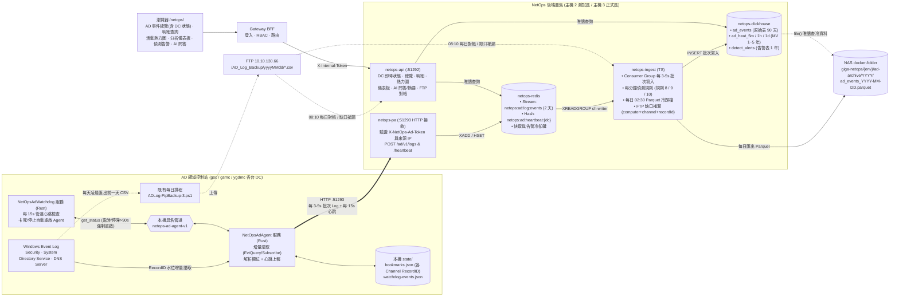
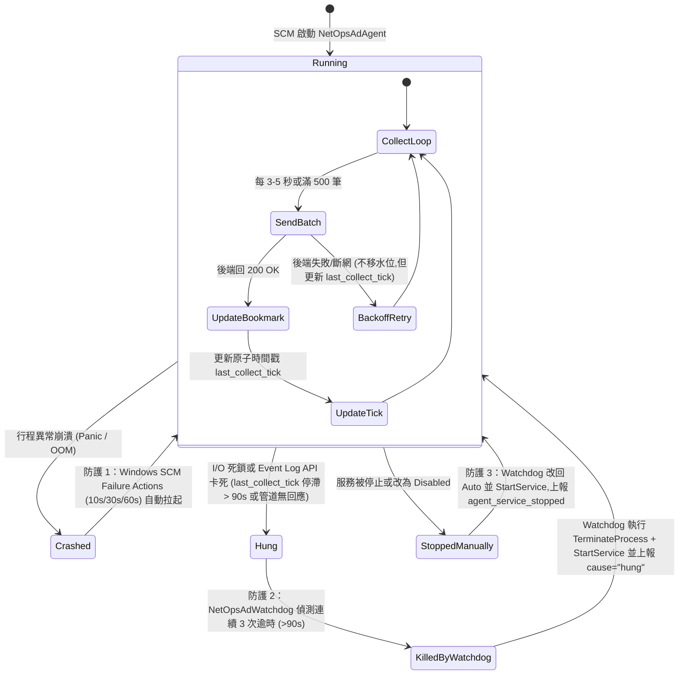

# NetOps AD Log 即時收集 Agent 與高吞吐架構計畫(AD-1 ~ AD-5)

> **狀態**:計畫已定案(需求方 2026-11-20 決定 AD1–AD10「全部依建議」)。**時程以 NexusPlan 甘特圖為準**,本文件只記架構、規格、工作分批與完成標準。
> **分工(依 `AGENT.md` §7 與 `HANDOFF.md` 2026-11-20 決定)**:本計畫與後續 `AD-1` ~ `AD-5` 實作由 **Gemini** 撰寫並開立 MR,由 **Claude** 進行審查(審查意見寫在 `docs/reviews/YYYY-MM-DD-ad-<批>.md` 或 MR 評論)。動到 Compose、`.env*` 範本、ClickHouse DDL / migration、`gateway-rbac.yaml`、CI/CD 等敏感變更,合併前必須有 Claude 的審查紀錄。
> **相關文件**:[ARCHITECTURE.md](ARCHITECTURE.md)(D19–D45)、[PA-LIVE-PLAN.md](PA-LIVE-PLAN.md)(收集器與 Redis 鍵設計)、[PA-LOG-CLICKHOUSE-GUIDE.md](PA-LOG-CLICKHOUSE-GUIDE.md)(ClickHouse 寫入、去重與 Parquet 冷歸檔)、[VIZ-RULES-DESIGN.md](VIZ-RULES-DESIGN.md)(熱力圖、儀表板與 V-d 規則 8 / 9 預留)、`../RustIt/docs/P5-MONITOR-DESIGN.md`(Windows 服務 + Watchdog 具名管道互相看守範本)。

---

## 目錄

1. [背景與需求方決策(AD1–AD10)](#1-背景與需求方決策ad1ad10)
2. [整體架構與流程圖](#2-整體架構與流程圖)
3. [AD Agent 與 Watchdog 常駐自癒設計(Rust)](#3-ad-agent-與-watchdog-常駐自癒設計rust)
4. [後端接收、Redis 緩衝與 ClickHouse 資料層](#4-後端接收redis-緩衝與-clickhouse-資料層)
5. [FTP 每日對帳與缺口自動補漏](#5-ftp-每日對帳與缺口自動補漏)
6. [API 設計、V-d 視覺化與偵測規則引擎](#6-api-設計v-d-視覺化與偵測規則引擎)
7. [安全與權限規範](#7-安全與權限規範)
8. [工作分批與完成標準(AD-1 ~ AD-5)](#8-工作分批與完成標準ad-1--ad-5)

---

## 1. 背景與需求方決策(AD1–AD10)

### 1.1 現況與痛點

目前 AD 網域控制站(DC)事件由每台 DC 每天凌晨執行排程腳本 [`scripts/dc/ADLog-FtpBackup-3.ps1`](../scripts/dc/ADLog-FtpBackup-3.ps1),匯出前一天的 `Security`(23 種稽核事件)、`System`、`Directory Service`、`DNS Server` 為 CSV 到 FTP(`10.10.130.66:/AD_Log_Backup/yyyyMMdd/`),再由 `netops-api`([`backend/src/modules/ad/importer.ts`](../backend/src/modules/ad/importer.ts))在每日對帳後(08:10,AC1)同步到本機 `adlogs/yyyyMMdd.json`。

既有做法有三個主要限制:
1. **T+1 天延遲**:當天發生的暴力破解(4625 / 4771)、帳號鎖定(4740)、特權群組異動(4728 / 4732 / 4756)、稽核記錄清除(1102)無法即時在 NetOps 看到或問 AI,也無法執行即時偵測規則(V-d 規則 8、9)。
2. **DC 本機 Security Log 覆蓋風險**:若 DC 的 `Security.evtx` 容量上限不足,未到隔天凌晨匯出前就已被新事件覆蓋(wrap)。
3. **無常駐看守與健康監控**:排程腳本若失敗或卡住,直到隔天對帳才發現缺檔。

### 1.2 需求方 2026-11-20 決定(AD1–AD10,全部照建議)

| # | 決策主題 | 決定內容(2026-11-20 定案) | 對齊既有決策 |
| --- | --- | --- | --- |
| **AD1** | **納管 AD 主機範圍** | 先在 1 台主力 DC(如 `GSMC-DC1`)試裝驗證,通過後推廣至三網域(`gsc` / `gsmc` / `ygdmc`)全部 DC。後端資料表與心跳一律以 `computer`(DC 主機名稱)+ `domain` 區分,支援多台 DC 並行回傳 | — |
| **AD2** | **Agent 語言與架構** | 採用 **Rust**(放本 repo `ad-agent/` 目錄,與 `frontend/`、`backend/`、`pa-collector/` 平行)。編譯單一靜態執行檔 `netops-ad-agent.exe`,以參數 `--mode agent` 與 `--mode watchdog` 註冊為兩個 Windows 服務(`NetOpsAdAgent`、`NetOpsAdWatchdog`) | 複用 `RustIt` Windows Service + Watchdog 模式與主機 2 `host2-windows` Runner |
| **AD3** | **常駐、心跳與停止回應(Hang)自動重啟** | **三層防護**:<br/>① **Windows SCM 失敗復原**:行程 Crash 時 10 / 30 / 60 秒自動重啟。<br/>② **Watchdog 具名管道看守(防 Hang / 卡死)**:`NetOpsAdWatchdog` 每 15 秒經本機具名管道 `\\.\pipe\netops-ad-agent-v1` 詢問 `get_status`,檢查 Agent 內部 `last_collect_tick` 與 `last_send_tick`。若管道逾時(5 秒)或 tick 停滯 **> 90 秒**,Watchdog 強制終止 Agent PID(`TerminateProcess`)並由 SCM 重啟,同時向後端上報 `agent_restarted (cause: "hung")`。被手動停止或改啟動類型時自動恢復並上報 `agent_service_stopped`;Agent 每 60 秒亦反向看守 Watchdog。<br/>③ **後端心跳 TTL 監控**:Agent 每 15 秒送心跳到後端 更新 `netops:ad:heartbeat:{computer}`,超過 **90 秒**未更新畫面即顯示「DC 資料停止更新」,超過 3 分鐘觸發離線告警 | 比照 `RustIt` P5-2、`PA-LIVE-PLAN` §3.1 |
| **AD4** | **後端接收通道與認證** | 沿用 `netops-pa` 的 **`:51293` HTTP 接收端點**,新增 `POST /ad/v1/logs` 與 `POST /ad/v1/heartbeat`。使用獨立 Token `AD_AGENT_TOKEN_FILE`(標頭 `X-NetOps-Ad-Token`,與 PA HTTP Token 分離)+ `AD_ALLOWED_SOURCES` 與主機 Windows 防火牆限制來源 DC IP | 對齊 D19、D24、D26(內網 HTTP + 獨立 Token + 防火牆白名單) |
| **AD5** | **收集的 Channel 與事件範圍** | 收集 `Security`、`System`、`Directory Service`、`DNS Server`(未裝 DNS 角色自動略過)。`Security` 預設白名單收既有 v3 的 **23 種稽核事件** + **`4672`**(特殊權限登入,排除 `*$ / SYSTEM / LOCAL SERVICE / NETWORK SERVICE`)+ **`4776`**(NTLM 認證失敗)+ **`4768`**(只收失敗 `ResultCode != 0x0`);提供 `include_user_logon_4624` 設定開關(預設 `false`,開啟時只收非 `$` 結尾的真人帳號 `4624`) | 沿用 `adlog.js` 事件定義並補齊 V-d 需求 |
| **AD6** | **回傳頻率與本機離線水位續傳** | 每 **3–5 秒**(或滿 500 筆)批次 `POST /ad/v1/logs`,每 **15 秒** `POST /ad/v1/heartbeat`。本機 `state\bookmarks.json` 記錄各 Channel 已獲後端 HTTP 200 ACK 的最後 `RecordID`;斷線重連後直接以 `EventRecordID > last_acked_record_id` 從 Windows Event Log 增量補讀 | — |
| **AD7** | **資料儲存與保留期限** | **核准 AD 事件進 Redis、ClickHouse 與 NAS Parquet 冷歸檔**(為 `AGENT.md` §7.2 與 D20 / D36 的正式核准例外):<br/>• `netops-redis` Stream `netops:ad:log:events`:保留 **2 天**<br/>• `netops-clickhouse` 原始表 `netops.ad_events`:正式區保留 **90 天**、測試區 **3 天**<br/>• `netops-clickhouse` 彙總表 `ad_heat_5m` / `1h` / `1d`:正式區保留 **1 年 / 5 年 / 5 年**、測試區 **3 天**<br/>• NAS Parquet 冷歸檔 `/mnt/nas-docker/giga-netops/{env}/ad-archive/YYYY/`:每日 02:30 匯出前一天,正式區保留至少 **1 年**、測試區 **14 天** | 對齊 D21、D27–D30、D34–D36 |
| **AD8** | **FTP 排程降級為對帳與補漏** | DC 上的 `ADLog-FtpBackup-3.ps1` 每日排程保留;每天 08:10 對帳排程自動比對 FTP `/AD_Log_Backup/yyyyMMdd/` 與 ClickHouse `ad_events` 每台 DC 各 Channel 筆數,有缺口時由 `netops-ingest` 自動從 FTP 補寫缺漏的 `(computer, channel, record_id)` | 對齊 D33、D43 |
| **AD9** | **一併打通 V-d(熱力圖、儀表板、規則 8 & 9)** | 分階段納入本計畫(`AD-3` ~ `AD-5`):既有 AD 頁面改查 ClickHouse + 結合 IP 對照表(AC3)→ 解鎖熱力圖 `metric=ad` 與 AD 時段明細熱/冷路由 → 解鎖分析儀表板「AD 網域」Tab → 啟用偵測規則 8、9 與規則 10(DC Agent 健康告警) | 實踐 D36、VIZ-RULES-DESIGN §5.8 |
| **AD10** | **Agent 部署與更新方式** | 第一版提供發佈資料夾 + PowerShell 一鍵安裝/升級腳本 `Install-NetOpsAdAgent.ps1`(建立目錄、鎖定 `SYSTEM`/`Administrators` ACL、寫入 `agent.toml` 與 Token 檔、註冊雙服務與 SCM 復原原則) | DC 台數少,腳本部署最直接 |

---

## 2. 整體架構與流程圖

### 2.1 資料流向與元件邊界圖



- **單一對外入口原則(D24)**:瀏覽器與 BFF 只連 `netops-api (:51292)`;`netops-pa`、`netops-ingest`、`netops-clickhouse`、`netops-redis` 均不註冊為 Gateway 上游。
- **讀寫分離原則(D27)**:`netops-api` 只使用 `netops_reader`(一般查詢)與 `netops_cold`(Parquet 冷查詢)唯讀帳號存取 ClickHouse;所有寫入、歸檔、補漏與規則告警均由 `netops-ingest`(`netops_writer`)執行。

---

## 3. AD Agent 與 Watchdog 常駐自癒設計(Rust)

### 3.1 目錄結構与執行模式

在 repo 根目錄新增 `ad-agent/`(獨立 Rust Cargo package):

```text
NetOps/
└─ ad-agent/
   ├─ Cargo.toml
   ├─ src/
   │  ├─ main.rs          CLI 進入點:run(前景開發)、service(--mode agent)、watchdog(--mode watchdog)
   │  ├─ config.rs        解析 agent.toml 與 token_file(拒絕預設空 token)
   │  ├─ winlog.rs        Windows Event Log API(EvtQuery / EvtRender / GetLogInformation 容量與最舊事件檢查)
   │  ├─ parser.rs        Event XML + RenderingInfo Message 解析,對齊 adlog.js 欄位
   │  ├─ bookmark.rs      本機 state/bookmarks.json 原子讀寫(各 Channel 最後 ACK RecordID)
   │  ├─ sender.rs        HTTP client 批次送出 /ad/v1/logs 與 /ad/v1/heartbeat(退避重試)
   │  ├─ pipe.rs          本機具名管道 \\.\pipe\netops-ad-agent-v1(get_status / status)
   │  ├─ service.rs       Windows Service 主迴圈與 SCM 控制(windows-service crate)
   │  └─ watchdog.rs      Watchdog 看守迴圈:SCM 狀態檢查、管道探測、逾時 Kill + 重啟、事件暫存上報
   ├─ scripts/
   │  ├─ Install-NetOpsAdAgent.ps1    一鍵安裝 / 升級腳本(含目錄 ACL、服務註冊、SCM 失敗復原)
   │  └─ Uninstall-NetOpsAdAgent.ps1  移除服務腳本(保留 state/ 與 logs/)
   └─ agent.toml.example
```

### 3.2 常駐與「停止回應自動重啟」狀態機



**看守細節**:
1. **本機具名管道(`\\.\pipe\netops-ad-agent-v1`)**:
   - 建立管道時以 Windows Security Descriptor (SDDL) 限制只有 `LocalSystem (SY)` 與 `Builtin Administrators (BA)` 可讀寫,防止同機一般權限行程干擾或偽造指令。
   - Watchdog 每 **15 秒**連線管道送出 `{"type":"get_status"}`(讀寫逾時 5 秒)。
   - Agent 回傳 `{"type":"status","pid":1234,"version":"0.1.0","startedAt":"...","lastCollectTickMs":1763616000000,"lastSendOkAt":"...","lastError":"","bookmarks":{...}}`。
2. **判定「停止回應(Hung)」的條件**:
   - 管道連線/讀取失敗連續 **3 次**(約 45 秒),**或**回傳的 `now - lastCollectTickMs > 90_000`(採集主迴圈已卡死超過 90 秒)。
   - 注意:**網路斷線或後端 503 不算卡死**!後端連不上時,Agent 的採集與退避迴圈仍在運作,會持續推進 `lastCollectTickMs` 並更新 `lastError`,因此 Watchdog 不會在後端停機時誤殺 Agent。
3. **強制重啟與冷卻保護**:
   - 判定 `hung` 後,Watchdog 對該 `pid` 執行 `TerminateProcess`,等待程序退出後呼叫 SCM `StartService`,並將一筆 `agent_restarted (cause: "hung", previousPid, pid)` 寫入本機 `state\watchdog-events.json`,於下次心跳附上報後端。
   - **防無限重啟風暴**:若 10 分鐘內連續強制重啟達 5 次仍失敗,Watchdog 進入 10 分鐘冷卻期並持續向後端發送 `agent_start_failed` 心跳告警,不消耗 DC CPU。

### 3.3 Windows Event Log 採集與水位(Bookmark)設計

1. **查詢方式**:
   - 每個採集週期(每 3 秒)對 `Security`、`System`、`Directory Service`、`DNS Server` 執行 `EvtQuery`:
     - `Security`:XPath 篩選 `*[System[(EventID=4625 or EventID=4771 or ...) and (EventRecordID > {last_record_id})]]`(因 Windows XPath 條件數上限,分 2 個查詢或以 `EventRecordID > {last_record_id}` 順序掃描並在記憶體以 `HashSet<u32>` 瞬間過濾 EventID;實測在記憶體過濾 `EventID` 比複雜 XPath 更快且不受 22 個 ID 限制)。
     - 其他 3 個 Channel:`*[System[EventRecordID > {last_record_id}]]`。
   - **首次啟動基準**:若 `bookmarks.json` 尚無該 Channel 的 `RecordID`,預設從**啟動當下最新一筆 `RecordID`**(或往回推 1 小時,可由 `initial_lookback_minutes = 60` 設定)開始收;當天更早的事件由每日 08:10 FTP 對帳自動補齊。
   - **Event Log 被清除(1102)或覆蓋重置的處理**:若查詢發現目前 Channel 的最大 `RecordID` 小於本機記錄的 `last_record_id`(代表 Event Log 被清空重編),Agent 自動將水位重設為 `0` 從頭讀取,並附帶一筆 `log_record_id_reset` 警告。
2. **Security Log 覆蓋健康度檢查(每 15 秒心跳時執行)**:
   - 讀取 `Security` Channel 的 `FileSize`、`MaxSize`(bytes)、`RecordCount`,以及最舊一筆事件的 `TimeCreated`(`EvtQuery` `EvtQueryForwardDirection` 取第 1 筆)。
   - 計算 `coverageHours = (now - oldestEventTime) / 3600`:若 `< 24` 小時,心跳標記 `wrapRisk: true`,讓網管在事件被覆蓋前就能在 NetOps 看到預警。

---

## 4. 後端接收、Redis 緩衝與 ClickHouse 資料層

### 4.1 `netops-pa` HTTP 接收端點擴充(`:51293`)

在 `pa-collector/netops_pa/` 既有 HTTP 伺服器(`:51293`)新增兩個路由(與 PA 的 `/` HTTP Log Forwarding 並存,認證分開):

| 路徑 | 標頭認證 | 用途 | 寫入 Redis |
| --- | --- | --- | --- |
| `POST /ad/v1/logs` | `X-NetOps-Ad-Token: <token>` | 批次上傳 AD 事件(單批 ≤ 1,000 筆、≤ 4 MB) | `XADD netops:ad:log:events MINID ~ <2天前ms> * d <json>` |
| `POST /ad/v1/heartbeat` | `X-NetOps-Ad-Token: <token>` | 每 15 秒上報 DC Agent / Watchdog 狀態與 Security Log 容量;若有 Watchdog 事件一併轉進事件流 | `HSET netops:ad:heartbeat:{computer}`、`SADD netops:ad:computers {computer}` |

**請求 Payload 規格(`POST /ad/v1/logs`)**:

```json
{
  "computer": "GSMC-DC1",
  "domain": "gsmc.com",
  "agentVersion": "0.1.0",
  "events": [
    {
      "time": "2026-11-20T13:05:12.345+08:00",
      "channel": "Security",
      "eventId": 4625,
      "recordId": 98765432,
      "level": "Audit Failure",
      "provider": "Microsoft-Windows-Security-Auditing",
      "message": "帳戶登入失敗。..."
    }
  ]
}
```

**請求 Payload 規格(`POST /ad/v1/heartbeat`)**:

```json
{
  "computer": "GSMC-DC1",
  "domain": "gsmc.com",
  "reportedAt": "2026-11-20T13:05:15.000+08:00",
  "agentVersion": "0.1.0",
  "watchdogVersion": "0.1.0",
  "agent": {
    "pid": 4120,
    "serviceState": "running",
    "startType": "auto",
    "statusOk": true,
    "lastCollectTickAt": "2026-11-20T13:05:14.000+08:00",
    "lastSendOkAt": "2026-11-20T13:05:12.500+08:00",
    "lastError": "",
    "restarts24h": 0,
    "cpuPct": 0.4,
    "rssMb": 11.2
  },
  "channels": {
    "Security": { "lastRecordId": 98765432, "fileSizeMb": 1024, "maxSizeMb": 4096, "oldestEventAt": "2026-11-12T04:10:00+08:00", "coverageHours": 200.9, "wrapRisk": false },
    "System": { "lastRecordId": 451200 },
    "Directory_Service": { "lastRecordId": 12044 },
    "DNS_Server": { "lastRecordId": 88310 }
  },
  "watchdogEvents": []
}
```

### 4.2 Redis 鍵設計(補充 `PA-LIVE-PLAN.md` §4)

| 鍵 | 型別 | 內容 | 保留 / TTL |
| --- | --- | --- | --- |
| `netops:ad:log:events` | Stream | AD 事件明細 JSON(含 `computer`、`domain`、`channel`、`eventId`、`recordId`、`level`、`provider`、`message`) | **2 天**(`XADD … MINID ~`) |
| `netops:ad:log:events` group `ch-writer` | Stream group | `netops-ingest` 讀取並解析寫入 `netops.ad_events`,成功後 `XACK` | 跟 Stream |
| `netops:ad:computers` | Set | 已回報過的 DC `computer` 名稱清單 | 無(下線可由管理 API 移除) |
| `netops:ad:heartbeat:{computer}` | Hash | 該台 DC 最新心跳 JSON、`updatedAt`(伺服器收到時間)、累計收到的 `received` 筆數 | 無(由 `updatedAt` 距今 > 90 秒判定為離線,保留最後狀態供畫面顯示「最後連線於…」) |
| `netops:ad:backfill:queue` / `job:{id}` | List / Hash | AD FTP 補漏工作佇列與狀態(同 PA `netops:backfill:*` 結構) | job 7 天 TTL |

### 4.3 ClickHouse 資料表 DDL(`deploy/clickhouse/`)

#### 4.3.1 原始表 `netops.ad_events`

`netops-ingest` 讀取 `netops:ad:log:events` 時,直接呼叫既有 [`backend/src/modules/ad/core/adlog.js`](../backend/src/modules/ad/core/adlog.js) 的 `toEvent()` 與 `enrichEvent()` 抽出 `account`、`domain`、`ip`、`workstation`、`reason`、`actor`、`target`、`group`、`privileged`、`is_issue`,寫入 `netops.ad_events`:

```sql
CREATE TABLE IF NOT EXISTS netops.ad_events
(
    event_time    DateTime('Asia/Taipei')        CODEC(DoubleDelta, ZSTD(1)),
    received_at   DateTime64(3, 'Asia/Taipei')   CODEC(DoubleDelta, ZSTD(1)),
    computer      LowCardinality(String),        -- DC 主機名,例 GSMC-DC1
    ad_domain     LowCardinality(String),        -- AD 網域,例 gsmc.com / 帳戶網域
    channel       LowCardinality(String),        -- 'Security' | 'System' | 'Directory_Service' | 'DNS_Server'
    event_id      UInt32,
    record_id     UInt64,                        -- Windows EventRecordID(同台 DC + Channel 唯一)
    level         LowCardinality(String),        -- 'critical' | 'error' | 'warning' | 'audit_failure' | 'audit_success' | 'info'
    level_text    LowCardinality(String),
    provider      LowCardinality(String),
    account       String CODEC(ZSTD(1)),         -- 目標或登入失敗帳號
    actor         String CODEC(ZSTD(1)),         -- 執行異動的主體帳號
    target        String CODEC(ZSTD(1)),         -- 被異動對象(CN 已拆出)
    group_name    LowCardinality(String),        -- 異動的安全群組名稱
    privileged    UInt8 DEFAULT 0,               -- 1 = 特權群組異動
    is_issue      UInt8 DEFAULT 0,               -- 1 = isIssue(e) 需要注意的事件
    src_ip        IPv6,                          -- 來源 IP(無 IP 時為 '::')
    src_ip_raw    String CODEC(ZSTD(1)),         -- 原始來源位址字串(保留非標準格式)
    workstation   LowCardinality(String),        -- 來源工作站名稱
    reason        LowCardinality(String),        -- 登入失敗原因(已轉換 NTSTATUS / Kerberos 中文)
    message       String CODEC(ZSTD(3)),         -- 完整訊息(上限 3,000 字)
    source        LowCardinality(String),        -- 'agent' | 'ftp'

    INDEX idx_account account TYPE tokenbf_v1(4096, 2, 0) GRANULARITY 2,
    INDEX idx_src_ip  src_ip  TYPE bloom_filter(0.01)     GRANULARITY 1,
    INDEX idx_msg     message TYPE ngrambf_v1(3, 16384, 2, 0) GRANULARITY 4
)
ENGINE = MergeTree
PARTITION BY toYYYYMM(event_time)
ORDER BY (toStartOfHour(event_time), channel, event_id, computer, record_id)
TTL event_time + INTERVAL {{TTL_AD_RAW}} DELETE
SETTINGS index_granularity = 8192, ttl_only_drop_parts = 1,
         non_replicated_deduplication_window = 1000;
```

- **TTL 佔位符 `{{TTL_AD_RAW}}`**:正式區 `90 DAY`、測試區 `3 DAY`。
- **容量估算**:每台 DC 每天經過篩選的事件約 5,000–30,000 筆,3 台 DC 合計每天 < 10 萬筆;ZSTD 壓縮後每天約 **3–8 MB**,90 天不到 **500 MB**,對主機 2 / 主機 3 的記憶體與 20 GB 磁碟預留幾乎零負擔。
- **寫入去重**:`netops-ingest` 每個批次以 `ad:{computer}:{channel}:{firstRecordId}_{lastRecordId}` 作為 `insert_deduplication_token`;另外在寫入前查詢或於 FTP 補漏時比對 `(computer, channel, record_id)` 確保不重複。

#### 4.3.2 熱力圖長期彙總表 `netops.ad_heat_5m` / `ad_heat_1h` / `ad_heat_1d`(V-d)

結構對齊 `pa_heat_*`([VIZ-RULES-DESIGN.md](VIZ-RULES-DESIGN.md) §3.1):

```sql
CREATE TABLE IF NOT EXISTS netops.ad_heat_5m
(
    bucket            DateTime('Asia/Taipei'),
    total_events      SimpleAggregateFunction(sum, UInt64),
    issue_events      SimpleAggregateFunction(sum, UInt64),   -- is_issue = 1
    fail_logons       SimpleAggregateFunction(sum, UInt64),   -- event_id IN (4625, 4771, 4776)
    lockouts          SimpleAggregateFunction(sum, UInt64),   -- event_id = 4740
    priv_changes      SimpleAggregateFunction(sum, UInt64),   -- privileged = 1 OR event_id IN (1102, 4794)
    account_changes   SimpleAggregateFunction(sum, UInt64),   -- 帳號/群組異動
    top_fail_src      AggregateFunction(topKIf(3), IPv6, UInt8),
    top_fail_account  AggregateFunction(topKIf(3), String, UInt8)
)
ENGINE = AggregatingMergeTree
PARTITION BY toYYYYMM(bucket)
ORDER BY bucket
TTL bucket + INTERVAL {{TTL_HEAT_5M}} DELETE
SETTINGS non_replicated_deduplication_window = 1000;
-- ad_heat_1h(TTL {{TTL_HEAT_1H}} = 5 YEAR)、ad_heat_1d(TTL {{TTL_HEAT_1D}} = 5 YEAR)結構相同
```

對應 3 個物化檢視 `ad_heat_5m_mv`、`ad_heat_1h_mv`、`ad_heat_1d_mv` 從 `netops.ad_events` 自動聚合。

---

## 5. FTP 每日對帳與缺口自動補漏

完全對齊 PA-560 的 `reconcile.ts` + `backfill.ts`(ARCHITECTURE D33、D43):

1. **每日 08:10 自動對帳**:
   - `netops-api` 在每日 08:10 對帳排程中,列出 FTP `/AD_Log_Backup/yyyyMMdd/` 最近 3 天(或 FTP 保留期內)的 CSV 檔。
   - 解析 CSV 計算各 `(day, computer, channel)` 的事件筆數,與 ClickHouse `netops.ad_events` 同一天同一 `(computer, channel)` 的 `count()` 比對。
2. **自動補漏**:
   - 若某個 `(day, computer, channel)` 在 ClickHouse 筆數少於 FTP(差異 > 0 筆),自動建立 AD 補漏工作推入 `netops:ad:backfill:queue`。
   - `netops-ingest` 讀取 FTP 上的該 CSV 檔,先向 ClickHouse 查詢該日已存在的 `(computer, channel, record_id)` 集合(一天幾千~幾萬個 `UInt64`,記憶體 < 1 MB),**只將缺漏的列以 `source = 'ftp'` 寫入 `netops.ad_events`**。
   - 補寫前先停用或於補寫後重建該日的 `ad_heat_5m` / `1h` / `1d` 分桶,確保熱力圖與總覽數字精確無重複。
3. **相容過渡期**:
   - 新增環境變數 `NETOPS_AD_SOURCE=clickhouse|ftp`(未設定時:測試區預設 `clickhouse`,正式區在 AD Agent 上線前預設 `ftp`)。切換為 `clickhouse` 後,AD 總覽、明細、AI 問答一律查 ClickHouse。

---

## 6. API 設計、V-d 視覺化與偵測規則引擎

### 6.1 新增與升級的後端 API(`netops-api`)

| 方法 | 對外路徑(`/api/netops/...`) | 權限 | 稽核 | 說明 |
| --- | --- | --- | --- | --- |
| GET | `/ad/agents` | `netops.ad.read` | — | **新增**:列出所有納管 DC 的 Agent / Watchdog 即時心跳狀態、各 Channel 最新 `RecordID`、Security Log 容量與 `wrapRisk`、24h 重啟次數 |
| GET | `/ad/days` | `netops.ad.read` | — | **升級**:`NETOPS_AD_SOURCE=clickhouse` 時回傳 ClickHouse 有資料的日期與每日筆數,並附 `agents` 狀態摘要 |
| GET | `/ad/overview` | `netops.ad.read` | — | **升級**:改由 ClickHouse `ad_events` 即時聚合(含今天即時資料),並在 `failIps` 等欄位透過 `preSerialization` 附帶 **IP 對照表 `names`**(AC3) |
| GET | `/ad/events` | `netops.ad-log.read` | `meta` | **升級**:改查 ClickHouse `ad_events`(支援 `computer`、`domain` 篩選,以及用 IP 對照表「員工姓名 / 部門」反查來源 IP);附帶 `names` |
| GET | `/ad/events/export` | `netops.ad-log.read` | `meta` | **升級**:從 ClickHouse 匯出 CSV,新增「來源名稱 / 部門」欄位 |
| GET | `/ad/reconcile` | `netops.ftp.read` | — | **新增**:查看 AD ClickHouse vs FTP 每日對帳結果与補漏工作狀態 |
| POST | `/ad/backfill` | `netops.ftp.write` | `body` | **新增**:手動觸發指定日期的 AD FTP 補漏 |
| GET | `/ad/heatmap` | `netops.ad.read` | — | **V-d 解鎖**:查詢 `ad_heat_5m` / `1h` / `1d`(年 / 月 / 日三級熱力圖,指標 `ad`),回傳格式同 `GET /pa/heatmap` |
| GET | `/ad/slice` | `netops.ad-log.read` | `meta` | **V-d 解鎖**:AD 時段明細(≤ 89 天查 `ad_events` 熱表,> 89 天查 NAS Parquet 冷歸檔;30 秒內同步、超過轉工作模式 `GET /ad/slices/{id}`) |
| GET | `/ad/insight` | `netops.ad.read` | — | **V-d 解鎖**:分析儀表板「AD 網域」Tab 資料(登入失敗/鎖定時序、失敗來源 IP Top 10、失敗帳號 Top 10、失敗原因分布、各 DC 事件量、特權異動清單) |

### 6.2 V-d 熱力圖「AD 異常」分級與儀表板設計

1. **熱力圖 `metric=ad` 分數與 4 階色階**:
   - 每個時間格分數:`score = priv_changes * 10 + lockouts * 5 + fail_logons * 1 + issue_events * 0.2`。
   - 分級(`level 0..4`):
     - `0`:無異常事件(`score == 0`)
     - `1`(低):有零星登入失敗或警告(`score > 0`)
     - `2`(中):單格登入失敗 ≥ 10 次
     - `3`(高):發生帳號鎖定(`lockouts > 0`)或單格登入失敗 ≥ 50 次
     - `4`(嚴重):發生特權群組異動 / 稽核清除(`priv_changes > 0`)或單格登入失敗 ≥ 200 次
   - Tooltip 顯示:總事件數、登入失敗數、帳號鎖定數、特權異動數、Top 1 失敗來源 IP(含名稱)、Top 1 失敗帳號。
2. **分析儀表板「AD 網域」Tab(解鎖 `Insight.vue` 第三個分頁)**:
   - KPI 卡片:總事件數、登入失敗數(4625/4771/4776)、帳號鎖定數(4740)、特權群組異動數、活躍 DC 數。
   - 圖表 1:**登入失敗與帳號鎖定時序圖**(雙軸或堆疊折線/長條)。
   - 圖表 2:**失敗來源 IP Top 10 排行**(自動帶出 IP 對照表姓名/部門)與**被嘗試帳號 Top 10 排行**並排比較(`GTopCompare`)。
   - 圖表 3:**失敗原因佔比環圈圖**(`GAppShare` 複用)與**最新特權/帳號異動時間軸清單**。
   - 點擊任何圖表項目均可連動開啟 `SliceDrawer`(AD 時段明細抽屜)或跳轉至 AD Log 明細查詢。
   - 支援「AI 摘要本期 AD 異常」(`POST /ai/explanations` 新增 `kind: 'ad-insight'` 與 `kind: 'ad-slice'`)。

### 6.3 V-d 偵測規則引擎(規則 8、9、10,於 `netops-ingest` 每分鐘執行)

| 規則編號 | 規則代碼 | 間隔 / 時間窗 | 觸發條件(初始門檻,可在偵測設定頁調整) | 冷卻主體 | 預設嚴重度 |
| --- | --- | --- | --- | --- | --- |
| **規則 8a** | `AD_BRUTE_FORCE_ACCOUNT` | 1 / 5 分鐘 | 單一 `account` 在 5 分鐘內登入失敗(`event_id IN (4625, 4771, 4776)`) **`>= 10` 次** | `account` | `high` |
| **規則 8b** | `AD_PASSWORD_SPRAY` | 1 / 5 分鐘 | 單一來源 `src_ip`(`!= '::'`)在 5 分鐘內嘗試登入失敗的不同帳號數 `uniqExact(account)` **`>= 5` 個** | `src_ip` | `critical` |
| **規則 9a** | `AD_ACCOUNT_LOCKOUT` | 1 / 5 分鐘 | 發生帳號鎖定(`event_id = 4740`) **`>= 1` 次** | `account` | `medium` |
| **規則 9b** | `AD_PRIVILEGED_CHANGE` | 1 / 5 分鐘 | 發生特權群組人員異動(`privileged = 1`)、DSRM 密碼變更(`4794`)或稽核日誌清除(`1102`) | `computer \| event_id \| target` | `critical` |
| **規則 9c** | `AD_OFF_HOURS_PRIV_LOGON` | 5 / 5 分鐘 | 離峰時段(預設台北時間 **01:00–05:00**,對齊規則 7 X13)發生真人帳號特殊權限登入(`event_id = 4672`)或特權帳號異動 | `actor` | `high` |
| **規則 10** | `AD_AGENT_HEALTH` | 1 / 1 分鐘 | ① 已納管 DC 心跳逾時 **`> 180` 秒**(離線)<br/>② Watchdog 上報 `agent_restarted (cause: hung / crashed)` 或 `agent_service_stopped`<br/>③ DC `Security` Log `wrapRisk = true`(最舊事件覆蓋不足 24 小時) | `computer \| subkind` | ①/② `high`<br/>③ `medium` |

- 告警統一寫入 `netops.detect_alerts`,共用 `netops:detect:cool:{rule}:{subject}` 30 分鐘冷卻與抑制計數(`suppressed`)、IP 白名單排除,直接呈現在「偵測告警 › 告警」頁面與側欄徽章。

---

## 7. 安全與權限規範

1. **機密管理(`AGENT.md` §7.5)**:
   - 後端 `AD_AGENT_TOKEN_FILE` 由需求方執行主機腳本(`deploy/host2-set-pa-secrets.sh` / `host3-set-pa-secrets.sh` 擴充)產生 32 bytes 隨機 hex 寫入 `/srv/giganexus/netops-secrets/ad_agent_token`,容器以 Docker secret / 唯讀檔案掛載。
   - DC 端 Token 存於 `%ProgramData%\GigaNexus\NetOpsAdAgent\secrets\ad_agent.token`,安裝腳本以 `icacls` 設定僅 `NT AUTHORITY\SYSTEM` 與 `BUILTIN\Administrators` 可讀,不放環境變數或命令列參數。
   - 日誌與錯誤訊息一律遮罩 Token。
2. **本機管道與服務防護**:
   - 具名管道 `\\.\pipe\netops-ad-agent-v1` 設定 SDDL ACL `D:(A;;GA;;;SY)(A;;GA;;;BA)`,阻絕低權限使用者連線。
   - Agent 與 Watchdog 只讀 Event Log 與發送 HTTP POST,不開放任何遠端指令執行介面。
3. **ClickHouse 查詢安全(`AGENT.md` §7.2)**:
   - 所有查詢條件一律走 `query_params` 參數化,表名只用程式常數,禁止字串拼接 SQL。
   - `netops-api` 維持使用 `netops_reader` 與 `netops_cold` 唯讀帳號。
4. **權限代碼(`AGENT.md` §8)**:
   - 沿用既有 `netops.ad.read`、`netops.ad-log.read`、`netops.ftp.read`、`netops.ftp.write`、`netops.alert.read`、`netops.alert.write`、`netops.detect.read`、`netops.detect.write`、`netops.ai.use`,**不自創新權限代碼**,無須修改 Gateway repo。
   - 新增按鈕節點(若熱力圖 / 儀表板 AD 分頁需獨立 AI 按鈕,沿用該頁既有 `netops.pa-heatmap.ai` / `netops.pa-insight.ai`,並在 AD 事件總覽新增 `netops.ad-events.ai` 綁 `[netops.ai.use, netops.ad.read]`)。

---

## 8. 工作分批與完成標準(AD-1 ~ AD-5)

每批各自從最新的 `origin/develop` 開立工作分支並提 MR,由 **Claude 審查**通過、需求方合併後進入下一批:

| 批次 | 分支名稱 | 工作內容 | 負責 / 審查 | 完成標準 |
| --- | --- | --- | --- | --- |
| **AD-1** | `feature/ad-1-collector-ingest` | **接收器 + ClickHouse DDL + Ingest 寫入與冷歸檔**:<br/>1. `pa-collector`:`:51293` 新增 `POST /ad/v1/logs`、`/ad/v1/heartbeat`(`AD_AGENT_TOKEN_FILE`、`AD_ALLOWED_SOURCES`),寫入 Redis `netops:ad:log:events`、`netops:ad:heartbeat:{computer}`、`netops:ad:computers`。<br/>2. `deploy/clickhouse/`:新增 `ad_events`、`ad_heat_5m` / `1h` / `1d` 與 3 個 MV(`schema.sql` + migration、`apply-schema.sh` 加 `{{TTL_AD_RAW}}`)。<br/>3. `netops-ingest`:Consumer Group 批次解析(`adlog.js`)寫入 `ad_events`、每日 02:30 匯出 `ad-archive/YYYY/ad_events_YYYY-MM-DD.parquet`。<br/>4. 主機機密腳本補 `ad_agent_token` | **Gemini** 實作<br/>**Claude** 審查(含敏感變更:DDL、Compose、env 範本) | • `pytest` 與 `ruff` 通過(含 Token 驗證、來源 IP 白名單、Payload 上限測試)<br/>• `backend` 單元測試與 `test:int`(真 Redis + ClickHouse 寫入、MV 聚合、Parquet 歸檔核對)通過<br/>• Claude 審查無 Critical / High |
| **AD-2** | `feature/ad-2-rust-agent` | **Rust AD Agent + Watchdog 雙服務與安裝腳本**:<br/>1. `ad-agent/`:Windows Event Log 增量讀取(`Security` 白名單 + `System` + `Directory Service` + `DNS Server`)、`bookmarks.json` 水位續傳、Security Log 容量與 `wrapRisk` 檢查。<br/>2. 本機具名管道 `get_status`、`NetOpsAdWatchdog` 每 15 秒看守(逾時 / 停滯 > 90 秒強制 Kill + 重啟 + 上報 `hung`;服務被停自動拉起)。<br/>3. `Install-NetOpsAdAgent.ps1` / `Uninstall-NetOpsAdAgent.ps1` 與單元測試 | **Gemini** 實作<br/>**Claude** 審查(安全與資源看守) | • `cargo test`、`cargo clippy` 通過(含 Bookmark 續傳、EventID 過濾、Watchdog 逾時判定與冷卻邏輯測試)<br/>• 測試機 / DC 實測:強制凍結或結束 Agent 行程,Watchdog 能在 90 秒內重啟並上報後端;常駐記憶體 < 20 MB |
| **AD-3** | `feature/ad-3-api-reconcile` | **AD 查詢切換 ClickHouse + DC 狀態 API + FTP 對帳補漏**:<br/>1. `netops-api`:`GET /v1/ad/agents`、升級 `/v1/ad/days`、`/v1/ad/overview`、`/v1/ad/events`、`/v1/ad/events/export` 支援 `NETOPS_AD_SOURCE=clickhouse` 並結合 IP 對照表 `names`(AC3);AI 問答 AD 來源支援 ClickHouse。<br/>2. 每日 08:10 AD FTP 對帳與 `netops-ingest` 自動補漏(`/v1/ad/reconcile`、`/v1/ad/backfill`)。<br/>3. 前端 `AD 事件總覽` 頂部新增「DC Agent 即時狀態列」、`AD 明細查詢` 支援 DC 篩選與名稱顯示、`AD › FTP Log 檔案` 新增對帳補漏卡片 | **Gemini** 實作<br/>**Claude** 審查 | • `backend` 與 `frontend` 測試、型別檢查、OpenAPI 必填欄位檢查全部通過<br/>• 對帳補漏整合測試證明 FTP 補寫不會產生重複 `(computer, channel, record_id)` |
| **AD-4** | `feature/ad-4-vd-viz-ai` | **V-d 熱力圖 AD 指標、分析儀表板 AD 視角與 AI 解讀**:<br/>1. 後端:`GET /v1/ad/heatmap`、`GET /v1/ad/slice`(熱/冷自動路由)、`GET /v1/ad/slices/{id}`、`GET /v1/ad/insight`;`POST /v1/ai/explanations` 支援 `ad-insight`、`ad-slice`、`ad-events`。<br/>2. 前端:解鎖熱力圖 `metric=ad` 與 `SliceDrawer` AD 欄位;解鎖 `Insight.vue`「AD 網域」Tab 圖表與 AI 摘要面板 | **Gemini** 實作<br/>**Claude** 審查 | • 熱力圖與時段明細熱/冷路由整合測試通過<br/>• 前端元件掛載測試(`vitest`)與 `vite build` 通過,四種主題風格與 `prefers-reduced-motion` 正常 |
| **AD-5** | `feature/ad-5-vd-detect-docs` | **V-d 偵測規則引擎(規則 8、9、10)與全專案文件同步**:<br/>1. `netops-ingest`:每分鐘執行規則 8(`AD_BRUTE_FORCE_ACCOUNT`、`AD_PASSWORD_SPRAY`)、規則 9(`AD_ACCOUNT_LOCKOUT`、`AD_PRIVILEGED_CHANGE`、`AD_OFF_HOURS_PRIV_LOGON`)、規則 10(`AD_AGENT_HEALTH`)。<br/>2. 偵測設定頁與告警頁支援 AD 規則門檻調整與點擊告警開啟 AD 時段明細。<br/>3. 同步更新 `AGENT.md` §0/§7.2、`docs/ARCHITECTURE.md`、`docs/IMPL-PLAN.md`、`docs/API.md`、`docs/PA-LIVE-PLAN.md` §4、`docs/PROJECT-MAP.md` 與 `docs/test-reports/` | **Gemini** 實作<br/>**Claude** 審查 | • 規則 8、9、10「剛好超過 / 剛好未超過門檻」與 30 分鐘冷卻測試全部通過<br/>• 文件與架構完整同步,測試報告齊備 |
