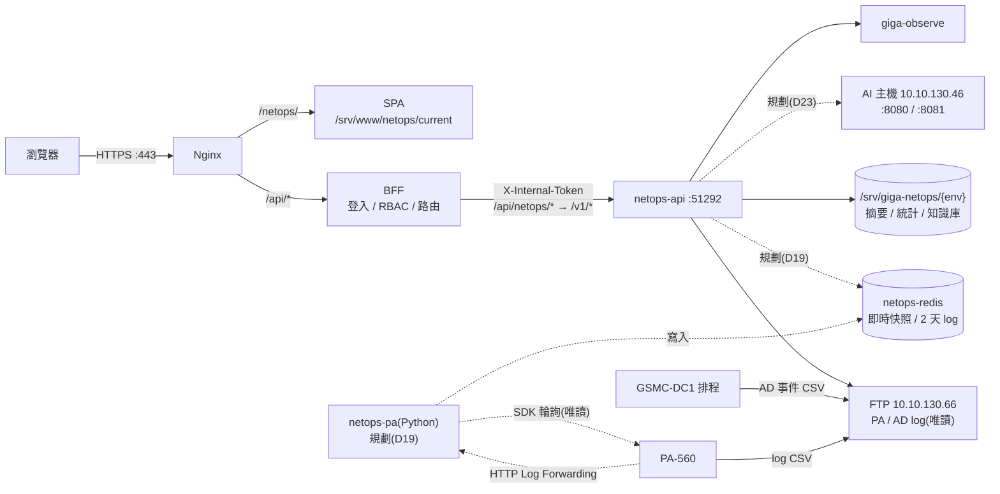

# NetOps 架構與決策

> 目標架構與設計決策。工作項目見 [IMPL-PLAN.md](IMPL-PLAN.md),目錄見 [PROJECT-MAP.md](PROJECT-MAP.md),現況、過渡期與未來目標的流程見 [FLOW-ARCHITECTURE.md](FLOW-ARCHITECTURE.md)。與 Gateway `docs/` 不一致時以 Gateway 為準,先指出差異。
> **狀態:D1 已上測試區;2026-11-04 重新規劃 PA 即時監控與 AI 搬移(D19–D24,細節見 [PA-LIVE-PLAN.md](PA-LIVE-PLAN.md));2026-11-10 核准 ClickHouse 高吞吐架構(D27–D33,§3.1,見 [PA-LOG-CLICKHOUSE-GUIDE.md](PA-LOG-CLICKHOUSE-GUIDE.md));2026-11-11 規劃熱力圖、儀表板與偵測規則引擎(D34–D41,§3.2,見 [VIZ-RULES-DESIGN.md](VIZ-RULES-DESIGN.md);待決事項已決定,網段清單待提供)**(API 介面見 [API.md](API.md),行為規格見 `docs/Gherkin/`);舊版程式未改動,現況見 [README.md](../README.md)。

---

## 1. 現況與目標

| 項目 | 舊版(IIS) | 目標 |
| --- | --- | --- |
| 部署 | IIS + iisnode,單一服務同時提供前端與 API | Nginx 託管 SPA;後端容器經 BFF 轉送 |
| 路徑 | `/NetOps/`、`/NetOps/api/*` | `/netops/`、`/api/netops/*` |
| 後端 | Express 5 + JavaScript,39 支 API | Fastify 5 + TypeScript 介面層;核心 JS 先沿用 |
| 登入 | AD + 自簽 JWT(localStorage)、入口網同步碼 | BFF 單一入口,`X-Internal-Token` |
| 權限 | `.env` 工號 / 部門清單 | Gateway RBAC,GigaItApp 設定 |
| 資料庫 | 只為登入與跳轉查 `LOS`、`GscSystem`、`PortalSolar` | **不寫入關聯式資料庫**(D20);PA TRAFFIC 與威脅類 log 寫 NetOps 自有的 ClickHouse(D27,2026-11-10 核准) |
| 資料 | `uploads/` 下 JSON、TSV.GZ、Markdown | 歷史:同格式,放 `/srv/giga-netops/{env}`,只經 `infra/store` 存取;即時:Redis(D19) |
| AI | 直連 vLLM、Qdrant | 搬進 `netops-api`,直接呼叫 AI 主機(D23) |

---

## 2. 目標架構



- 使用者永遠不直接連 `netops-api`;防火牆只允許 Gateway 容器網路連入。
- `netops-api` 內的背景工作:PA / AD 同步與分析。
- 虛線是 2026-11-04 規劃、尚未實作的部分(PA-LIVE-PLAN)。實作前 AI 仍留在舊版 IIS。

---

## 3. 決策

| # | 決策 | 理由 |
| --- | --- | --- |
| D1 | 系統代碼 `netops`、子路徑 `/netops/`、服務 `netops-api`、port 51292(Gateway BACKEND-GUIDE §3.3) | 子路徑規定小寫;51290 之後為未分配區段,51291 已使用 |
| D2 | 前後端分離,放同一 repo 的 `frontend/`、`backend/` | 比照 GigaItApp;一起發版,部署各自獨立 |
| D3 | 後端用 Fastify 5 + TypeScript | `setupGateway`(監控 + 自動註冊)只支援 Fastify;OpenAPI 可由程式產生;符合 Gateway §10.7.2 |
| D4 | 既有核心 JS(約 4,000 行)以 `allowJs` 沿用,先補測試再搬移 | 解析與研判已驗證,重寫風險高,且不是這次的目標 |
| D5 | 前端 UI 比照員工入口網與 GigaItApp:Vue 3 + TypeScript + `src/ui/` 全域元件,複製入口網框架,**視覺只換主題色**;移除 Element Plus 與 Tailwind(2026-11-02 改定,原為保留舊 UI) | 使用者在系統間切換時操作一致,也共用同一套規範;代價是 F1 要改寫約 3,400 行畫面(細節見 [UI-GUIDE.md](UI-GUIDE.md)) |
| D6 | Log 明細查詢等超過 60 秒的操作改成「送出工作 → 查詢結果」 | 舊版最長 180 秒,超過路由上限;逾時會累積斷路器失敗(BACKEND-GUIDE §5.2) |
| D7 | **改為 S0 串流驗證**(2026-11-04,原 2026-11-02 移到 AI 中控台):AI 問答 / 分析與即時監控都用 SSE + heartbeat,一起驗證;失敗改輪詢 | BFF 會串流轉送,但 undici 與 Nginx 都有 60 秒閒置逾時,Nginx 預設緩衝(PA-LIVE-PLAN §7) |
| D8 | 存檔案,只經 `infra/store` 邊界存取。~~未來改由服務直接寫入資料庫~~(2026-11-04 由 D20 取代) | 保留換儲存時不動 API 與核心的空間 |
| D9 | 單一容器;背景工作在程序內執行 | 目前有記憶體索引與排程狀態;多實例會重複同步 |
| D10 | 外部 IP 自動學習隨 AI 搬進新版(2026-11-04 改,D23;原 2026-11-02 移到 AI 中控台) | 開發時要驗證 HTTPS 與 DNS 對外。主機 3 WSL 已可連外(工作區 AGENT §5 於 2026-11-03 更新;2026-11-02 實測可解析 `dns.google`、`rdap.arin.net` 回 200);其他登記處、DNS 反查與容器內都未驗證 |
| D11 | Veeam 入口先改一般連結,使用者另行登入 | 同步登入要直接寫 `PortalSolar.SyncLoginInfo`,不符合 Gateway §10.4;Veeam 接入平台後再評估 |
| D12 | `main` 在切換前維持舊 IIS 版本,接入程式只進 `develop`;測試區驗收後才切換 | 舊系統切換前持續運作,有回滾路徑 |
| D13 | B0 直接做最小骨架並部署到測試區,不做串流驗證(D7) | 部署、上游、路由與 API Key 之後都用得到,先打通可以提早發現問題 |
| D14 | 切換時全部複製舊版資料(摘要、統計、其他 log、AD 事件、知識庫、狀態檔)再核對,不重新分析 | 速度快,也保留 FTP 上已不存在的歷史;知識庫本來就不可重建 |
| D15 | 初始成員上線時由負責人在 GigaItApp 重新指派,不沿用舊版 `.env` 名單 | 順便清理舊名單;舊版「清單空白就開放全部」的情況不會帶過來 |
| D16 | 檔案資料不自動清除;保留期限另外決定(原併入資料庫階段,已取消,D20)。Redis 的 2 天保留見 D21;ClickHouse 以 TTL 自動刪除(D27,不適用本條) | 只有手動刪除;PA TRAFFIC 摘要與統計估計約 26 MB / 天(150 檔),主機 2、3 WSL 磁碟各約 930 GB 可用 |
| D17 | ~~這次不改寫 AI 功能,未來由 AI 中控台提供~~(2026-11-02 決定,**2026-11-04 取消 AI 中控台**,由 D23 取代) | — |
| D18 | 切換後舊版 IIS 留著提供 AI,**直到 A1(AI 搬移)完成**(2026-11-04 改;原為直到 AI 中控台接入);選單放一般連結到舊版,使用者另行登入。知識庫以新版為準,舊版關閉寫入與自動學習;舊版繼續同步 FTP。切換時在 `main` 打標籤保留舊版程式 | 切換不必等 AI 搬完;代價是過渡期 FTP 同步兩份、舊版 AI 參考的知識庫會落後 |
| D19 | **PA 即時監控**(2026-11-04):新增 Python 服務 `netops-pa`(官方 SDK pan-os-python),每 10–15 秒輪詢設備狀態,並接收 PA-560 轉送的 log(HTTP :51293、Syslog :51294);資料寫入 NetOps 自己的 `netops-redis`;新選單「即時監控」 | 與系統、網通開會決定;SDK 只有 Python 版 |
| D20 | **不寫入資料庫**(2026-11-04):即時資料用 Redis,歷史用 FTP 事後查詢(沿用現有同步、摘要與明細查詢);會議圖上的 Mongo / Time-Series 不做。**2026-11-10 由 D27、D29、D33 修改**:PA TRAFFIC 與威脅類 log 寫 NetOps 自有的 ClickHouse;歷史查詢改查 ClickHouse,FTP 降為補漏與對帳;其他資料(摘要、知識庫等)仍不寫資料庫 | 不增加資料庫維運;歷史查詢已有 FTP |
| D21 | **原始 log 存進 Redis**(2026-11-04,使用者決定,取代 AGENT §7.2「原始 log 不存本機」):TRAFFIC 每分鐘統計 1 天、明細 1 小時;其他類型明細與統計 2 天;`maxmemory` 2 GB、開 RDB 不開 AOF。TRAFFIC 用 Syslog 轉送,其他類型用 HTTP。欄位沿用舊版功能已在用的欄位;上線後觀察用量再調整。**2026-11-10 由 D28 修改**:Stream 兼作 ClickHouse 寫入緩衝(保留時間不變,TRAFFIC 明細仍 1 小時);超過保留期間改查 ClickHouse。**由 D28 例外**:轉送欄位加 `seqno`、`sessionid` | 實測 TRAFFIC 每天約 1,000 萬筆(4.6–6.8 GB),2 天明細放不下主機 WSL 記憶體(PA-LIVE-PLAN §5);超過保留期間回 FTP |
| D22 | **第一版只讀**:不寫入防火牆。封鎖 IP(DAG 動態標籤,免 Commit)排在 R2。**2026-11-10 由 D31 修改**:API 角色加 XML API「Log」權限(查 log 仍是唯讀,不寫防火牆) | 寫入防火牆要另定權限、稽核、白名單與解除流程 |
| D23 | **AI 搬進 `netops-api`**(2026-11-04):舊版 AI 分析、問答、翻譯、整理筆記、語意搜尋、向量同步、外部 IP 自動學習都搬;直接呼叫 AI 主機 `10.10.130.46`(`:8080` 模型 `Qwen3.6-35B-A3B-FP8`、`:8081` embedding),`.45` 配置相同作為備用。**翻譯與整理筆記後來決定不搬**(2026-11-09,見 D25) | 取消 AI 中控台,沿用原本專案的 AI 功能;搬完後可停用舊版 IIS |
| D24 | `netops-pa` **不註冊為 Gateway 上游**:瀏覽器與 BFF 只連 `netops-api`,由它讀 Redis | 權限、稽核、監控都維持一個入口 |
| D25 | **A1 的權限、開關與送給模型的資料**(2026-11-06,需求方決定):① AI 只用一個權限 `netops.ai.use`(admin、viewer),不拆 PA / AD;它的實際範圍是 PA + AD + 知識庫的彙整,所以 AI 按鈕一併綁定三個讀取權限。② 向量同步(`VECTOR_SYNC`)與每天 03:00 的外部 IP 自動學習(`IPLEARN_HOUR`)**等舊版 IIS 停用後才開**:測試區一直關,正式區在 A1 上線、舊版停用時切換(步驟見 [AI-FEATURE-INVENTORY.md](AI-FEATURE-INVENTORY.md) §4),預設值維持關閉。③ **AGENT.md §7.4 的例外**:問答送給模型的彙整含最多 15 筆範例紀錄(含來源使用者帳號)與 AD 事件訊息前 400 字,照舊版;模型在公司內部 AI 主機。④ 哪些 AI 功能不搬由需求方依 [AI-FEATURE-INVENTORY.md](AI-FEATURE-INVENTORY.md) 決定(「功能不用全部搬」)。⑤ **2026-11-09 決定**:翻譯與整理筆記(請 AI 記錄)**不搬**(D23 所列這兩項取消;管理者在知識庫頁自己寫筆記);外部 IP 自動學習照現在做法(直接寫入、標「自動學習」,不加「待確認」),時機依 ②;其餘(分析、問答 PA / AD、語意搜尋、向量同步、服務狀態)照搬 | ① 簡化授權;② 舊版仍同步同一個 Qdrant collection,兩邊同步會互刪;③ 範例紀錄是判斷「卡在哪一段」的依據,且資料不出公司內網;⑤ 整理筆記會讓外部可控文字直接進知識庫,翻譯不是網通判讀必要的功能 |
| D26 | **R1 的安全取捨與測試區收集器開關**(2026-11-09,需求方決定):① 接受 R1-1~R1-4:Syslog 接收端點在設定 mTLS 前只靠 Windows 防火牆限制來源(WSL portproxy 後容器看不到 PA-560 真實 IP);`netops-redis` 不設密碼 / ACL,只靠 Compose 內部網路隔離;容器與機密檔共用 uid 1000;正式區沒有接收端點憑證時接受明文接收(`PA_RECEIVE_PLAINTEXT=1`)。② **viewer 可以匯出 Log 明細**(HANDOFF 待決定 j),維持現狀(匯出設 `x-audit-level: meta`)。③ **測試區收集器手動開關**(需求方原話「在測試區我想要有按鈕可以停用或開啟」;輪詢「手動開關」,不是測完自動關):環境變數 `PA_POLL_ENABLED` / `PA_RECEIVE_ENABLED` 仍是總開關(決定能不能開);畫面按鈕只切換執行中的暫停 / 繼續,狀態存在 Redis `netops:pa:control`(PA-LIVE-PLAN §4),`netops-api` 經 `infra/redis` 的具名函式寫入(這是 `netops-api` 對 Redis 唯一的寫入)。權限 `netops.pa-realtime.write`,按鈕 `netops.pa-live.manage` 只給 `netops-admin`;正式區 API 回 403、`netops-pa` 不讀這個鍵。接收暫停時端點照開、log 丟棄並計數(不關 port)。**2026-11-10 由 D32 修改**:「`netops-api` 對 Redis 唯一的寫入」擴大為開關、儀表板快取、PA 查詢冷卻與工作三類。**2026-11-11 C2 再確認**(資安審查 M3):`netops-ingest` 加入後仍**不加 Redis ACL**,維持 ① | ① 都在公司內網、單一主機,風險已知;② 匯出內容與 viewer 能查詢的相同;③ 測試區輪詢會增加 PA-560 管理平面負擔,需求方要能自己隨時停,不用改主機設定重新部署;接收暫停不關 port,PA-560 端不會累積重送、繼續時立即恢復 |

### 3.1 PA log 高吞吐架構(ClickHouse,**2026-11-10 已核准**)

> 需求方 2026-11-10「全部照建議」:D27–D33 與待決策 CQ1–CQ14 全部照 [PA-LOG-CLICKHOUSE-GUIDE.md](PA-LOG-CLICKHOUSE-GUIDE.md) §12 的建議核准(手冊 §12「決定」欄)。被修改的既有決策(D16、D20、D21、D22、D26)原文保留,加註「由 D2x 修改」。有外部前置條件的項目(CQ2 正式區資源、CQ3、CQ6、CQ9)要先完成才能開工對應階段(IMPL-PLAN C0–C6)。

| # | 決策 | 取代 / 修改 | 理由 | 狀態 |
| --- | --- | --- | --- | --- |
| D27 | **引入 NetOps 自有的 ClickHouse**(`netops-clickhouse`,只在 Compose 內部網路),**範圍限 TRAFFIC 與威脅類**(threat、url、data、wildfire)。保留(CQ12):原始 TRAFFIC 30 天、威脅類 90 天、每小時彙總 13 個月、來源 IP 彙總 90 天。部署(CQ2):**測試區 TTL 2–3 天只驗功能,正式區 30 天**;正式區上線前看實測,記憶體不夠就加大主機 3 WSL 或換主機(手冊 §4.6、§7) | **推翻 D20 的「不寫入資料庫」**(只限這個 ClickHouse;SQL Server、Gateway 資料庫照舊不用);修改 AGENT §7.2「原始 log 不進資料庫」;§4.3 原「資料庫階段」的方向不採用 | FTP 整天掃描太慢;TRAFFIC 實測約 1,000 萬筆 / 天,SQL Server 2012 Standard 不適合;已有 Syslog 即時串流可直接寫入 | 已核准(2026-11-10)(CQ1、CQ2、CQ12);**前置**:正式區資源(主機 3 記憶體 / 磁碟,C6 前確認) |
| D28 | **寫入走 Redis Stream**:新服務 `netops-ingest`(TS,與 `netops-api` 同映像不同進入點,CQ4)以 consumer group 讀現有 `netops:pa:log:{type}`,每 3–5 秒批次寫 ClickHouse,成功才 ACK;不另開 Stream;TRAFFIC Stream 維持 1 小時(CQ13)。**先不過濾雜訊**,查詢時排除,一個月後看雜訊佔比(CQ8)。**轉送格式加 `$seqno`、`$sessionid`**(CQ9,AGENT §7.2「欄位不新增」的例外),供補漏去重 | 修改 D21:Redis Stream 多一個「寫入緩衝」角色(保留時間不變)、轉送欄位加兩個;D9 的單一容器限制只套用 `netops-api` | 接收與寫入解耦,ClickHouse 停機有約 1 小時緩衝;不增加 Redis 記憶體 | 已核准(2026-11-10)(CQ4、CQ8、CQ9、CQ13);**前置**:網通改 Custom Log Format 加 `$seqno`、`$sessionid` 並 Commit(CQ9) |
| D29 | **查詢分工**:總覽、趨勢、Top N、威脅統計、30 天內明細查 ClickHouse(+ Redis 快取 30–60 秒);最近 1 小時與設備狀態仍查 Redis;PA-560 只做 Session Browser、HA / 介面狀態與單一 IP ≤ 15 分鐘、≤ 500 筆的精準 log 查詢 | 修改 D20「歷史用 FTP 事後查詢」 | PA 管理平面不能撈大量歷史;ClickHouse 秒級查詢 | 已核准(2026-11-10)(CQ10) |
| D30 | **冷資料 Parquet 歸檔**:每天凌晨匯出前一天到 NAS `/mnt/nas-docker/giga-netops/{env}/pa-archive/YYYY/`(CQ14),先寫本機暫存再搬、記 SHA-256 與 manifest;> 30 天以 ClickHouse `file()` 唯讀查詢(工作模式)。**歸檔範圍依 CQ3**:先問 FTP 10.10.130.66 本身保留多久,保留夠長就只歸檔每小時彙總,不夠就申請 NAS 空間後歸檔原始 log(Parquet 至少 1 年,CQ12) | 新增;D16「檔案資料不自動清除」不適用於 ClickHouse(TTL 自動刪) | 本機只放熱資料;NAS 瞬斷不影響寫入 | 已核准(2026-11-10)(CQ3、CQ12、CQ14);**待 FTP 保留期限**:CQ3 的分支要等 FTP 10.10.130.66 保留期限的答案,現有 NAS 分享只剩 18 GB |
| D31 | **PA log 精準查詢**:由 `netops-pa`(Python,pan-python `xapi.log`)執行,`netops-api` 只送出工作;全域同時 1 個、每人冷卻 60 秒、全域間隔 10 秒、逾時 60 秒,忙碌回 429;測試區預設關閉。**只給 `netops-admin`**(CQ7:`netops-viewer` 排除 `netops.pa-query.read`) | 修改 D22:API Key 角色要加 XML API「Log」權限(仍唯讀,不寫防火牆) | 保護 PA-560 管理平面;API Key 只放在一個容器 | 已核准(2026-11-10)(CQ5、CQ6、CQ7);**前置**:網通在 API 角色加 XML API「Log」權限並先在離峰試查(CQ6) |
| D32 | **`netops-api` 寫 Redis 的範圍**擴大為:測試區開關(既有)、儀表板快取 `netops:cache:*`、PA 查詢冷卻與工作 `netops:paq:*`;都只經 `infra/redis`、都有 TTL | 修改 D26「`netops-api` 對 Redis 唯一的寫入是開關」 | 快取與限流需要共用狀態 | 已核准(2026-11-10)(CQ11) |
| D33 | **FTP 降級為補漏與對帳**:每天以 FTP 逐列計數對帳每小時筆數,差異 > 0.5% 的時段從 FTP 匯入補齊;過渡期 FTP 摘要與明細並行 2 週後切換 | 修改 D20(FTP 不再是歷史查詢的主要來源);D18 舊版 IIS 同步 FTP 不受影響 | Syslog 不是無遺失管道(PA 連線失敗不重試、速率上限丟棄) | 已核准(2026-11-10)(CQ10:並行對帳 2 週後切換) |

### 3.2 熱力圖、儀表板與偵測規則引擎(**2026-11-11 規劃,!70 已合併;待決 X1–X16 全部照建議**)

> 需求方 2026-11-11 提出「GitHub 風格熱力圖 + 冷熱資料反查 + 圖表儀表板 + 動畫 + 偵測規則引擎」,並做完 V1–V10 決策;下列決策照 V1–V10 寫成架構,設計細節、DDL、API 與待決事項(X1–X16,需求方 2026-11-11「全部照建議」,只剩 X11 網段清單待提供)見 [VIZ-RULES-DESIGN.md](VIZ-RULES-DESIGN.md),工作項目見 IMPL-PLAN V-a–V-d,給 Gemini 的交接見 [HANDOFF-GEMINI-VIZ.md](HANDOFF-GEMINI-VIZ.md)。前置:C3(查詢切換);冷資料路由另需 C4。

| # | 決策 | 取代 / 修改 | 理由 | 狀態 |
| --- | --- | --- | --- | --- |
| D34 | **熱力圖長期彙總**(V1):新增不分維度的 `pa_heat_5m`(保留 **1 年**)、`pa_heat_1h`、`pa_heat_1d`(保留 **5 年**),每個時間格一列,存總流量、上傳 / 下載、Session、阻擋數、各嚴重度威脅數;tooltip 的 Top 1 IP 以 `topK` 聚合狀態存在同一列(近似值,保留期限內都查得到)。測試區照慣例 TTL 3 天 | **和 CQ12 的差異是需求方 2026-11-11 改的**:CQ12「每小時彙總 13 個月、來源 IP 彙總 90 天」只適用分維度的 `pa_traffic_hourly_app` / `_src`(TTL 不變);熱力圖的不分維度彙總改為 5 年 / 1 年。`_src` 加上傳 / 下載欄位(儀表板用) | 年 / 月 / 日三級熱力圖要跨年查;只存總數,5 年合計 < 100 MB | 規劃(V1) |
| D35 | **時段明細的熱 / 冷自動路由**(V2、V3):在 ClickHouse 原始表保留期間內(TRAFFIC 29 天、威脅 89 天)查熱表,更早查 NAS Parquet(歸檔目錄維持 CQ14 `/mnt/nas-docker/giga-netops/{env}/pa-archive/YYYY/`,`file()` 只用相對 `user_files` 的路徑);一次最多 **1 天**;**30 秒內同步回應,超過自動轉工作模式**(D6);**全系統同時 1 個冷查詢**,第 2 個回 429(不回 5xx),和 C4 的冷明細查詢、歸檔匯出共用同一把鎖 | 細化 D30 的「> 30 天以 `file()` 查詢(工作模式)」:冷明細限 1 天、先同步等 30 秒 | 熱力圖點一格最多 1 天;保護 NAS 與 ClickHouse 記憶體 | 規劃(V2、V3);**X1 決定(2026-11-11):申請 NAS 空間歸檔原始 log(E2)**,冷明細可查 |
| D36 | **AD 延後**(V4):先完成 PA;熱力圖「AD 異常」指標、AD 視角圖表、規則 8 / 9 列在 V-d,介面先預留(指標列舉、規則清單、告警表的 `subject`)。AD 事件未來也進 ClickHouse(AGENT §7.2 的例外,V-d 另外核准;來源先 FTP 批次,即時轉送再議) | — | 先把 PA 做完;AD 目前沒有可以秒級查詢的儲存 | 規劃(V4);V-d 開工前另開規劃 |
| D37 | **網段與白名單設定**(V5、V7):內網、伺服器群、IT 管理網段、員工網段、IP 白名單、App 白名單做成設定頁,存 `infra/store`(`detect/config.json`,有版本與歷史),**只有 `netops-admin` 可改**;規則門檻也在同一份設定。規則 2 加 App 白名單 + IP 白名單,**IT 網段預設排除**(公司正式使用 RustDesk 等遠端工具)。初始值由需求方提供,沒提供前相關規則不執行 | — | 網段與門檻會隨網路調整,不寫死在程式 | 規劃(V5、V7);**待需求方提供網段清單與初始白名單**(X11;是否先用 RFC 1918 當內網預設尚未決定) |
| D38 | **偵測規則引擎與告警**(V6):引擎放 `netops-ingest`(單一實例),每分鐘一輪查 ClickHouse 原始表(規則 1–7,窗 1–15 分鐘),Redis 冷卻 30 分鐘(`netops:detect:*`,都有 TTL)。告警存 ClickHouse **`detect_alerts`**(只新增,正式區保留 **1 年**,X3;測試區 3 天);處理狀態(確認 / 結案)由 `netops-api` 存 `infra/store`,`netops-api` 仍只用唯讀 ClickHouse 帳號。第一版只存紀錄 + 畫面(告警頁、選單徽章),Email 第二版 | 擴大 D27 的 ClickHouse 範圍(多一張告警表;AGENT §7.2,實作 MR 同步改 AGENT);擴大 D32 的 Redis 範圍(`netops-ingest` 的冷卻鍵) | 告警是時間序列,要依時間 / 規則 / IP 篩選並對照原始 log;不佔 `netops-api` 事件迴圈 | 規劃(V6);**X2 同意**告警存 ClickHouse(2026-11-11),AGENT §0 / §7.2 在 V-c 實作 MR 改;X7 有確認 / 結案狀態 |
| D39 | **權限**(V8):看熱力圖 / 儀表板 / 告警給 `netops-admin`、`netops-viewer`;改規則門檻 / 網段 / 白名單、處理告警只給 `netops-admin`;「查詢該 IP 當下 PA 即時連線」照 CQ7 只給 `netops-admin`(依賴 C5)。新增 API 權限 `netops.alert.read`、`netops.alert.write`、`netops.detect.read`、`netops.detect.write`,畫面節點見 §5;`gateway-rbac.yaml` 在實作 MR 登記,不改 Gateway | — | 和既有「viewer 全部 `.read`、寫入只給 admin」一致 | 規劃(V8) |
| D40 | **前端引入 ECharts,世界地圖打包**(V9):`echarts` 按需引入、只在儀表板路由載入,顏色從主題 token 讀;世界地圖用 Natural Earth 1:110m 國家層級簡化 GeoJSON 打包進前端,**不連外部 CDN**。熱力圖本身用 CSS Grid 元件(逐格動畫) | 補充 D5(`ui/charts` 原本只有自刻 SVG 圖表) | 桑基圖、地圖、Treemap 自刻成本太高;地端環境不依賴外網 | 規劃(V9) |
| D41 | **分工**(V10,工作區 AGENT §7):Claude 負責 DDL / MV、API、規則引擎、`api/`、`composables/`、ECharts 基底、熱力圖與圖表元件的**介面**(props、事件、資料型別);**Gemini 負責頁面組裝、元件畫面與動畫**(全部支援 `prefers-reduced-motion`),依 [HANDOFF-GEMINI-VIZ.md](HANDOFF-GEMINI-VIZ.md) | — | 2026-11-11 新分工 | 規劃(V10) |

---

## 4. 資料儲存

### 4.1 第一版:檔案

| 資料 | 位置(相對資料目錄) | 規模(舊版文件) | 可否重建 |
| --- | --- | --- | --- |
| PA 分析狀態 | `palogs/index.json` | 小 | 可,重新分析 |
| PA 摘要 | `palogs/summaries/*.json` | 每檔約 45 KB;427 檔約 18 MB | 可,FTP 還有原檔時 |
| 連線組合統計 | `palogs/flows/*.tsv.gz` | 每檔約 0.13 MB、6,600 組合 | 可,FTP 還有原檔時 |
| 其他 log 摘要 | `palogs/events/` | 未量測 | 可,FTP 還有原檔時 |
| AD 事件 | `adlogs/yyyyMMdd.json` | 未量測 | 可,FTP 還有原檔時 |
| 知識庫 | `knowledge/*.md`、`_knowledge-all.md` | 未量測 | **不可,要備份** |
| 自動學習狀態 | `palogs/iplearn.json` | 小 | 可,會重查 RDAP |

### 4.2 即時資料:Redis(D19、D21)

設備快照、2 天內的 log 與每分鐘統計放 `netops-redis`,鍵設計與容量估算見 [PA-LIVE-PLAN.md](PA-LIVE-PLAN.md) §4、§5。`netops-api` 只經 `infra/redis` 的具名函式讀取。

### 4.3 ~~未來:服務直接寫入資料庫~~(2026-11-04 取消,D20)

> 2026-11-10:PA log 改寫 ClickHouse(D27),下面的 `giganexus_gw` / SQL Server 方向仍不採用。資料表與保留見 [PA-LOG-CLICKHOUSE-GUIDE.md](PA-LOG-CLICKHOUSE-GUIDE.md) §7。

以下是原規劃,保留供參考。**不再排程**;「檔案只經 `infra/store` 存取」的邊界照常遵守:

1. 核心不直接讀寫資料檔,只呼叫 `infra/store` 的具名函式。
2. 匯入拆成解析、彙總(純函式)與寫入,寫入可以單獨替換。
3. API 回應不含路徑與檔案結構,改儲存時前端不動。

**開始這個階段前要定案**:

| 問題 | 說明 |
| --- | --- |
| 資料庫位置 | 比照附件服務放 `giganexus_gw` 的自有 schema `netops`,或獨立資料庫;SQL Server 2012 語法受限 |
| 資料量 | 連線組合統計估計上限約 100 萬列 / 天(6,600 × 150 檔,跨檔未合併),要先決定彙總粒度與保留期限;量大時才評估其他引擎 |
| 查詢方式 | 現在是合併檔案在記憶體計算,改資料庫要重新設計索引與總覽查詢 |
| 寫入單位 | 留在 `netops-api` 或拆獨立匯入服務(屆時才有多實例的空間) |
| 歷史資料 | 從檔案匯入,或從 FTP 重新分析 |
| 知識庫 | 內容進資料庫或維持 `.md`;向量仍在 Qdrant |
| 原始 log | 維持不存(AGENT §7.2),要改由使用者決定 |

---

## 5. 權限草案

BFF 以 API 權限檢查;畫面節點由 `deploy/gateway-rbac.yaml` 登記並以 `includes` 綁定。上線前以實際路由為準;每支 API 用哪個權限見 [API.md](API.md) §2(B1 盤點後沿用下列代碼,沒有新增)。

```text
netops.ping.read                         連線驗證 API(B0,GET /api/netops/ping;不綁畫面節點)
netops.app.access                        應用
├─ netops.group.firewall                 防火牆 PA-560
│  ├─ netops.pa-live.read                即時監控     → netops.pa-realtime.read(草案,D19,未實作)
│  │  └─ netops.pa-live.query (button)   向 PA-560 查詢 → netops.pa-query.read(D31,C5;只給 netops-admin)
│  ├─ netops.pa-dashboard.read           流量總覽     → netops.pa.read
│  │  └─ netops.pa-dashboard.ai (button)  AI 分析      → netops.ai.use(A1)
│  ├─ netops.pa-heatmap.read             活動熱力圖   → netops.pa.read、netops.pa-log.read(規劃 V-a / V-b,D39)
│  │  └─ netops.pa-heatmap.query (button) 查詢即時連線 → netops.pa-query.read(只給 netops-admin,C5 後)
│  ├─ netops.pa-insight.read             分析儀表板   → netops.pa.read、netops.pa-log.read(規劃 V-b)
│  │  └─ netops.pa-insight.query (button) 查詢即時連線 → netops.pa-query.read(只給 netops-admin,C5 後)
│  ├─ netops.pa-events.read              安全事件     → netops.pa.read
│  ├─ netops.pa-search.read              Log 明細查詢 → netops.pa-log.read
│  ├─ netops.pa-ask.read                 AI 問答      → netops.pa.read(A1)
│  │  └─ netops.pa-ask.use (button)                   → netops.ai.use
│  └─ netops.pa-files.read               FTP Log 檔案 → netops.ftp.read
│     └─ netops.pa-files.manage (button)              → netops.ftp.write
├─ netops.group.ad                       AD 網域
│  ├─ netops.ad-events.read              AD 事件總覽  → netops.ad.read
│  ├─ netops.ad-search.read              Log 明細查詢 → netops.ad-log.read
│  ├─ netops.ad-ask.read                 AI 問答      → netops.ad.read(A1)
│  │  └─ netops.ad-ask.use (button)                   → netops.ai.use
│  └─ netops.ad-files.read               FTP Log 檔案 → netops.ftp.read
│     └─ netops.ad-files.manage (button)              → netops.ftp.write
├─ netops.group.knowledge                網通知識
│  └─ netops.kb-page.read                知識庫       → netops.kb.read
│     └─ netops.kb-page.write (button)                → netops.kb.write
└─ netops.group.detect                   偵測告警(規劃 V-c,D38、D39)
   ├─ netops.alerts.read                 告警         → netops.alert.read
   │  └─ netops.alerts.manage (button)   確認 / 結案  → netops.alert.write(只給 netops-admin)
   └─ netops.detect-settings.read        偵測設定     → netops.detect.read
      └─ netops.detect-settings.manage (button) 修改  → netops.detect.write(只給 netops-admin)
```

| 角色 | 內容 |
| --- | --- |
| `netops-admin` | 全部 |
| `netops-viewer` | 全部 `.read` 與 `netops.ai.use`(A1,2026-11-05 決定);不含 `netops.ftp.write`、`netops.kb.write`、`netops.alert.write`、`netops.detect.write`(D39);**例外:不含 `netops.pa-query.read`**(D31,CQ7,2026-11-10)。含 `netops.detect.read`(唯讀看偵測設定,X10,2026-11-11 決定) |

新權限預設沒有人擁有,成員由系統負責人上線時指派(D15);不比照舊版「清單空白就開放全部在職員工」。

---

## 6. 風險

| 風險 | 影響 | 對策 |
| --- | --- | --- |
| 舊版與新版並行(D18) | FTP 負載加倍;舊版 AI 的知識庫落後;舊版要繼續維護 | 新舊都控制 FTP 連線數;只保留 AI 功能的使用;A1 完成後停用舊版 |
| PA 即時監控的量與負載(D19、D21) | PA-560 負載、Redis 記憶體不足 | 見 PA-LIVE-PLAN §10 |
| 長時間掃描阻塞事件迴圈 | `/healthz` 延遲,誤判上游異常 | B2 量測;必要時移到 worker thread |
| 容器連不到 FTP | 功能不可用 | 主機 2、3 Windows 端 TCP 已通;D1 在容器內再驗證 |
| FTP 預設明文傳輸(帳密與 log 內容) | 同網段可竊聽 | 沿用舊版;帳號只給唯讀。確認 FTP 伺服器支援 FTPS 後設 `FTP_SECURE=1`(正式區不允許略過憑證驗證) |
| 測試區與舊系統同時同步 | FTP 負載加倍 | 測試區連線數設 1 |
| 畫面改寫時漏掉舊功能 | 切換後使用者少了操作 | F1 逐頁對照舊版功能;只換畫面,不同時改功能 |
| 資料目錄持續成長 | 第一版不自動清除(D16),其他 log 與 AD 事件的量未量測 | D1 後量測實際用量 |
| 知識庫遺失 | 不可重建 | D1 規劃 NAS 備份;切換前複製並核對 |
| 新舊系統知識庫雙寫 | 內容不一致 | 切換時關閉舊版寫入與自動學習(D18) |

---

## 7. 待確認事項

| # | 問題 | 預設 |
| --- | --- | --- |
| Q1 | 專案負責人 | 已定案:佳緯 |
| Q2 | `develop` 分支 | 已完成:從 `main` 建立 |
| Q3 | 知識庫備份到 NAS 的位置與帳號 | D1 比照附件服務 `docker-backup` |
| Q4 | 資料庫階段的各項決定(§4.3) | 已取消(D20,2026-11-04) |
| Q5 | PA 即時監控與 AI 搬移的開工前事項 | 見 PA-LIVE-PLAN §11(P1–P6) |
| Q6 | PA log 高吞吐架構(ClickHouse)D27–D33 是否核准 | **已核准(2026-11-10,全部照建議)**;外部前置事項見 IMPL-PLAN C0 |
| Q7 | 熱力圖、儀表板與偵測規則引擎(D34–D41)的設計與待決事項 | 2026-11-11 規劃合併(!70);X1–X16 需求方「全部照建議」,結果見 [VIZ-RULES-DESIGN.md](VIZ-RULES-DESIGN.md) §9;**只剩 X11 網段清單與初始白名單待提供** |
