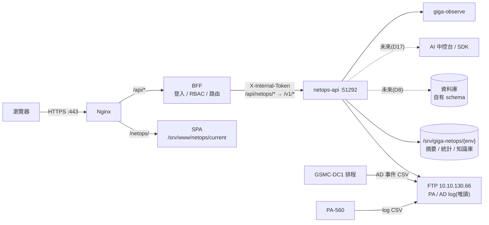

# NetOps 架構與決策

> 目標架構與設計決策。工作項目見 [IMPL-PLAN.md](IMPL-PLAN.md),目錄見 [PROJECT-MAP.md](PROJECT-MAP.md),現況、過渡期與未來目標的流程見 [FLOW-ARCHITECTURE.md](FLOW-ARCHITECTURE.md)。與 Gateway `docs/` 不一致時以 Gateway 為準,先指出差異。
> **狀態:B0 最小骨架待合併**(`backend/`、`deploy/`、`.gitlab-ci.yml`);舊版程式未改動,現況見 [README.md](../README.md)。

---

## 1. 現況與目標

| 項目 | 舊版(IIS) | 目標 |
| --- | --- | --- |
| 部署 | IIS + iisnode,單一服務同時提供前端與 API | Nginx 託管 SPA;後端容器經 BFF 轉送 |
| 路徑 | `/NetOps/`、`/NetOps/api/*` | `/netops/`、`/api/netops/*` |
| 後端 | Express 5 + JavaScript,39 支 API | Fastify 5 + TypeScript 介面層;核心 JS 先沿用 |
| 登入 | AD + 自簽 JWT(localStorage)、入口網同步碼 | BFF 單一入口,`X-Internal-Token` |
| 權限 | `.env` 工號 / 部門清單 | Gateway RBAC,GigaItApp 設定 |
| 資料庫 | 只為登入與跳轉查 `LOS`、`GscSystem`、`PortalSolar` | 第一版不連資料庫;未來由服務寫入自有資料庫(D8) |
| 資料 | `uploads/` 下 JSON、TSV.GZ、Markdown | 第一版同格式,放 `/srv/giga-netops/{env}`,只經 `infra/store` 存取 |

---

## 2. 目標架構



- 使用者永遠不直接連 `netops-api`;防火牆只允許 Gateway 容器網路連入。
- `netops-api` 內的背景工作:PA / AD 同步與分析。
- AI 功能留在舊版 IIS(D17、D18),`netops-api` 第一版不連 vLLM 與 Qdrant。

---

## 3. 決策

| # | 決策 | 理由 |
| --- | --- | --- |
| D1 | 系統代碼 `netops`、子路徑 `/netops/`、服務 `netops-api`、port 51292(Gateway BACKEND-GUIDE §3.3) | 子路徑規定小寫;51290 之後為未分配區段,51291 已使用 |
| D2 | 前後端分離,放同一 repo 的 `frontend/`、`backend/` | 比照 GigaItApp;一起發版,部署各自獨立 |
| D3 | 後端用 Fastify 5 + TypeScript | `setupGateway`(監控 + 自動註冊)只支援 Fastify;OpenAPI 可由程式產生;符合 Gateway §10.7.2 |
| D4 | 既有核心 JS(約 4,000 行)以 `allowJs` 沿用,先補測試再搬移 | 解析與研判已驗證,重寫風險高,且不是這次的目標 |
| D5 | 前端 UI 比照員工入口網與 GigaItApp:Vue 3 + TypeScript + `src/ui/` 全域元件,複製入口網框架,**視覺只換主題色**;移除 Element Plus 與 Tailwind(2026-11-02 改定,原為保留舊 UI) | 使用者在系統間切換時操作一致,也共用同一套規範;代價是 F1 要改寫約 3,400 行畫面(細節見 [UI-GUIDE.md](UI-GUIDE.md)) |
| D6 | Log 明細查詢等超過 60 秒的操作改成「送出工作 → 查詢結果」 | 舊版最長 180 秒,超過路由上限;逾時會累積斷路器失敗(BACKEND-GUIDE §5.2) |
| D7 | **移到 AI 中控台**(2026-11-02):AI 分析與問答的傳輸方式(POST + SSE + heartbeat,或工作 + 輪詢)不在這次驗證 | 新版沒有 AI 就不需要串流;BFF 會串流轉送,但 undici 與 Nginx 都有 60 秒閒置逾時,Nginx 預設緩衝,開發 AI 中控台時先實測 |
| D8 | **第一版存檔案,未來改由服務直接寫入資料庫**;現在只做 `infra/store` 邊界,不做資料庫實作 | 先完成接入,不讓資料遷移擴大這次範圍;保留換儲存時不動 API 與核心的空間(§4) |
| D9 | 單一容器;背景工作在程序內執行 | 目前有記憶體索引與排程狀態;多實例會重複同步 |
| D10 | **移到 AI 中控台**(2026-11-02):外部 IP 自動學習要用 LLM 整理筆記,新版不搬移,也不是切換條件 | 開發時要驗證 HTTPS 與 DNS 對外。主機 3 WSL 已可連外(工作區 AGENT §5 於 2026-11-03 更新;2026-11-02 實測可解析 `dns.google`、`rdap.arin.net` 回 200);其他登記處、DNS 反查與容器內都未驗證 |
| D11 | Veeam 入口先改一般連結,使用者另行登入 | 同步登入要直接寫 `PortalSolar.SyncLoginInfo`,不符合 Gateway §10.4;Veeam 接入平台後再評估 |
| D12 | `main` 在切換前維持舊 IIS 版本,接入程式只進 `develop`;測試區驗收後才切換 | 舊系統切換前持續運作,有回滾路徑 |
| D13 | B0 直接做最小骨架並部署到測試區,不做串流驗證(D7) | 部署、上游、路由與 API Key 之後都用得到,先打通可以提早發現問題 |
| D14 | 切換時全部複製舊版資料(摘要、統計、其他 log、AD 事件、知識庫、狀態檔)再核對,不重新分析 | 速度快,也保留 FTP 上已不存在的歷史;知識庫本來就不可重建 |
| D15 | 初始成員上線時由負責人在 GigaItApp 重新指派,不沿用舊版 `.env` 名單 | 順便清理舊名單;舊版「清單空白就開放全部」的情況不會帶過來 |
| D16 | 第一版不自動清除資料,保留期限併入資料庫階段(§4.2)決定 | 只有手動刪除;PA TRAFFIC 摘要與統計估計約 26 MB / 天(150 檔),主機 2、3 WSL 磁碟各約 930 GB 可用 |
| D17 | **這次不改寫 AI 功能**:AI 分析、問答、翻譯、整理筆記、語意搜尋、向量同步、外部 IP 自動學習都不搬移。未來由獨立的 SDK 與應用「AI 中控台」提供,另開 repo;目前只有 PRD(工作區 `GigaNexusAIPlan/docs/AI-CONSOLE-PRD.md`)。連線組合統計照常產生,知識庫筆記照常管理 | 先把這裡的功能做好;AI 集中開發,各系統不各自重做 |
| D18 | 切換後舊版 IIS 留著提供 AI 功能,直到 AI 中控台接入;選單放一般連結到舊版,使用者另行登入。知識庫以新版為準,舊版關閉寫入與自動學習;舊版繼續同步 FTP。切換時在 `main` 打標籤保留舊版程式 | 不用開發就保有 AI;代價是 FTP 同步兩份、舊版 AI 參考的知識庫會落後 |

---

## 4. 資料儲存

### 4.1 第一版:檔案

| 資料 | 位置(相對資料目錄) | 規模(舊版文件) | 可否重建 |
| --- | --- | --- | --- |
| PA 分析狀態 | `palogs/index.json` | 小 | 可,重新分析 |
| PA 摘要 | `palogs/summaries/*.json` | 每檔約 45 KB;427 檔約 18 MB | 可,FTP 還有原檔時 |
| 連線組合統計 | `palogs/flows/*.tsv.gz` | 每檔約 0.13 MB、6,600 組合 | 可,FTP 還有原檔時 |
| 其他 log 摘要 | `palogs/events/` | 未量測 | 可,FTP 還有原檔時 |
| AD 事件 | `adlogs/yyyyMMdd.json` | 未量測 | 可,FTP 還有原檔時 |
| 知識庫 | `knowledge/*.md`、`_knowledge-all.md` | 未量測 | **不可,要備份** |
| 自動學習狀態 | `palogs/iplearn.json` | 小 | 可,會重查 RDAP |

### 4.2 未來:服務直接寫入資料庫

**方向**:匯入流程解析後直接由服務寫入資料庫,不再寫 JSON;總覽、明細條件與知識庫中繼資料都從資料庫查詢。**尚未排程**,D2 切換後另外規劃。

現在要遵守的邊界:

1. 核心不直接讀寫資料檔,只呼叫 `infra/store` 的具名函式。
2. 匯入拆成解析、彙總(純函式)與寫入,寫入可以單獨替換。
3. API 回應不含路徑與檔案結構,改儲存時前端不動。

**開始這個階段前要定案**:

| 問題 | 說明 |
| --- | --- |
| 資料庫位置 | 比照附件服務放 `giganexus_gw` 的自有 schema `netops`,或獨立資料庫;SQL Server 2012 語法受限 |
| 資料量 | 連線組合統計估計上限約 100 萬列 / 天(6,600 × 150 檔,跨檔未合併),要先決定彙總粒度與保留期限;量大時才評估其他引擎 |
| 查詢方式 | 現在是合併檔案在記憶體計算,改資料庫要重新設計索引與總覽查詢 |
| 寫入單位 | 留在 `netops-api` 或拆獨立匯入服務(屆時才有多實例的空間) |
| 歷史資料 | 從檔案匯入,或從 FTP 重新分析 |
| 知識庫 | 內容進資料庫或維持 `.md`;向量仍在 Qdrant |
| 原始 log | 維持不存(AGENT §7.2),要改由使用者決定 |

---

## 5. 權限草案

BFF 以 API 權限檢查;畫面節點由 `deploy/gateway-rbac.yaml` 登記並以 `includes` 綁定。上線前以實際路由為準。

```text
netops.ping.read                         連線驗證 API(B0,GET /api/netops/ping;不綁畫面節點)
netops.app.access                        應用
├─ netops.group.firewall                 防火牆 PA-560
│  ├─ netops.pa-dashboard.read           流量總覽     → netops.pa.read
│  ├─ netops.pa-events.read              安全事件     → netops.pa.read
│  ├─ netops.pa-search.read              Log 明細查詢 → netops.pa-log.read
│  └─ netops.pa-files.read               FTP Log 檔案 → netops.ftp.read
│     └─ netops.pa-files.manage (button)              → netops.ftp.write
├─ netops.group.ad                       AD 網域
│  ├─ netops.ad-events.read              AD 事件總覽  → netops.ad.read
│  ├─ netops.ad-search.read              Log 明細查詢 → netops.ad-log.read
│  └─ netops.ad-files.read               FTP Log 檔案 → netops.ftp.read
│     └─ netops.ad-files.manage (button)              → netops.ftp.write
└─ netops.group.knowledge                網通知識
   └─ netops.kb-page.read                知識庫       → netops.kb.read
      └─ netops.kb-page.write (button)                → netops.kb.write
```

| 角色 | 內容 |
| --- | --- |
| `netops-admin` | 全部 |
| `netops-viewer` | 全部 `.read`;不含 `netops.ftp.write`、`netops.kb.write` |

新權限預設沒有人擁有,成員由系統負責人上線時指派(D15);不比照舊版「清單空白就開放全部在職員工」。

---

## 6. 風險

| 風險 | 影響 | 對策 |
| --- | --- | --- |
| 舊版與新版長期並行(D18) | FTP 負載加倍;舊版 AI 的知識庫落後;舊版要繼續維護 | 新舊都控制 FTP 連線數;只保留 AI 功能的使用;AI 中控台接入後停用舊版 |
| 長時間掃描阻塞事件迴圈 | `/healthz` 延遲,誤判上游異常 | B2 量測;必要時移到 worker thread |
| 容器連不到 FTP | 功能不可用 | 主機 2、3 Windows 端 TCP 已通;D1 在容器內再驗證 |
| 測試區與舊系統同時同步 | FTP 負載加倍 | 測試區連線數設 1 |
| 畫面改寫時漏掉舊功能 | 切換後使用者少了操作 | F1 逐頁對照舊版功能;只換畫面,不同時改功能 |
| 資料目錄持續成長 | 第一版不自動清除(D16),其他 log 與 AD 事件的量未量測 | D1 後量測實際用量 |
| 知識庫遺失 | 不可重建 | D1 規劃 NAS 備份;切換前複製並核對 |
| 新舊系統知識庫雙寫 | 內容不一致 | 切換時關閉舊版寫入與自動學習(D18) |

---

## 7. 待確認事項

| # | 問題 | 預設 |
| --- | --- | --- |
| Q1 | 專案負責人 | 已定案:佳緯 |
| Q2 | `develop` 分支 | 已完成:從 `main` 建立 |
| Q3 | 知識庫備份到 NAS 的位置與帳號 | D1 比照附件服務 `docker-backup` |
| Q4 | 資料庫階段的各項決定(§4.2) | D2 後討論 |
