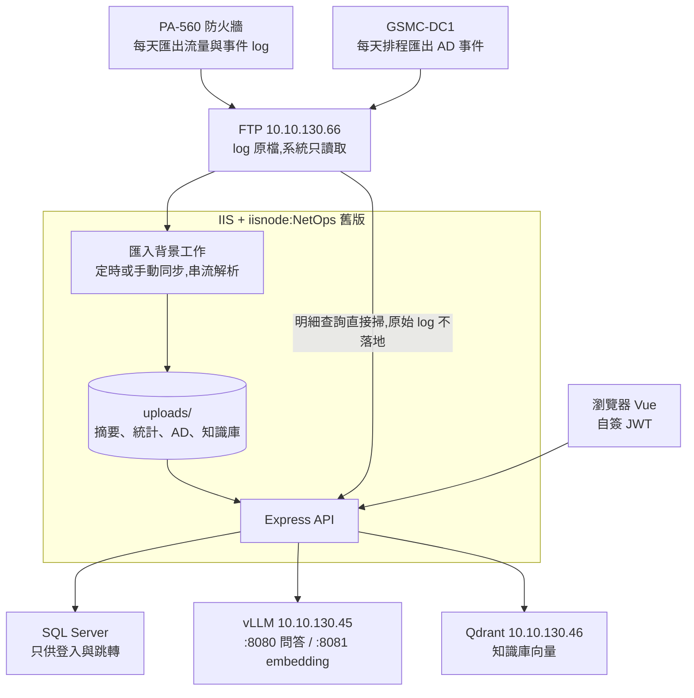
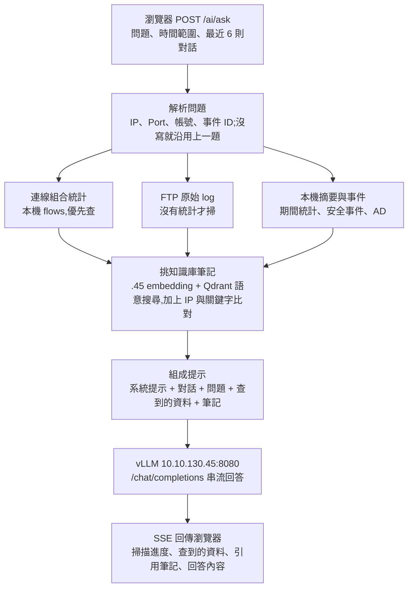
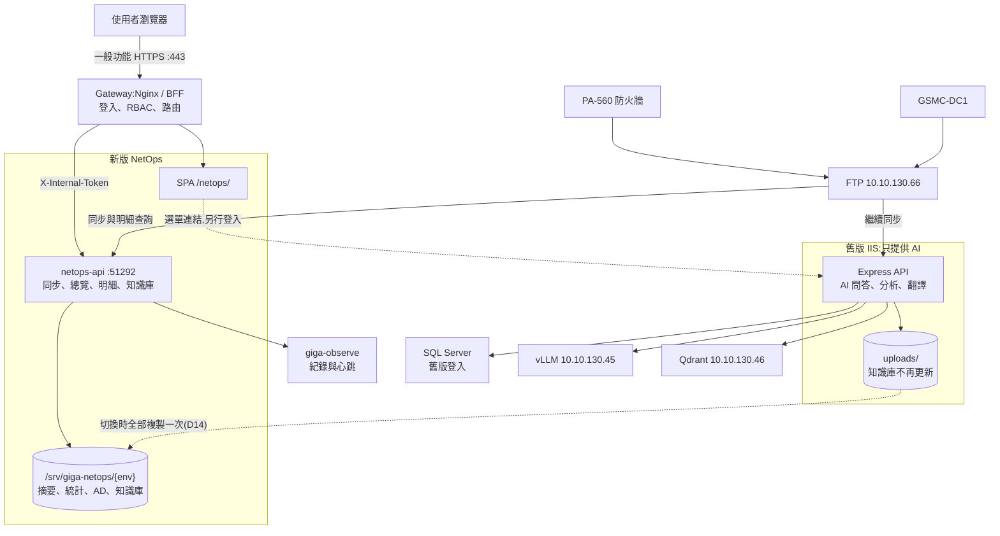
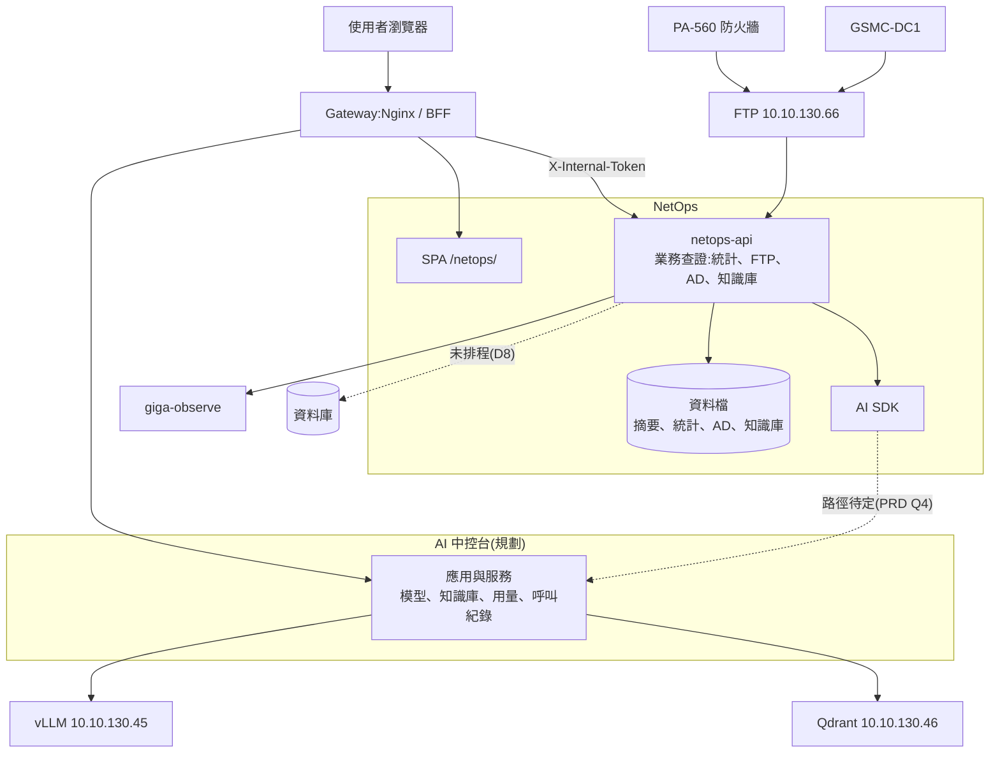

# NetOps 流程架構

> 資料怎麼取得、存在哪裡、AI 怎麼串,分現況、過渡期與未來目標三個階段。決策見 [ARCHITECTURE.md](ARCHITECTURE.md),工作項目見 [IMPL-PLAN.md](IMPL-PLAN.md)。**時程以 NexusPlan 甘特圖為準**,本文件只記架構。
> 現況依 `server/` 程式與 `README.md` 整理,IIS 實際部署版本與 `.env` 設定未核對;過渡期與未來目標尚未實作。

| 項目 | 現況 | 過渡期 | 未來目標 |
| --- | --- | --- | --- |
| 期間 | 目前到正式切換前 | 正式切換後到 AI 中控台接入前 | AI 中控台接入後 |
| 使用者入口 | IIS `/NetOps` | 新版 `/netops/`;AI 連到舊版 | `/netops/` |
| 登入與權限 | 自簽 JWT、`.env` 名單 | 新版經 BFF;舊版維持自簽 JWT | 經 BFF |
| 資料取得 | 舊版同步 FTP | 新舊各自同步 FTP | 新版同步 FTP |
| 資料存放 | IIS `uploads/` | 新版 `/srv/giga-netops/{env}`;舊版 `uploads/` | 第一版仍存檔案;資料庫未排程(D8) |
| 知識庫 | 舊版可寫 | 以新版為準,舊版關閉寫入 | 新版管理內容;向量歸屬待定(PRD Q6) |
| AI | 舊版直連 vLLM、Qdrant | 同現況,知識庫內容會落後 | 經 AI 中控台與 SDK |

---

## 1. 現況(IIS 舊版)

單一 Node 程序同時提供前端、API 與背景工作。

### 1.1 資料取得

| 資料 | 怎麼來 | 存放位置 |
| --- | --- | --- |
| PA TRAFFIC log | PA-560 每天匯出 CSV 到 FTP,系統串流解析 | `palogs/summaries/`(摘要)、`palogs/flows/`(連線組合統計) |
| 威脅、URL、VPN 等其他 log | FTP 各類型目錄,用同一個同步間隔 | `palogs/events/` |
| AD 事件 | GSMC-DC1 排程匯出到 FTP `/AD_Log_Backup/yyyyMMdd/` | `adlogs/yyyyMMdd.json` |
| 知識庫 | 管理者手寫、請 AI 整理,或外部 IP 自動學習 | `knowledge/*.md`;向量同步到 Qdrant |

- 同步依 `FTP_SYNC_MINUTES` 自動執行,PA 與 AD 的 FTP Log 頁也能手動同步。
- 明細查詢依時間挑檔案後即時掃 FTP,不讀本機資料。

### 1.2 AI 問答流程

### 1.3 其他 AI 功能

| 功能 | 送給模型的內容 | 回傳方式 |
| --- | --- | --- |
| AI 分析 | 期間摘要與其他 log 統計,不掃 FTP;有輸入問題才做語意搜尋 | SSE 串流 |
| 整理筆記 | 管理者的說明與最近對話,AI 回 JSON 後存成筆記 | 一次回傳 |
| 翻譯 | AI 的回答內容,關閉思考模式 | 一次回傳 |
| 向量同步 | 筆記內容經 `.45:8081` 算向量後寫入 Qdrant;異動 3 秒後同步,另外每 30 分鐘全部比對 | 背景執行 |
| 外部 IP 自動學習 | 每天查 RDAP 與 DNS 反查,交給 AI 整理成筆記 | 背景執行 |

---

## 2. 過渡期(新版上線,舊版留給 AI)

新版接入 Gateway 負責一般功能,AI 不改寫(D17)。正式切換後舊版 IIS 繼續運作,只提供 AI(D18)。切換前新版只在測試區,正式使用者仍用舊版。

| 規則 | 內容 |
| --- | --- |
| 資料複製 | 切換時關閉舊版知識庫寫入與自動學習,全部複製後核對檔數與總覽數字 |
| 知識庫 | 以新版為準,不寫回舊版;舊版 AI 參考的內容會落後 |
| FTP | 新舊各同步一份,要控制連線數;測試區連線數為 1 |
| 回滾 | 舊版同時作為回滾路徑;切換時在 `main` 打標籤保留程式 |

**未定**:舊版關閉知識庫寫入的做法,D2 切換前確認。

---

## 3. 未來目標(AI 中控台接入)

AI 中控台與 SDK 另開 repo,目前只有 PRD 草案(工作區 `GigaNexusAIPlan/docs/AI-CONSOLE-PRD.md`)。接入後停用舊版 IIS。虛線是尚未定案的部分。

| 分工 | 內容 |
| --- | --- |
| NetOps | 查證資料:解析問題條件、查統計、掃 FTP、提供知識庫內容;只送統計與彙整結果 |
| AI SDK | 問答與串流、embedding、翻譯、失敗回報 |
| AI 中控台 | 模型服務、知識庫向量、用量與呼叫紀錄 |

**開工前要確認**:

- SDK 直接連模型,或一律經 AI 中控台服務(PRD Q4);圖上的呼叫路徑依此調整。
- 知識庫歸屬(PRD Q6)。
- 串流實測:Nginx 與 BFF 都有最長 60 秒閒置逾時,失敗就改工作加輪詢(D7)。
- 外部 IP 自動學習的對外連線(D10)。
