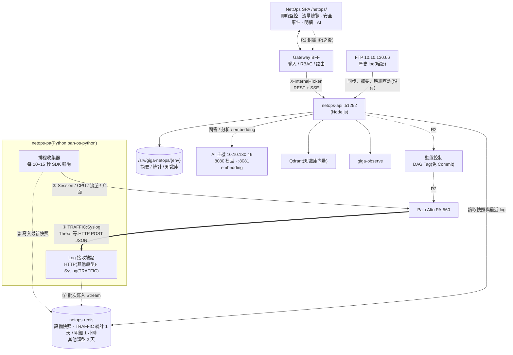

# PA 即時監控與 AI 搬移規劃

> 2026-11-04 與系統、網通開會後重新規劃。決策摘要寫在 [ARCHITECTURE.md](ARCHITECTURE.md) D19–D24,工作項目寫在 [IMPL-PLAN.md](IMPL-PLAN.md)。**時程以 NexusPlan 甘特圖為準**,本文件只記架構與狀態。
> **狀態:規劃中,尚未實作**。2026-11-04 已定案 P3–P6 並完成容量量測(§5);P1、P2 待網通。

---

## 1. 範圍與原則

| 項目 | 決定 |
| --- | --- |
| 即時資料 | PA-560 的設備狀態與 log 放 **Redis**,在新選單「即時監控」呈現 |
| 歷史資料 | **FTP 當作事後查詢**:沿用現有的 FTP 同步、摘要與 Log 明細查詢 |
| 資料庫 | **不寫入資料庫**(取代 D8「未來改由服務寫入資料庫」) |
| PA 介接 | 官方 SDK [pan-os-python](https://pan-os-python.readthedocs.io/en/latest/)(Python) |
| Redis 保留 | **TRAFFIC:每分鐘統計 1 天、明細 1 小時;其他類型:明細與統計 2 天**(依 §5 量測調整);上線後觀察實際用量再調整 |
| log 轉送 | **TRAFFIC 用 Syslog**(量大);威脅、URL 等其他類型用 HTTP Log Forwarding(JSON) |
| 寫入防火牆 | **第一版只讀**。封鎖 IP(DAG 動態標籤)之後再做(R2) |
| AI | **取消 AI 中控台**;舊版 AI 功能搬進新版 `netops-api`,直接呼叫 AI 主機 |

---

## 2. 目標架構



- 瀏覽器、BFF 都**只連 `netops-api`**;`netops-pa` 不註冊為 Gateway 上游,只寫 Redis。
- 和會議架構圖的差異:拿掉「觀測資料庫(Mongo / Time-Series)」,報表與排行改由 Redis 的每分鐘統計(TRAFFIC 1 天、其他 2 天)與既有的 FTP 摘要(更早)提供;TRAFFIC 改用 Syslog 轉送(§5)。
- `netops-api` 維持單一容器(D9);`netops-pa` 也是單一容器,收集器與接收端點在同一個程序內。

---

## 3. 元件

### 3.1 `netops-pa`(新,Python)

| 項目 | 內容 |
| --- | --- |
| 位置 | NetOps repo `pa-collector/`(與 `frontend/`、`backend/` 平行) |
| 語言 / 套件 | Python 3.12、`pan-os-python`、Redis 用戶端、輕量 HTTP 伺服器(實作時選定,先說明理由) |
| 排程收集器 | 每 10–15 秒以 SDK 執行唯讀 op 指令:`show session info`(Session 數與使用率)、`show system resources`(管理平面 CPU / 記憶體)、`show running resource-monitor`(資料平面 CPU)、介面計數(算流量)。結果寫 Redis 快照 |
| Log 接收端點 | 兩種接收:**Syslog**(TRAFFIC,TCP,優先 TLS;PAN-OS 自訂格式輸出 §4 的欄位)與 **HTTP**(其他類型,JSON);驗證來源後批次寫入 Redis Stream 與每分鐘統計 |
| 設備帳號 | PA-560 建**唯讀管理角色**(只允許 XML API 的 operational 查詢)與 API Key;以 `PA_API_KEY_FILE` 指向 Docker secret,金鑰由使用者用腳本寫入主機 |
| 監控 | `setupGateway` 只支援 Fastify,Python 不接。改為每次輪詢寫心跳鍵 `netops:pa:heartbeat`,由 `netops-api` 的 `/readyz` 與畫面顯示「收集器最後更新時間」 |
| 失敗 | 連不到 PA-560、API Key 失效、寫 Redis 失敗都記 log 並更新心跳鍵的錯誤欄位;畫面明確顯示「資料停止更新」,不顯示舊快照當作即時(AGENT §5) |

### 3.2 `netops-redis`(新)

- NetOps **自己的** Redis 7 容器,不共用 Gateway 的 Redis(Gateway 的 Redis 存路由與 Session,要互相隔離);只在 Compose 內部網路,不對主機開 port。
- 設 `maxmemory` 上限;`maxmemory-policy noeviction`:滿了就寫入失敗並告警,不默默丟掉資料。容量上限依 §5 量測結果決定。
- 持久化:**開 RDB、不開 AOF**(2026-11-04 決定),快照存 named volume,重啟後保留最近資料。RDB 存檔會 fork,記憶體上限要預留空間(§5)。Redis 資料遺失時,歷史仍可從 FTP 查。

### 3.3 `netops-api`(既有,新增)

| 新增 | 內容 |
| --- | --- |
| `modules/pa-live/` | 讀 Redis 的快照、最近 log、每分鐘統計;API 對外 `/api/netops/pa-live/*` |
| `infra/redis/` | Redis 連線與具名讀取函式(同 `infra/store` 的原則:模組不直接組 Redis 鍵) |
| `modules/ai/` 等 | AI 搬移(§6) |

---

## 4. Redis 資料設計(草案)

| 鍵 | 型別 | 內容 | 保留 |
| --- | --- | --- | --- |
| `netops:pa:snap:{metric}` | String(JSON) | 最新設備快照:`session`、`cpu`、`throughput`、`interfaces` | 60 秒 TTL(過期即顯示「停止更新」) |
| `netops:pa:series:{metric}` | Stream | 快照歷史,畫趨勢圖 | 2 天(`XADD … MINID`) |
| `netops:pa:log:{type}` | Stream | log 明細,`type` 為 `traffic`、`threat`、`url`、`wildfire`、`data`、`decryption`、`globalprotect`、`userid` | `traffic` **1 小時**;其他 2 天(`MINID` 依時間修剪) |
| `netops:pa:agg:{type}:{yyyyMMddHHmm}` | Hash | 每分鐘統計:次數、位元組、依 action / app / rule / 來源 / 目的的計數 | `traffic` **1 天**;其他 2 天(TTL) |
| `netops:pa:top:{type}:{dim}:{yyyyMMddHHmm}` | Sorted Set | 每分鐘排行(來源 IP、目的 IP、App、Rule、威脅名稱);每分鐘只留前 N 名(例如 200) | 同上 |
| `netops:pa:heartbeat` | Hash | 收集器 / 接收端點最後成功時間、最後錯誤;總開關 `pollEnabled` / `receiveEnabled`、實際暫停狀態 `pollPaused` / `receivePaused`、計數(含暫停期間丟棄的 `paused`) | 無 |
| `netops:pa:control` | Hash | **測試區手動開關**(2026-11-09,ARCHITECTURE D26):`pollPaused`、`receivePaused`(`"1"` 暫停,`"0"` 或沒有 = 繼續)、`updatedAt`(ISO)、`updatedBy`(「姓名(工號)」)。**`netops-api` 寫入**(`PUT /pa-live/collector-control`,經 `infra/redis` `setCollectorControl`)、`netops-pa` 只讀:輪詢每次查 PA-560 前讀,接收每 5 秒(心跳時)讀;讀取失敗沿用上一次的狀態。正式區(`GW_ENV=prod`)兩邊都不用 | 無(Redis 資料遺失時回到「繼續」) |

**log 欄位**:沿用舊版功能已在用的欄位,不新增。

- **例外(2026-11-10,ARCHITECTURE D28 / CQ9)**:TRAFFIC 與威脅類(threat、url、data、wildfire)加 `seqno`(PA Sequence Number,64 位元,Stream JSON 裡存成**數字字串**,避免 Node 端失去精度)與 `sessionId`(Session ID,整數),給 `netops-ingest` 寫進 ClickHouse、FTP 補漏逐筆去重。decryption、globalprotect、userid 不收。

- TRAFFIC:`backend` 對應舊版 `server/lib/palog.js` 的 `COLUMNS`(時間、來源 / 目的 IP 與 Port、NAT、Rule、使用者、App、Zone、介面、協定、Action、位元組、封包、持續秒數、URL 分類、國家、結束原因、App 風險與分類、主機名稱)。
- THREAT 等其他類型:對應 `server/lib/paevents.js` 的各類型欄位(威脅名稱、嚴重度、方向、URL / 檔名、Repeat Count、檔案摘要等)。威脅、URL、資料過濾、WildFire 另有來源 Port `sport`、目的 NAT Port `natDport`(2026-11-10 補;PA 的 HTTP Payload 要手動加變數,見 PA-FORWARDING-SPEC B.3)。
- PA-560 的 HTTP Server Profile(JSON)與 Syslog Server Profile 的自訂格式,**欄位名稱直接用上面的 key**(`time`、`src`、`dst`…),讓 Node 端的彙總邏輯可以沿用。

---

## 5. 容量估算(2026-11-04 量測)

**原始 log 這次會存進 Redis**,取代 AGENT §7.2「原始 log 不存本機」的規定(使用者 2026-11-04 決定)。

**量測方式**:在主機 2 測試區 `netops-api` 容器內,以既有 FTP 設定唯讀列出各目錄、串流讀一個 TRAFFIC 檔計算列數(不存檔)。

| 類型 | FTP 目錄 | 每日量(最近幾天) | 換算 |
| --- | --- | --- | --- |
| TRAFFIC | `/my-data`(`PA-560_traffic_*.csv`,每檔 65,536 列、約 41 MB) | 120–173 檔,**4.6–6.8 GB / 天** | 每列約 652 bytes → **約 790–1,130 萬筆 / 天**,平均每秒約 90–130 筆 |
| THREAT | `/threat` | 約 46–56 MB / 天 | 約 8–9 萬筆 / 天(以每列約 650 bytes 估) |
| 資料過濾 | `/data-filtering` | 約 26–131 MB / 天 | 波動大 |
| URL 過濾 | `/url-filtering` | 約 8–43 MB / 天 | |
| GlobalProtect | `/globalprotect` | 約 1–26 MB / 天 | |
| WildFire、解密、User-ID | 各目錄 | 都在 1 MB / 天以下 | |

> FTP 根目錄沒有 TRAFFIC 檔,實際在 `/my-data`;測試區容器的 `FTP_LOG_DIR` 是空的(預設根目錄),「FTP Log 檔案」頁預設目錄看不到 TRAFFIC。D1 未驗項目 1 要先切到 `/my-data` 分析,或把測試區 `FTP_LOG_DIR` 設為 `/my-data`(另外處理)。

**主機記憶體**(WSL):主機 2 總共 5.8 GiB(可用約 3.6 GiB,已跑 Gateway 測試區等);主機 3 總共 7.8 GiB(可用約 4.3 GiB)。

**估算**(Redis 每筆約 300 bytes,含 Stream 開銷):

| 資料 | 估計 |
| --- | --- |
| TRAFFIC 明細 2 天(原規劃) | 約 6–7 GB:**放不下** |
| TRAFFIC 明細 1 小時(定案) | 尖峰約 50 萬筆 → 約 150–250 MB |
| TRAFFIC 每分鐘統計 1 天(定案) | 1,440 分鐘 × 各維度前 N 名 → 約 100–300 MB(實作後實測) |
| 其他類型明細 2 天 | 約 0.5–1 GB(資料過濾波動大) |
| 合計 | 約 1–1.5 GB;`maxmemory` 先設 **2 GB**,RDB fork 另需預留 |

- 上線後每天記錄 `INFO memory` 與各 Stream 長度,一週後檢討;超過上限時先縮短資料過濾的保留時間。
- 量測依據是 FTP 匯出檔;PA-560 即時轉送的量要在 R0 設好轉送後再核對一次。

---

**轉送後實測(2026-11-10,測試區)**:Syslog TRAFFIC 約 107–117 筆/秒(約 1,000 萬筆 / 天,與上表 FTP 估算一致);Redis 每筆約 700 bytes(含統計鍵),修剪前每小時約 293 MB,TRAFFIC 明細 1 小時穩態約 395 k 筆、約 291 MB;threat / url / data 每小時遠小於 TRAFFIC,2 天累積量未驗。保留時間不需調整(`docs/test-reports/2026-11-10-pa-live-uat.md` §3.3)。

## 6. AI 搬移(取消 AI 中控台)

| 項目 | 內容 |
| --- | --- |
| 搬移範圍 | 舊版 `server/routes/ai.js`、`server/lib/evidence.js`、`llm.js`、`vector.js`、`iplearn.js`:AI 分析、問答、翻譯、整理筆記、語意搜尋、向量同步、外部 IP 自動學習 |
| 做法 | 同 B2(D4):既有 JS 以 `allowJs` 沿用,先補測試基準再搬,搬移與行為變更分開提交;核心經 `infra/` 呼叫模型與 Qdrant |
| 模型 | `LLM_URL=http://10.10.130.46:8080/v1`、`LLM_MODEL=Qwen3.6-35B-A3B-FP8` |
| embedding | `EMBED_URL=http://10.10.130.46:8081/v1`。10.10.130.45 與 .46 配置相同(主要模型 `:8080`、embedding `:8081`),.45 作為備用,換主機只改設定 |
| 向量庫 | **沿用**舊版 Qdrant `10.10.130.46:6333`(collection `NetOpsKb`,2026-11-04 決定)。A1 開工時先比對 `.46:8081` 的 embedding 模型與維度是否同舊版(Qwen3-Embedding-8B、4096 維),不同就重建 collection |
| 翻譯 | **沿用 `LLM_URL` / `LLM_MODEL`**(關閉思考模式,2026-11-04 決定);不再另設翻譯模型 |
| 串流 | 問答與分析用 SSE,和即時監控一起做 S0 串流驗證 |
| 權限 | 新增 AI 用的 API 權限(草案 `netops.ai.use`;整理筆記沿用 `netops.kb.write`),實作時寫進 API.md 與 `gateway-rbac.yaml` |
| 連線 | 主機 2、3 的容器要能連 `.46:8080`、`:8081`、`:6333`(開發機被 PA 擋,舊版走 SSH tunnel);外部 IP 自動學習要能連 RDAP(D10) |
| 舊版 IIS | AI 搬完並切換後即可停用;`main` 打標籤保留,停用前作為回滾 |

---

## 7. 串流傳輸(S0)

即時監控與 AI 都要經 BFF 串流,先做一次驗證:

- `GET /api/netops/pa-live/stream`(SSE):事件 `snapshot`(設備快照)、`logs`(新 log 批次)、`heartbeat`(每 15 秒)。
- 要驗證的地方:Nginx 預設緩衝(回應帶 `X-Accel-Buffering: no` 或 location 關閉 `proxy_buffering`)、Nginx 與 BFF(undici)的 60 秒閒置逾時、斷線後瀏覽器重連、BFF 斷路器不把長連線算成逾時。
- 驗證失敗就改成前端每 5 秒輪詢 REST(收集器本來就是 10–15 秒更新一次,體驗差異小)。
- 若要改 Gateway(Nginx location 或 BFF 串流設定),屬於 Gateway repo,先說明再動。
- S0 的寫法規則(2026-11-05,NetOps !32;細節見 `docs/API.md` §3.1、`docs/test-reports/2026-11-05-s0-sse.md`):OpenAPI 設 `x-timeout-ms: 60000`(BFF 的逾時是資料塊之間的閒置時間,預設 10 秒會在第一次心跳前切斷);立即送第一個事件,心跳 15 秒;回 `X-Accel-Buffering: no`、`Cache-Control: no-cache, no-transform`;名額滿回 429(不回 5xx,上游 5xx 會累積 BFF 斷路器失敗);每人上限;服務關閉在 `preClose` 結束串流。寫法照 `backend/src/modules/pa-live/routes.ts`。

---

## 8. 畫面與權限(草案)

新選單放在「防火牆 PA-560」群組最上方:**即時監控**。

| 區塊 | 內容 | 資料來源 |
| --- | --- | --- |
| 設備狀態 | 管理 / 資料平面 CPU、Session 數與使用率、整體流量、介面流量,含最近 1 小時趨勢 | 快照與 series |
| 即時排行 | 最近 5 / 15 / 60 分鐘的來源 IP、目的 IP、App、Rule、威脅 Top N | 每分鐘統計 |
| 即時 log | 最新 log 捲動顯示,可依類型、IP、Port、Action 篩選,可暫停(TRAFFIC 只有最近 1 小時) | log Stream |
| 查更早的資料 | 超過保留期間(TRAFFIC 明細 1 小時、統計 1 天;其他 2 天)引導到「Log 明細查詢」與既有總覽(FTP) | — |

```text
netops.group.firewall
└─ netops.pa-live.read              即時監控 → netops.pa-realtime.read(API)
   └─ netops.pa-live.manage         測試區暫停 / 繼續收集器(按鈕)→ netops.pa-realtime.write(API;只給 netops-admin)
```

- `netops-viewer` 也有(全部 `.read`,ARCHITECTURE §5)。
- 即時 log 是原始明細,API 設 `x-audit-level: meta`,同 Log 明細查詢。
- **即時 log 的上限**(2026-11-10,需求方決定提高):TRAFFIC 實測約 107–140 筆/秒。原本每 2 秒最多送 200 筆、一次讀超過 500 筆就跳到最新,5 分鐘 SSE 實測 Redis 42,005 筆、頁面只收 31,960 筆(`dropped` 9,300、2 次 `skipped`,約 76%)。改為:檢查間隔 1 秒、每個 tick 最多讀 / 送 1500 筆(約平均的 10 倍)、一個事件最多 200 筆(大批分段)、慢消費者門檻 256 KB → 2 MB(單 tick 最壞約 1.5 MB);全系統 20 條 × 2 MB = 40 MB 上限。前端最多顯示 500 筆、每秒 100+ 筆只觸發每事件一次表格更新(`shallowRef`),不需修改。
- **測試區收集器開關**(2026-11-09,ARCHITECTURE D26):頁首「收集器」區分開顯示輪詢(設備狀態的來源)與接收(排行、即時 log 的來源)狀態;有 `netops.pa-live.manage`(按鈕,`includes: [netops.pa-realtime.write]`,只給 `netops-admin`)且部署區不是正式區時,顯示「輪詢:開啟 / 停用」「接收:開啟 / 停用」。總開關(環境變數)關閉的那一個按鈕停用並說明「主機設定未開啟…」。
- **單一連線最長 5 分鐘**(需求方 2026-11-05 決定):到時伺服器結束連線,瀏覽器自動重連時 BFF 重新檢查登入與權限,所以登出或撤權後最晚 5 分鐘停止收到即時 log(S0 驗證路由是 10 分鐘,只送心跳)。重連時以 `Last-Event-ID` 補送斷線期間的 log(Stream 的 ID)。

---

## 9. 安全與網路

| 項目 | 做法 |
| --- | --- |
| Log 接收端點 | 只接受 PA-560 的來源 IP。HTTP:Server Profile 帶自訂標頭 Token(`*_FILE`),優先 HTTPS。Syslog:TCP,優先 TLS(Syslog 沒有 Token,靠來源 IP 與 TLS)。PA-560 是否信任內部憑證要網通確認 |
| PA API Key | 唯讀角色、只放 Docker secret,不進版控與日誌;日誌遮罩 `key=` 參數 |
| 網路 | `netops-pa` → PA-560 管理介面 `:443`;PA-560 → 主機 2 / 主機 3 的接收 port(51293、51294)。兩個方向都要網通放行 |
| 接收 port | **51293** HTTP Log Forwarding(使用者 2026-11-04 同意)、**51294** Syslog(TRAFFIC 改 Syslog 後新增);登記在 Gateway BACKEND-GUIDE §3.3。不是 Gateway 上游(D24),只供 PA-560 連入 |
| PA-560 端設定 | 給網通的設定規格(唯讀 API 帳號、HTTP / Syslog Server Profile、payload 欄位對應)與主機端轉送、防火牆:[PA-FORWARDING-SPEC.md](PA-FORWARDING-SPEC.md)(R1,2026-11-05) |
| 兩個部署區 | 測試區與正式區都會輪詢同一台 PA-560;HTTP Server Profile 可列兩台伺服器。測試區輪詢間隔設長一點,或只在測試期間開 |

---

## 10. 風險

| 風險 | 影響 | 對策 |
| --- | --- | --- |
| 轉送量大 | PA-560 管理平面負載升高、log 延遲或遺失 | TRAFFIC 每天約 1,000 萬筆,改用 Syslog(定案);先開其他類型的 HTTP,再開 TRAFFIC Syslog,請網通觀察管理平面 CPU |
| Redis 記憶體不夠 | 寫入失敗(noeviction) | 依 §5 設 2 GB 上限並告警;TRAFFIC 明細只留 1 小時;超過先縮短資料過濾的保留時間 |
| SDK 輪詢加重 PA-560 負擔 | 管理介面變慢 | 10–15 秒、只用 op 查詢;兩區不同時高頻 |
| 串流經 BFF 不穩 | 畫面斷線 | S0 驗證;失敗改輪詢 |
| Python 是平台新語言 | 建置、監控、維護方式和其他服務不同 | 已在 Gateway TECH-STACK 登記(使用者 2026-11-04 同意);映像在主機 2 建置推 Registry,主機 3 只拉映像 |
| Redis 保留期間有限(TRAFFIC 明細只有 1 小時)、FTP 有延遲 | 「剛發生」與「FTP 已有」之間可能有空檔 | 畫面標示 Redis 的最早時間;明細查詢提示 FTP 最新檔案時間 |

---

## 11. 開工前要確認

| # | 事項 | 狀態 |
| --- | --- | --- |
| P1 | PA-560 管理介面 IP、PAN-OS 版本(決定 SDK 與轉送格式) | **待網通** |
| P2 | 唯讀管理角色與 API Key、HTTP / Syslog Server Profile 與 Log Forwarding Profile 由誰設定 | **待網通** |
| P3 | 每日 log 量與主機記憶體 | 已量測(§5);定案:TRAFFIC 統計 1 天、明細 1 小時,其他 2 天,`maxmemory` 2 GB |
| P4 | 接收 port 與 Python 在 Gateway 文件登記 | 已同意:51293(HTTP)、Python;51294(Syslog)隨 TRAFFIC 改 Syslog 新增。Gateway MR 見 HANDOFF |
| P5 | Redis 持久化 | 已定案:開 RDB、不開 AOF |
| P6 | Qdrant、embedding、翻譯 | 已定案:沿用 Qdrant(A1 先比對 embedding 維度)、翻譯沿用 LLM |
| P7 | TRAFFIC 轉送方式 | 已定案:Syslog;其他類型 HTTP |
