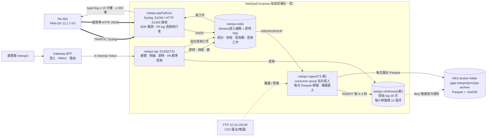
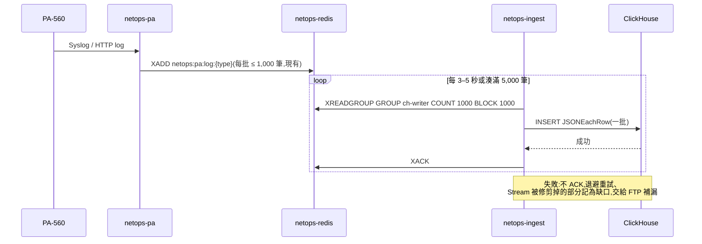
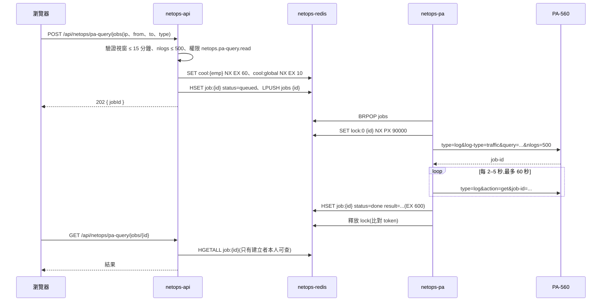

# PA-560 防火牆日誌高吞吐架構與開發手冊(ClickHouse)

> **狀態:已核准(2026-11-10)**(需求方 2026-11-10「全部照建議」;§12 CQ1–CQ14 都照建議,見「決定」欄)。有外部前置條件的項目(CQ2 正式區資源、CQ3、CQ6、CQ9)完成前,不開工對應階段(IMPL-PLAN C0)。
> 本文件依需求方 2026-11-10 的需求撰寫,並和**已上線的 R1 即時監控**(`netops-pa` + `netops-redis`)核對。和現況或既有決策衝突的地方都列在 §12「待需求方決策」,**沒有替需求方決定**。
> 決策寫在 [ARCHITECTURE.md](ARCHITECTURE.md) §3.1 D27–D33,工作項目寫在 [IMPL-PLAN.md](IMPL-PLAN.md) C0–C6(都已核准)。**時程以 NexusPlan 甘特圖為準**,本文件不列日期。
> 文件裡的 DDL、設定與程式碼都是**範例,實作時調整**;語法出處見附錄 A。
> **C1 實測(2026-11-10)**:§4 已換成實測值;實際使用的設定與 DDL 在 `deploy/clickhouse/`(和本文範例的差異見 §10.2 末段),報告 `docs/test-reports/2026-11-10-clickhouse-c1.md`。

---

## 目錄

1. [背景與痛點](#1-背景與痛點)
2. [現況對照](#2-現況對照)
3. [和需求原文不同的地方](#3-和需求原文不同的地方)
4. [容量與資源估算(實測數字)](#4-容量與資源估算實測數字)
5. [目標架構](#5-目標架構)
6. [模組一 日誌收集與寫入管線](#6-模組一-日誌收集與寫入管線)
7. [模組二 ClickHouse 資料表與索引](#7-模組二-clickhouse-資料表與索引)
8. [模組三 冷資料 Parquet 歸檔到 NAS](#8-模組三-冷資料-parquet-歸檔到-nas)
9. [模組四 PA SDK / API 的安全定位](#9-模組四-pa-sdk--api-的安全定位)
10. [模組五 平台整合與部署](#10-模組五-平台整合與部署)
11. [FTP 的角色與過渡期對帳](#11-ftp-的角色與過渡期對帳)
12. [待需求方決策](#12-待需求方決策)
13. [風險](#13-風險)
14. [分階段計畫](#14-分階段計畫)
- [附錄 A 出處](#附錄-a-出處)
- [附錄 B 唯讀查詢紀錄(2026-11-10)](#附錄-b-唯讀查詢紀錄2026-11-10)

---

## 1. 背景與痛點

| # | 痛點(需求原文) | 現況核對 |
| --- | --- | --- |
| 1 | FTP(10.10.130.66)匯入整天全量 Traffic 很慢 | 屬實。TRAFFIC 每天 120–173 個 CSV(每檔 65,536 列、約 41 MB),合計 4.6–6.8 GB(PA-LIVE-PLAN §5)。現在的 Log 明細查詢(B2,D6)在 `netops-api` 逐列串流掃描 FTP 檔,一次查一天要讀幾 GB |
| 2 | PA API 不能拿來撈整天歷史 log,會打掛管理平面 | 屬實。XML API 一次最多 5,000 筆、要非同步工作輪詢;PA-560 管理平面 CPU 小。現在 SDK 只做 10–15 秒的唯讀 op 查詢(D19、D22) |
| 3 | SQL Server 2012 Standard 不適合每天數百萬筆 | 屬實。2012 Standard 沒有分割區(2016 SP1 起 Standard 才有),也沒有可更新的 Columnstore。D20 也決定不寫資料庫 |
| 4 | (需求沒寫,現況補充)R1 已即時收到 TRAFFIC | 2026-11-10 起 PA-560 以 Syslog 轉送 TRAFFIC 到 `netops-pa`,寫 `netops-redis`,**明細只留 1 小時**(D21)。這條即時串流就是 ClickHouse 最好的資料來源,不必再從 FTP 批次讀 |

**結論**:痛點 1 的根本原因是「查詢時才掃原始檔」。把已經在收的 Syslog 串流**一邊收一邊寫進欄式資料庫**,查詢改成查索引過的表,就不必再整天讀 FTP。

---

## 2. 現況對照

已上線、這個提案要**沿用**的元件:

| 元件 | 現況(2026-11-10) | 本提案怎麼用 |
| --- | --- | --- |
| `netops-pa`(Python 3.12,pan-os-python 1.13.1) | SDK 每 10–15 秒唯讀輪詢;HTTP :51293(威脅等)與 Syslog :51294(TRAFFIC)接收;有上限佇列、每來源速率上限,批次寫 Redis(`pipeline.py`、`store.py`) | **不改接收**。新增 PA log 精準查詢的工作執行者(模組四) |
| `netops-redis`(Redis 7.4,`maxmemory` 2 GB,noeviction,RDB) | Stream `netops:pa:log:{type}`(TRAFFIC 1 小時、其他 2 天)、每分鐘統計、排行、心跳、開關 | **Stream 直接當寫入緩衝**:ClickHouse 寫入服務用 consumer group 讀,不另開 Stream(模組一) |
| `netops-api`(Fastify 5 + TS,:51292) | 讀 Redis(`infra/redis`)、FTP(`infra/ftp`)、檔案(`infra/store`);Log 明細查詢是工作模式(D6) | 新增 `infra/clickhouse`;明細查詢 ≤ 30 天改查 ClickHouse;儀表板快取;PA 精準查詢的送出與權限(模組四) |
| FTP 同步、摘要、明細查詢(B2) | 流量總覽、安全事件靠 FTP 摘要;明細查詢掃 FTP | 過渡期並行;之後降級為補漏(§11,決策 CQ10) |
| 知識庫 NAS 備份 | `netops-kb-backup` → `/mnt/nas-docker/giga-netops/{env}`(標記檔、`.sha256`、保留 30 份) | Parquet 歸檔照同一套做法(標記檔、雜湊、暫存再搬) |

和現行決策的關係(細節見 ARCHITECTURE D27–D33):

| 既有決策 | 本提案的影響 |
| --- | --- |
| D20 不寫入資料庫 | **推翻**(部分):原始 log 與彙總寫進 NetOps 自有的 ClickHouse。SQL Server、Gateway 資料庫照舊不用 |
| D21 原始 log 存 Redis(TRAFFIC 明細 1 小時、統計 1 天) | **保留**,Redis 角色多一個「寫入緩衝」;超過保留時間改查 ClickHouse,不是 FTP |
| AGENT §7.2「原始 log 不存本機檔案、不進資料庫」 | **要改**:ClickHouse 保留 30 天原始 log,NAS 保留 Parquet |
| D8 / §4.3「資料庫階段」取消 | 原本規劃的 `giganexus_gw` schema 方向不採用;改 ClickHouse(資料量是 §4.3 估的 10 倍以上) |
| D9 單一容器、背景工作在程序內 | `netops-api` 照舊單一容器;寫入與歸檔拆到新容器(決策 CQ4) |
| D22 第一版只讀 | **不變**。查 log(`type=log`)仍是唯讀,但要新增 XML API 的 Log 權限(決策 CQ6) |
| D24 `netops-pa` 不註冊為 Gateway 上游 | 不變;ClickHouse、寫入服務也都不註冊 |
| D26 `netops-api` 對 Redis 唯一的寫入是開關 | **要改**:新增快取、查詢鎖、查詢工作三類寫入(決策 CQ11) |

---

## 3. 和需求原文不同的地方

| # | 需求原文 | 本手冊 | 理由 |
| --- | --- | --- | --- |
| 1 | 每日約 150 萬~400 萬筆 | **約 1,000 萬筆 / 天**(790–1,130 萬) | FTP 實測(PA-LIVE-PLAN §5)與 2026-11-10 Syslog 實測(約 107–117 筆 / 秒)一致。容量全部用實測數字重算(§4) |
| 2 | ClickHouse 30 天約 5~10 GB | **約 10–30 GB**(另加合併與系統表空間,磁碟規劃 40 GB) | 量是需求估的 2.5–7 倍;壓縮率要在 C1 用一天真實資料實測才定 |
| 3 | 歸檔路徑 `/mnt/nas-docker/netops-archive/YYYY/` | `/mnt/nas-docker/giga-netops/{env}/pa-archive/YYYY/` | 對齊既有知識庫備份目錄與「測試 / 正式隔離」(附件服務 `giga-files/{env}` 同樣做法);兩區不互相覆蓋(決策 CQ14) |
| 4 | NAS 冷歸檔(沒寫容量) | **現有 NAS 分享放不下一年** | `docker-folder` 總共 30 GB、剩 18 GB;Parquet 每天約 0.4–1 GB,一年 150–370 GB(決策 CQ3) |
| 5 | 批次 5,000~10,000 筆或每 3~5 秒 | **實際由「每 3–5 秒」觸發**,每批約 350–600 筆 | 117 筆 / 秒要 43–85 秒才湊滿 5,000 筆;ClickHouse 建議每秒不超過約 1 次 insert,3–5 秒一批剛好 |
| 6 | 寫入前過濾高頻雜訊 | **建議先不過濾**,先量雜訊比例 | 寫入前丟掉就找不回來(只剩 FTP);1,000 萬筆 / 天 ClickHouse 放得下。過濾改在儀表板查詢做(決策 CQ8) |
| 7 | TypeScript 範例(含 PA SDK 封裝、批次寫入) | 批次寫入、快取、限流、歸檔用 **TS**;PA log 精準查詢用 **Python**(`netops-pa`) | pan-os-python 只有 Python 版,API Key、憑證設定已在 `netops-pa`;TS 端只負責送出工作與權限(決策 CQ5) |
| 8 | Redis 寫入緩衝(Stream) | **沿用現有 Stream**,不新增 | `netops-pa` 已把每筆 log 寫進 `netops:pa:log:{type}`;再開一條 Stream 會讓 TRAFFIC 佔兩倍 Redis 記憶體 |
| 9 | 權限 `netops.log.read`、`netops.pa-live.query` | 明細查詢沿用 **`netops.pa-log.read`**;PA 精準查詢 API 新增 **`netops.pa-query.read`**,畫面按鈕 `netops.pa-live.query` | `netops.log.read` 和既有 `netops.pa-log.read` 重複;`netops.pa-live.*` 是畫面節點的命名,API 權限另取(§10.4,決策 CQ7) |
| 10 | 匯出 `INTO OUTFILE`(需求未指定;任務提醒) | 用 `@clickhouse/client` 串流 `FORMAT Parquet`,或伺服器端 `INSERT INTO FUNCTION file()` | `INTO OUTFILE` 是 `clickhouse-client` 的用戶端功能,經 HTTP 介面不能用(§8.2) |
| 11 | 歸檔「前一天(或即將滿 30 天)」 | **前一天**(D+1 凌晨) | 保留 29 天重試空間;到第 30 天才歸檔,失敗一次資料就被 TTL 刪掉 |
| 12 | PA 精準查詢 5~15 分鐘 | 強制 ≤ 15 分鐘、`nlogs` ≤ 500,**同時最多 1 個工作**(可調到 2) | 先保守,實測管理平面 CPU 再放寬 |

---

## 4. 容量與資源估算(實測數字)

> **2026-11-10 C1 實測後更新**(報告 `docs/test-reports/2026-11-10-clickhouse-c1.md`):主機 2 測試區以 26.3 LTS、容器 1.5 GB 匯入 FTP 一整天(2026-11-09)TRAFFIC。原本的估算留在「原估」欄對照。

### 4.1 log 量

| 來源 | 數字 | 出處 |
| --- | --- | --- |
| FTP TRAFFIC(C1 實測) | 2026-11-09:160 個 CSV、**6.55 GB、1,043 萬筆**;平均 121 筆 / 秒,尖峰 08:00–09:00 約 195 筆 / 秒、夜間約 83 筆 / 秒 | C1 報告 §2 |
| FTP TRAFFIC(25 天清單) | 每檔 65,535 筆;每天 110–266 個檔 → **720 萬–1,743 萬筆 / 天,平均約 1,140 萬**;FTP 上只看得到 2026-10-16 起約 25 天(合計約 181 GB) | C1 報告 §3.3 |
| Syslog TRAFFIC | 2026-11-10 09:54 約 107 筆 / 秒;10:34 Stream 有 281,897 筆(09:53 起約 41 分鐘)≈ 115 筆 / 秒 | 驗收筆記、附錄 B |
| 威脅、URL、資料過濾等(HTTP) | 合計約 10–25 萬筆 / 天(資料過濾波動大);C1 未匯入 | PA-LIVE-PLAN §5;驗收報告 §3.2 |

**設計值**:TRAFFIC **平均 1,140 萬筆 / 天、尖峰 1,743 萬筆 / 天**。

### 4.2 ClickHouse(本機 30 天)

| 項目 | 實測 / 換算 | 原估 |
| --- | --- | --- |
| 每筆壓縮後(§7 的 36 欄 + skip index) | **20.6 bytes**(一天 205 MiB,壓縮比 5.8;CSV 的約 1/32) | 30–80 bytes |
| TRAFFIC 30 天 | 平均 **7.0 GB**、尖峰持續 10.8 GB | 9–27 GB |
| 威脅等 90 天 | 未實測,仍估 0.3–1 GB | 同左 |
| 每小時彙總(MV) | 每天約 250 KiB(App 70 KiB + 來源 180 KiB)→ 一年約 0.1 GB | 1–3 GB / 年 |
| 合併暫存、系統 log 表 | 資料量 × 0.5;`query_log`、`part_log` 3 天 TTL,其他系統 log 表關閉 | 同左 |
| **磁碟規劃** | **20 GB**(含 1.5 倍緩衝) | 40 GB |

### 4.3 Parquet(NAS)

| 項目 | 實測 / 換算 | 原估 |
| --- | --- | --- |
| 每天 | **200 MB**(19.2 bytes / 筆,ZSTD,IP 轉文字;IP 二進位版大小相同);平均日約 218 MB、尖峰日 334 MB | 0.4–1.0 GB |
| 一年 | 平均 **80 GB**、尖峰持續 122 GB → 申請 **150 GB / 年**(E2) | 150–370 GB |
| 只歸檔每小時彙總(CQ3 B) | 約 0.1 GB / 年 | — |
| 現有 NAS 分享 `//10.10.130.31/docker-folder` | 總共 **30 GB,已用 13 GB,剩 18 GB**(主機 2、3 看到同一個分享)→ 只放得下約 **54–80 天** | 18–45 天 |

### 4.4 主機資源(2026-11-10 10:34 唯讀查詢,附錄 B)

| 項目 | 主機 2(測試區) | 主機 3(正式區) |
| --- | --- | --- |
| WSL 記憶體 | 總共 5.8 GiB;可用約 3.2 GiB | 總共 7.8 GiB;可用約 4.2 GiB |
| Windows 實體記憶體 | 12 GB | 16 GB(`.wslconfig` 沒有設 `memory`,WSL 用預設上限) |
| WSL CPU | 4(Xeon Silver 4309Y) | 4(同型號) |
| WSL 磁碟(虛擬) | 1007 GB,剩 931 GB | 1007 GB,剩 936 GB |
| **實體磁碟** | `ext4.vhdx` 在 C 碟,已 28.3 GB;**C 碟只剩 36 GB** | C 碟剩 71 GB、D 碟剩 66 GB;`ext4.vhdx` 位置**沒查到** |
| 已跑的容器 | Gateway、測試區各系統、NetOps 4 個(Redis 212 MB) | Gateway、正式區各系統、**舊系統約 25 個容器**(open-webui 854 MB 等) |
| `netops-redis` 實測 | 211.7 MB(TRAFFIC Stream 28 萬筆 + 其他類型);C1 期間 328–333 MB | 未部署 |

> WSL 裡 `df` 看到的 931 GB 是虛擬磁碟上限,真正的限制是 vhdx 所在 Windows 磁碟的剩餘空間。

### 4.5 ClickHouse 需要的資源

| 資源 | C1 實測(主機 2,容器 1.5 GB) | 正式區建議 |
| --- | --- | --- |
| 記憶體 | 伺服器上限 1,152 MiB(容器 × 0.75);閒置 74 MiB;匯入期間最高 479 MiB;最大單一操作:Parquet 匯出 407–433 MiB、INSERT 198 MiB、查詢 ≤ 150 MiB | 容器 **2 GB**(伺服器 1.5 GB) |
| CPU | 匯入 45,700 筆 / 秒(遠高於 Syslog 的 80–200 筆 / 秒);查詢 `max_threads=2` | 2 核 |
| 磁碟 | 3 天約 0.6–1.0 GB | 20 GB(§4.2) |

### 4.6 結論:放不放得下

| 部署區 | 結論 |
| --- | --- |
| 主機 2 測試區 | **功能驗證可以**:容器 1.5 GB、TTL 3 天(約 1 GB 磁碟);C1 匯入期間 WSL available 最低 2.5 GB,其他服務沒有受影響 |
| 主機 3 正式區 | **放得下**:可用約 4.2 GB,給 ClickHouse 2 GB、`netops-ingest` 256 MB 後約剩 1.9 GB,舊系統不能受影響(工作區 AGENT §5);**不必先加大 WSL**,上線一週若 available 長期低於 1.5 GB 再排。磁碟要先查 vhdx 在哪個碟,預留 20 GB(E5) |
| NAS 冷歸檔 | **現有分享放不下一年**(只夠 54–80 天);要申請約 150 GB / 年,或只歸檔彙總(決策 CQ3、E1 / E2) |
| `netops-redis` | 放得下:當寫入緩衝不增加記憶體(沿用既有 Stream)。實測 1 小時 TRAFFIC 約 250–300 MB(PA-LIVE-PLAN §5 估 150–250 MB,偏低),仍在 2 GB 內;新增的快取鍵都有 TTL |

決策選項見 §12 CQ2。

---

## 5. 目標架構



| 查詢 | 資料來源 |
| --- | --- |
| 最近 1 小時明細、最近 1 天每分鐘統計、設備狀態 | Redis(現有,R1) |
| 流量總覽、趨勢、Top N、威脅統計(≤ 13 個月) | ClickHouse 每小時彙總 + Redis 快取 30–60 秒 |
| 明細查詢(≤ 30 天) | ClickHouse 原始表(工作模式,D6) |
| 明細查詢(> 30 天) | ClickHouse `file()` 讀 NAS Parquet(工作模式,慢) |
| 單一 IP 最近 5–15 分鐘、Session Browser、HA / 介面 | PA-560(SDK / XML API,受鎖與冷卻限制) |
| ClickHouse 有缺口的時段 | FTP 補漏後再查 |

---

## 6. 模組一 日誌收集與寫入管線

### 6.1 流程



### 6.2 收集層

- **Syslog 即時串流**:沿用 R1。TRAFFIC 走 Syslog TCP :51294,其他類型走 HTTP :51293(PA-FORWARDING-SPEC)。不改接收程式。
- **FTP 過渡 / 補漏**:不再每天全量匯入。只在「缺口」時段從 FTP 讀那幾個 CSV 匯入 ClickHouse(§11)。
- **注意**:Syslog 不是無遺失管道。PA-560 連線失敗後不會自動重試(PA-FORWARDING-SPEC E 節),`netops-pa` 速率上限與佇列滿時會丟棄並計數 `dropped`。所以一定要有 FTP 對帳與補漏。

### 6.3 雜訊過濾(決策 CQ8)

| 選項 | 做法 | 影響 |
| --- | --- | --- |
| A(建議先用) | 不過濾,全部寫進 ClickHouse;儀表板查詢排除雜訊(例如 `NOT (app = 'dns-base' AND to_zone = 'Server')`) | 保留鑑識資料;磁碟多用一些。上線後量雜訊佔比再決定 |
| B | `netops-ingest` 寫入前依規則丟棄 | 省空間;丟掉的資料只剩 FTP |
| C | PA-560 Log Forwarding 的 filter 不轉送 | 管理平面也省;Redis 即時 log 也看不到 |

規則(哪些內部廣播、哪些內部 DNS)要網通提供,放設定檔,不寫死。

### 6.4 Redis 的三個角色

| 角色 | 鍵(草案,實作時寫進 PA-LIVE-PLAN §4) | 寫入者 | TTL |
| --- | --- | --- | --- |
| 寫入緩衝 | 沿用 `netops:pa:log:{type}`;新增 consumer group `ch-writer` | `netops-pa` 寫、`netops-ingest` 讀 + ACK | 沿用(TRAFFIC 1 小時、其他 2 天) |
| 儀表板快取 | `netops:cache:{查詢名稱}:{參數雜湊}` | `netops-api` | 30–60 秒 |
| PA 查詢鎖與冷卻 | `netops:paq:lock:{slot}`、`netops:paq:cool:{emp}`、`netops:paq:cool:global` | `netops-api` | 鎖 90 秒、冷卻 60 秒 / 10 秒 |
| PA 查詢工作 | `netops:paq:jobs`(List)、`netops:paq:job:{id}`(Hash) | `netops-api` 建立、`netops-pa` 更新 | 10 分鐘 |

**緩衝能撐多久**:TRAFFIC Stream 只留 1 小時(`XTRIM MINID` 不看 consumer group 有沒有讀過)。ClickHouse 或 `netops-ingest` 停超過約 55 分鐘,沒寫進去的會被修剪掉,要靠 FTP 補漏。要撐更久就要延長 TRAFFIC Stream(每小時約 250–300 MB Redis),屬 D21 的保留時間,要需求方決定。

### 6.5 範例:ClickHouse 用戶端(TS,範例,實作時調整)

```ts
// backend/src/infra/clickhouse/index.ts(範例)
import { createClient, type ClickHouseClient } from '@clickhouse/client';
import { readFileSync } from 'node:fs';

export function connectClickHouse(env: NodeJS.ProcessEnv, opts: { requestTimeoutMs?: number } = {}): ClickHouseClient {
  return createClient({
    url: env.CLICKHOUSE_URL ?? 'http://netops-clickhouse:8123',
    username: env.CLICKHOUSE_USER,
    // 機密只從 *_FILE 讀(AGENT §7.5)
    password: readFileSync(env.CLICKHOUSE_PASSWORD_FILE!, 'utf8').trim(),
    database: 'netops',
    // 一般查詢 30 秒;歸檔(Parquet 匯出)另建一個 client,設 10 分鐘以上
    request_timeout: opts.requestTimeoutMs ?? 30_000,
    max_open_connections: 4,
    compression: { request: true, response: true },
    // 不在全域設 wait_end_of_query:會讓大結果(Parquet 匯出)先在伺服器端整份緩衝
  });
}
```

> 唯讀帳號用 `readonly=2`(可以帶一般設定、不能改 `readonly` 本身),上限值用 `users.d` 的 `<constraints>` 固定(§10.2)。`readonly=1` 時,用戶端每次帶的設定(例如回應壓縮的 `enable_http_compression`)會被拒絕。程式端不要帶 `readonly`。

### 6.6 範例:Redis Stream → ClickHouse 批次寫入(TS,範例)

```ts
// netops-ingest:src/writer.ts(範例)
import type { Redis } from 'ioredis';
import type { ClickHouseClient } from '@clickhouse/client';
import { toTrafficRow } from './map-traffic.js'; // JSON 欄位 → §7.1 欄位(IPv4 轉 ::ffff:a.b.c.d、時間轉 Unix 秒);不合法回 null
import { status } from './status.js';          // 心跳計數(malformed、trimmed、insertFailed…)

const STREAM = 'netops:pa:log:traffic';
const GROUP = 'ch-writer';
const CONSUMER = 'ingest-1'; // 單一容器(同 D9 的理由)
const MAX_ROWS = 5_000;
const MAX_WAIT_MS = 4_000;

/** 回傳 true 表示這次才建立(剛建立的 group 不做缺口判定) */
export async function ensureGroup(redis: Redis): Promise<boolean> {
  try {
    // 第一次建立:從現在開始讀($);之前的資料由 FTP 補漏
    await redis.xgroup('CREATE', STREAM, GROUP, '$', 'MKSTREAM');
    return true;
  } catch (e) {
    if (!String(e).includes('BUSYGROUP')) throw e;
    return false;
  }
}

/**
 * 啟動時檢查缺口(剛建立 group 時不呼叫):
 * ① group 最後送達的 ID 比 Stream 第一筆還舊 → 中間沒讀到的被修剪掉了;
 * ② 待處理(已送達未 ACK)的最小 ID 比第一筆還舊 → 這些條目已被修剪(runWriter 會讀到 [id, null])。
 * 回傳最早的遺失起點,交給 FTP 補漏(§11.3)。
 */
export async function detectGap(redis: Redis): Promise<{ from: string; to: string } | null> {
  const info = toObject((await redis.xinfo('STREAM', STREAM)) as unknown[]);
  const first = (info['first-entry'] as [string, unknown] | null)?.[0];
  if (!first) return null;
  const groups = (await redis.xinfo('GROUPS', STREAM)) as unknown[][];
  const g = groups.map(toObject).find((x) => x.name === GROUP);
  const candidates: string[] = [];
  const last = g?.['last-delivered-id'] as string | undefined;
  if (last && last !== '0-0') candidates.push(last);
  const pending = (await redis.xpending(STREAM, GROUP)) as [number, string | null, string | null, unknown];
  if (pending[0] > 0 && pending[1]) candidates.push(pending[1]);
  const oldest = candidates.sort(compareId)[0];
  return oldest && compareId(oldest, first) < 0 ? { from: oldest, to: first } : null;
}

export async function runWriter(redis: Redis, ch: ClickHouseClient, signal: AbortSignal): Promise<void> {
  // 先處理上次沒 ACK 的(重啟前寫到一半),再讀新的
  let cursor = '0';
  while (!signal.aborted) {
    const ids: string[] = [];
    const rows: Record<string, unknown>[] = [];
    const deadline = Date.now() + MAX_WAIT_MS;
    while (rows.length < MAX_ROWS && Date.now() < deadline) {
      const res = (await redis.xreadgroup(
        'GROUP', GROUP, CONSUMER, 'COUNT', 1000, 'BLOCK', 1000, 'STREAMS', STREAM, cursor,
      )) as [string, [string, string[] | null][]][] | null;
      const entries = res?.[0]?.[1] ?? [];
      if (cursor === '0' && entries.length === 0) { cursor = '>'; continue; } // 待處理的讀完了
      for (const [id, fields] of entries) {
        ids.push(id); // 不論能不能寫入都要 ACK,否則重啟後一直重讀同一筆
        if (!fields) { status.add('trimmed', 1); continue; } // 待處理條目已被 XTRIM 修剪(缺口由 detectGap / 對帳處理)
        let row: Record<string, unknown> | null = null;
        try { row = toTrafficRow(id, JSON.parse(fields[1])); } catch { /* 壞 JSON */ } // fields = ['d', json]
        if (row) rows.push(row); else status.add('malformed', 1);
      }
      if (cursor === '0' && entries.length) cursor = entries.at(-1)![0]; // 待處理清單往下翻
    }
    if (ids.length === 0) continue;
    // 同一批重送時 token 相同,伺服器略過(要配合 DDL 的 non_replicated_deduplication_window)
    await insertWithRetry(ch, rows, `${ids[0]}_${ids.at(-1)}`, signal);
    await redis.xack(STREAM, GROUP, ...ids);
  }
}

/** 暫時性錯誤(網路、逾時、5xx)退避重試;資料錯誤(型別、解析)對半拆批,找出壞列丟棄並計數,不堵住整條管線 */
async function insertWithRetry(ch: ClickHouseClient, rows: Record<string, unknown>[], token: string, signal: AbortSignal): Promise<void> {
  if (!rows.length) return;
  for (let attempt = 0; ; attempt++) {
    try {
      await ch.insert({
        table: 'pa_traffic_logs',
        values: rows,
        format: 'JSONEachRow',
        clickhouse_settings: { insert_deduplication_token: token },
      });
      return;
    } catch (e) {
      if (signal.aborted) throw e;
      if (isDataError(e)) {
        if (rows.length === 1) { status.add('rejected', 1); return; } // 壞列:計數後丟棄(FTP 對帳會看到差異)
        const mid = Math.ceil(rows.length / 2);
        await insertWithRetry(ch, rows.slice(0, mid), `${token}:a`, signal);
        await insertWithRetry(ch, rows.slice(mid), `${token}:b`, signal);
        return;
      }
      // 不 ACK、不丟資料;Stream 還在就能重試(TRAFFIC 最多約 1 小時),心跳記錯誤供告警
      status.fail('clickhouse', e);
      await new Promise((r) => setTimeout(r, Math.min(60_000, 1_000 * 2 ** attempt)));
    }
  }
}

/** ClickHouse 回的資料類錯誤(例如 CANNOT_PARSE_*、TYPE_MISMATCH);實作時依 @clickhouse/client 的 ClickHouseError.code 判斷 */
function isDataError(e: unknown): boolean {
  const code = (e as { code?: string }).code ?? '';
  return ['27', '26', '6', '53', '117'].includes(code); // 範例:CANNOT_PARSE_INPUT_ASSERTION_FAILED 等,C2 對照實際代碼
}

const toObject = (arr: unknown[]) =>
  Object.fromEntries(Array.from({ length: arr.length / 2 }, (_, i) => [arr[2 * i] as string, arr[2 * i + 1]]));
const compareId = (a: string, b: string) => {
  const [am, as] = a.split('-').map(BigInt);
  const [bm, bs] = b.split('-').map(BigInt);
  return am !== bm ? (am < bm ? -1 : 1) : as === bs ? 0 : as < bs ? -1 : 1;
};
```

重點:

- **至少一次**:先 insert 成功才 `XACK`;重啟時先讀待處理清單(`cursor = '0'`)。insert 成功、ACK 前當機會重送同一批:帶 `insert_deduplication_token`,表設 `non_replicated_deduplication_window`(§7.1;非複製表預設 0,不設就不會去重)。拆批後的子批 token 不同,重送時若拆法不同仍可能重複,用 §11.3 的「整小時重建」修正。
- **壞資料不堵管線**:壞 JSON、被修剪的條目、ClickHouse 拒收的列都計數後 ACK;數字寫進心跳,FTP 對帳會看到差異。
- **其他類型**(threat、url、data、wildfire)同樣做法,寫 `pa_threat_logs`;decryption、globalprotect、userid 量很小,第一期不進 ClickHouse(Redis 2 天 + FTP)。
- **不在 `netops-pa` 寫 ClickHouse 的理由**見決策 CQ4。

> **C2 實作(2026-11-10)與上面範例的差異**:① 不加 `@clickhouse/client`,用 Node 內建 `fetch` 打 HTTP 介面(`backend/src/infra/clickhouse/`;只需要 `INSERT … FORMAT JSONEachRow`,帳密放 `X-ClickHouse-User` / `X-ClickHouse-Key` 標頭)。② consumer group 從 `0` 建立(第一次部署把 Stream 裡現有的 1 小時 TRAFFIC、2 天威脅類一起寫進去),Stream 過期重建時自動重建 group。③ 一個迴圈同時讀 5 個 Stream(`XREADGROUP … STREAMS` 多鍵),每 5 秒或任一類型滿 5,000 筆寫一批;**重啟時待處理清單單獨成批**(不混新資料),token(類型 + 第一、最後 ID + 筆數)和當機前相同。④ 缺口判斷除了 ID 比較,還用 `entries-added − entries-read − length` 扣掉已回報的基準(`netops:ingest:gapbase`;被修剪跳過的筆數不會補進 entries-read,不扣會一直誤報;`max-deleted-entry-id` 只記 XDEL,不能用);缺口寫 `netops:ingest:gaps`。⑩ 寫入帶 `async_insert=0`:26.x 的 HTTP 寫入預設走 async insert,`insert_deduplication_token` 不生效;另帶 `deduplicate_blocks_in_dependent_materialized_views=1`,彙總表開去重視窗(`migrations/002`),否則重送時彙總會重複。⑤ 資料錯誤代碼對照 26.3(`DATA_ERROR_CODES`);結構性錯誤(欄位或表不存在、Unknown field、權限)不拆批、退避重試,拆批時前 3 個單列都被拒就熔斷;無法分類的 400 連續 5 次後才拆批;其他一律退避重試。單筆 64 KB、一輪 16 MB 上限。⑥ 進入點 `dist/src/ingest/main.js`;健康檢查看 `/tmp/netops-ingest.alive`。⑦ ClickHouse 改放獨立的 internal 網路 `netops-ch`(只有 `netops-ingest`,C3 起加 `netops-api`)。⑧ `seqno` 在 Stream JSON 裡是字串(64 位元)。⑨ 重複修正:`deploy/clickhouse/dedupe-day.sh`(`OPTIMIZE … FINAL DEDUPLICATE` + 重建那天的每小時彙總)。

### 6.7 範例:儀表板快取(TS,範例)

```ts
// backend/src/infra/redis/cache.ts(範例;鍵只在 infra/redis 組,AGENT §7.2)
import { createHash } from 'node:crypto';
import type { Redis } from 'ioredis';

export async function cached<T>(redis: Redis, name: string, params: object, ttlSec: number, load: () => Promise<T>): Promise<T> {
  const key = `netops:cache:${name}:${createHash('sha256').update(JSON.stringify(params)).digest('hex').slice(0, 16)}`;
  try {
    const hit = await redis.get(key);
    if (hit) return JSON.parse(hit) as T;
  } catch { /* Redis 異常:直接查 ClickHouse,不讓快取拖垮查詢 */ }
  const value = await load();
  try { await redis.set(key, JSON.stringify(value), 'EX', ttlSec); } catch { /* 寫不進去只是少了快取 */ }
  return value;
}
// 使用:cached(redis, 'traffic-overview', { day }, 60, () => queryOverview(ch, day))
```

---

## 7. 模組二 ClickHouse 資料表與索引

### 7.1 `pa_traffic_logs`(範例,實作時調整)

欄位沿用 R1 的 TRAFFIC 欄位(`pa-collector/netops_pa/records.py` `TRAFFIC_FIELDS`,對應 PA-FORWARDING-SPEC C.2),名稱改成 snake_case;另加 `received_at`、`source`,以及決策 CQ9 的 `seqno`、`session_id`。

```sql
CREATE DATABASE IF NOT EXISTS netops;

CREATE TABLE IF NOT EXISTS netops.pa_traffic_logs
(
    event_time     DateTime('Asia/Taipei')        CODEC(DoubleDelta, ZSTD(1)), -- $receive_time
    received_at    DateTime64(3, 'Asia/Taipei')   CODEC(DoubleDelta, ZSTD(1)), -- netops-pa 收到時間(Stream ID)
    seqno          UInt64 DEFAULT 0,                                              -- $seqno(CQ9;沒有時為 0)
    session_id     UInt32 DEFAULT 0,                                              -- $sessionid(CQ9)
    subtype        LowCardinality(String),
    src            IPv6,                     -- IPv4 存成 ::ffff:a.b.c.d(寫入端轉換)
    dst            IPv6,
    nat_src        IPv6,
    nat_dst        IPv6,
    sport          UInt16,
    dport          UInt16,
    nat_dport      UInt16,
    proto          LowCardinality(String),
    rule           LowCardinality(String),
    src_user       LowCardinality(String),
    app            LowCardinality(String),
    from_zone      LowCardinality(String),
    to_zone        LowCardinality(String),
    in_if          LowCardinality(String),
    out_if         LowCardinality(String),
    action         LowCardinality(String),
    bytes          UInt64 CODEC(T64, ZSTD(1)),
    bytes_sent     UInt64 CODEC(T64, ZSTD(1)),
    bytes_recv     UInt64 CODEC(T64, ZSTD(1)),
    packets        UInt64 CODEC(T64, ZSTD(1)),
    session_start  DateTime('Asia/Taipei') CODEC(DoubleDelta, ZSTD(1)),
    elapsed        UInt32 CODEC(T64, ZSTD(1)),
    category       LowCardinality(String),
    src_country    LowCardinality(String),
    dst_country    LowCardinality(String),
    end_reason     LowCardinality(String),
    app_risk       UInt8,
    app_category   LowCardinality(String),
    app_subcat     LowCardinality(String),
    app_tech       LowCardinality(String),
    src_host       String CODEC(ZSTD(3)),
    dst_host       String CODEC(ZSTD(3)),
    source         LowCardinality(String),  -- 'syslog' | 'ftp'

    INDEX idx_dst   dst   TYPE bloom_filter(0.01) GRANULARITY 1,  -- C1 實測加入
    INDEX idx_dport dport TYPE set(256)  GRANULARITY 4,
    INDEX idx_app   app   TYPE set(512)  GRANULARITY 4
)
ENGINE = MergeTree
PARTITION BY toYYYYMMDD(event_time)
ORDER BY (toStartOfHour(event_time), src, event_time)
TTL event_time + INTERVAL 30 DAY DELETE
SETTINGS index_granularity = 8192, ttl_only_drop_parts = 1,
         non_replicated_deduplication_window = 1000;  -- 讓 insert_deduplication_token 生效(§6.6)
```

設計說明:

| 項目 | 選擇 | 理由 |
| --- | --- | --- |
| 分割區 | 每天(`toYYYYMMDD`) | 30 個分割區,數量合理;TTL 整個分割區刪除(`ttl_only_drop_parts`),不做逐列刪除;補漏可整天 `REPLACE PARTITION`(§11.3) |
| 排序鍵 | `(小時, src, event_time)` | 查詢幾乎都有時間範圍;「某個來源 IP」最常查。`dst` 查詢靠時間裁切後掃描,一天約 1,000 萬筆 × 16 bytes,秒級內 |
| `dst` 索引 | `bloom_filter(0.01) GRANULARITY 1` | C1 實測 `IPv6` 支援 `bloom_filter`:少見的目的 IP 讀取量降 97%(73 ms vs 228 ms),常見 IP 沒效果;索引一天約 400 KiB(`deploy/clickhouse/schema.sql`) |
| IP 型別 | `IPv6`(IPv4 對應成 `::ffff:`) | 一欄同時存 IPv4 / IPv6;查詢用 `toIPv6('10.10.112.20')`(IPv4 字串會轉成對應的 IPv6);顯示時去掉 `::ffff:` 前綴 |
| 時區 | `Asia/Taipei` | PA 的 `$receive_time` 是設備本地時間、沒有時區;寫入端轉成 Unix 秒,API 輸出 ISO 8601 含時區(AGENT §8) |
| 引擎 | `MergeTree`(不用 `ReplacingMergeTree`) | 物化檢視只看到 insert,`Replacing` 的去重不會反映到彙總;重複改在寫入端與補漏流程處理 |

### 7.2 `pa_threat_logs`(範例)

```sql
CREATE TABLE IF NOT EXISTS netops.pa_threat_logs
(
    event_time    DateTime('Asia/Taipei')      CODEC(DoubleDelta, ZSTD(1)),
    received_at   DateTime64(3, 'Asia/Taipei') CODEC(DoubleDelta, ZSTD(1)),
    seqno         UInt64 DEFAULT 0,
    log_type      LowCardinality(String),  -- 'threat' | 'url' | 'data' | 'wildfire'(同一組欄位,PA-FORWARDING-SPEC B.3)
    subtype       LowCardinality(String),
    src           IPv6,
    dst           IPv6,
    nat_src       IPv6,
    nat_dst       IPv6,
    rule          LowCardinality(String),
    src_user      LowCardinality(String),
    app           LowCardinality(String),
    from_zone     LowCardinality(String),
    to_zone       LowCardinality(String),
    dport         UInt16,
    proto         LowCardinality(String),
    action        LowCardinality(String),
    url           String CODEC(ZSTD(3)),
    name          String CODEC(ZSTD(3)),   -- $threatid,例如 generic:xxx(52316871)
    category      LowCardinality(String),
    severity      LowCardinality(String),
    direction     LowCardinality(String),
    src_country   LowCardinality(String),
    dst_country   LowCardinality(String),
    repeat_count  UInt32,
    thr_category  LowCardinality(String),
    file_digest   String CODEC(ZSTD(3)),
    file_type     LowCardinality(String),
    source        LowCardinality(String)
)
ENGINE = MergeTree
PARTITION BY toYYYYMMDD(event_time)
ORDER BY (log_type, toStartOfHour(event_time), src, event_time)
TTL event_time + INTERVAL 90 DAY DELETE  -- CQ12:威脅類 90 天
SETTINGS ttl_only_drop_parts = 1, non_replicated_deduplication_window = 1000;
```

威脅類量小(約 10–25 萬筆 / 天),保留 90 天(CQ12 已核准;90 天約 1–3 GB)。

### 7.3 每小時預聚合(物化檢視,範例)

兩張彙總表,維度分開,避免「來源 IP × App」的組合數爆量:

```sql
-- 依 App / 動作 / 區域(流量總覽、趨勢)
CREATE TABLE IF NOT EXISTS netops.pa_traffic_hourly_app
(
    hour       DateTime('Asia/Taipei'),
    action     LowCardinality(String),
    app        LowCardinality(String),
    from_zone  LowCardinality(String),
    to_zone    LowCardinality(String),
    sessions   UInt64,
    bytes      UInt64,
    packets    UInt64
)
ENGINE = SummingMergeTree
PARTITION BY toYYYYMM(hour)
ORDER BY (hour, action, app, from_zone, to_zone)
TTL hour + INTERVAL 13 MONTH DELETE;

CREATE MATERIALIZED VIEW IF NOT EXISTS netops.pa_traffic_hourly_app_mv
TO netops.pa_traffic_hourly_app AS
SELECT
    toStartOfHour(event_time) AS hour,
    action, app, from_zone, to_zone,
    count()       AS sessions,
    sum(bytes)    AS bytes,
    sum(packets)  AS packets
FROM netops.pa_traffic_logs
GROUP BY hour, action, app, from_zone, to_zone;

-- 依來源 IP(Top N 來源)
CREATE TABLE IF NOT EXISTS netops.pa_traffic_hourly_src
(
    hour      DateTime('Asia/Taipei'),
    src       IPv6,
    action    LowCardinality(String),
    sessions  UInt64,
    bytes     UInt64
)
ENGINE = SummingMergeTree
PARTITION BY toYYYYMM(hour)
ORDER BY (hour, action, src)
TTL hour + INTERVAL 90 DAY DELETE;

CREATE MATERIALIZED VIEW IF NOT EXISTS netops.pa_traffic_hourly_src_mv
TO netops.pa_traffic_hourly_src AS
SELECT toStartOfHour(event_time) AS hour, src, action, count() AS sessions, sum(bytes) AS bytes
FROM netops.pa_traffic_logs
GROUP BY hour, src, action;
```

- `SummingMergeTree` 只在背景合併時加總,**查詢一定要 `sum()` + `GROUP BY`**,不能直接讀列。
- 物化檢視只處理建立之後的 insert;歷史資料用 `INSERT INTO ... SELECT` 回填一次。
- 威脅類需要時照同樣做法加 `pa_threat_hourly`(依 `log_type`、`name`、`severity`、`action`)。

### 7.4 查詢範例(TS,範例)

```ts
// 今日 Top 10 來源(彙總表;前端每 60 秒最多打一次,cached() 包住)
export async function topSources(ch: ClickHouseClient, from: Date, to: Date, limit = 10) {
  const rs = await ch.query({
    query: `
      SELECT replaceRegexpOne(toString(src), '^::ffff:', '') AS ip,
             sum(sessions) AS total_sessions, sum(bytes) AS total_bytes
      FROM netops.pa_traffic_hourly_src
      WHERE hour >= toStartOfHour({from:DateTime('Asia/Taipei')}) AND hour < {to:DateTime('Asia/Taipei')}
      GROUP BY src ORDER BY total_bytes DESC LIMIT {limit:UInt16}`,
    query_params: { from: Math.floor(from.getTime() / 1000), to: Math.floor(to.getTime() / 1000), limit },
    format: 'JSONEachRow',
  });
  return rs.json<{ ip: string; total_sessions: string; total_bytes: string }>(); // UInt64 預設以字串輸出
}

// 明細(工作模式內執行;參數一律用 query_params,不拼字串)
export async function trafficDetail(ch: ClickHouseClient, q: { from: Date; to: Date; ip?: string; dport?: number; limit: number }) {
  const where = ['event_time >= {from:DateTime} AND event_time < {to:DateTime}'];
  if (q.ip) where.push('(src = toIPv6({ip:String}) OR dst = toIPv6({ip:String}))');
  if (q.dport) where.push('dport = {dport:UInt16}');
  const rs = await ch.query({
    query: `SELECT * FROM netops.pa_traffic_logs WHERE ${where.join(' AND ')} ORDER BY event_time DESC LIMIT {limit:UInt32}`,
    query_params: { from: Math.floor(q.from.getTime() / 1000), to: Math.floor(q.to.getTime() / 1000), ip: q.ip, dport: q.dport, limit: q.limit },
    format: 'JSONEachRow',
    clickhouse_settings: { max_execution_time: 50, max_result_rows: '100000' }, // 上限另由 users.d constraints 固定
  });
  return rs.json();
}
```

- 現有明細查詢的 IP 萬用字元(`10.10.*`)改成 CIDR 或前綴:**應用程式把 CIDR 換成起訖位址,用排序鍵範圍 `src BETWEEN toIPv6({from:String}) AND toIPv6({to:String})`**(C1 實測一天 63 ms;`isIPAddressInRange(toString(src), '::ffff:10.10.112.0/120')` 266 ms,慢 4 倍)。不沿用正規表示式(B2 修過 ReDoS)。
- `netops-api` 用**唯讀帳號**(`readonly=2` + `<constraints>` 固定 `max_execution_time`、`max_memory_usage` 上限),寫入與歸檔用另外的帳號(§10.2)。

---

## 8. 模組三 冷資料 Parquet 歸檔到 NAS

### 8.1 目錄與掛載

| 項目 | 內容 |
| --- | --- |
| NAS | `//10.10.130.31/docker-folder`,主機 2、3 都以 `docker-backup` 帳號 cifs 掛在 `/mnt/nas-docker`(工作區 AGENT §5) |
| NetOps 目錄 | `/mnt/nas-docker/giga-netops/{env}/pa-archive/YYYY/`(決策 CQ14;需求原文 `/mnt/nas-docker/netops-archive/YYYY/`) |
| 檔名 | `pa_traffic_YYYY-MM-DD.parquet`、`pa_threat_YYYY-MM-DD.parquet`,旁邊放 `.sha256` |
| 標記檔 | `pa-archive/.giga-netops-archive`:沒有就不寫(NAS 沒掛上時不會寫進主機本機的空目錄;同 `netops-kb-backup`) |
| 掛進容器 | `netops-ingest`:`/mnt/nas-docker/giga-netops/{env}/pa-archive` → `/archive`(讀寫);ClickHouse:同一目錄 → `/var/lib/clickhouse/user_files/archive`(**唯讀**,只供 `file()` 查詢) |
| 只動自己的目錄 | 不掛整個 `/mnt/nas-docker`;不碰 `giga-files/`、`rustit-*` |

> **容量**:現有分享只剩 18 GB(§4.3)。C4 開工前要先有決策 CQ3 的結果。

### 8.2 匯出方式比較

| 方式 | 做法 | 優點 | 缺點 |
| --- | --- | --- | --- |
| **A(建議)用戶端串流** | `netops-ingest` 以 `@clickhouse/client` 送 `SELECT ... FORMAT Parquet`,回應串流一邊算 SHA-256 一邊寫本機暫存檔,完成後搬到 NAS | ClickHouse 不需要寫檔權限;雜湊在同一個程序算;不需要共用 volume | 資料經 HTTP 傳一次(一天約 0.4–1 GB,內網幾秒到幾十秒) |
| B 伺服器端寫檔 | `INSERT INTO FUNCTION file('staging/pa_traffic_2026-11-09.parquet', 'Parquet') SELECT ...`(路徑相對 `user_files_path`,加 `engine_file_truncate_on_insert=1` 讓重試覆蓋),`netops-ingest` 再從共用 volume 讀檔算雜湊、搬到 NAS | 不經網路 | ClickHouse 要能寫 `user_files`,兩個容器要共用暫存 volume |
| C `clickhouse-client --query "... INTO OUTFILE"` | 在 ClickHouse 容器內執行用戶端 | 一行指令 | `INTO OUTFILE` 是用戶端功能,要另外排程進容器執行;不建議 |

### 8.3 流程

1. 每天 02:30(避開 02:00 知識庫備份)處理**前一天**:`event_time` 在 `[D 00:00, D+1 00:00)`。
2. 先寫本機暫存 `/var/lib/netops-ingest/staging/`(WSL 磁碟),**不直接寫 NAS**:NAS 瞬斷不影響 ClickHouse,也不會留下半個檔。
3. 寫完核對:Parquet 列數 = `SELECT count()` 的列數;算 SHA-256。
4. 搬到 NAS:先寫 `*.parquet.tmp`、再改名;寫 `.sha256`;重新讀 NAS 上的檔算一次雜湊比對。
5. 記錄歸檔狀態(表 `netops.pa_archive_manifest`,下面);失敗記錄原因,下一輪(每小時)重試,最多到 D+25。
6. D+25 還沒成功就告警(心跳欄位 + giga-observe),因為 D+30 會被 TTL 刪掉。

```sql
CREATE TABLE IF NOT EXISTS netops.pa_archive_manifest
(
    day         Date,
    table_name  LowCardinality(String),
    status      LowCardinality(String),   -- 'ok' | 'failed'
    rows        UInt64,
    bytes       UInt64,
    sha256      FixedString(64),
    path        String,                    -- 相對 pa-archive 的路徑,不含主機路徑
    error       String,
    updated_at  DateTime64(3, 'Asia/Taipei')
)
ENGINE = ReplacingMergeTree(updated_at)
ORDER BY (table_name, day);
-- 查最新狀態:SELECT ... FROM netops.pa_archive_manifest FINAL WHERE day = ...
```

### 8.4 範例:歸檔排程(TS,範例)

```ts
// netops-ingest:src/archive.ts(範例)
import { createHash } from 'node:crypto';
import { createReadStream, createWriteStream } from 'node:fs';
import { access, mkdir, rename, rm, stat, writeFile } from 'node:fs/promises';
import { Transform } from 'node:stream';
import { pipeline } from 'node:stream/promises';
import path from 'node:path';
import type { ClickHouseClient } from '@clickhouse/client';

const STAGING = '/var/lib/netops-ingest/staging';
const ARCHIVE = '/archive';                       // NAS 掛載點(容器內)
const MARKER = path.join(ARCHIVE, '.giga-netops-archive');
// 表名只用查表,不從參數拼接;IP 欄位轉成文字(其他工具也能讀、冷查詢條件好寫;檔案稍大,C1 實測)
const ipText = (c: string) => `replaceRegexpOne(toString(${c}), '^::ffff:', '') AS ${c}`;
const IP_COLS = ['src', 'dst', 'nat_src', 'nat_dst'];
const TABLES = { pa_traffic: 'netops.pa_traffic_logs', pa_threat: 'netops.pa_threat_logs' } as const;
const DAY_RANGE = `WHERE event_time >= toDateTime({day:String}, 'Asia/Taipei')
                     AND event_time <  toDateTime({day:String}, 'Asia/Taipei') + INTERVAL 1 DAY`;

/**
 * ch:歸檔專用 client(netops_writer,request_timeout 10 分鐘以上);
 * cold:冷查詢帳號(netops_cold),讀回 NAS 上的檔核對列數。
 */
export async function archiveDay(ch: ClickHouseClient, cold: ClickHouseClient, day: string, table: keyof typeof TABLES) {
  if (!/^\d{4}-\d{2}-\d{2}$/.test(day)) throw new Error('day 格式錯誤'); // 防止 ../ 穿出目錄
  const source = TABLES[table];
  await access(MARKER); // NAS 沒掛上就丟例外,不寫
  const name = `${table}_${day}.parquet`;
  const local = path.join(STAGING, name);
  await mkdir(STAGING, { recursive: true });
  const params = { day: `${day} 00:00:00` };

  // 1) 串流匯出到本機暫存,同時算雜湊。不排序(全量排序 1,000 萬列會吃光記憶體),Parquet 不需要
  const hash = createHash('sha256');
  const rs = await ch.exec({
    query: `SELECT * EXCEPT (${IP_COLS.join(', ')}), ${IP_COLS.map(ipText).join(', ')}
            FROM ${source} ${DAY_RANGE} FORMAT Parquet`,
    query_params: params,
    clickhouse_settings: { output_format_parquet_compression_method: 'zstd', max_threads: 1 },
  });
  await pipeline(
    rs.stream,
    new Transform({ transform(chunk, _e, cb) { hash.update(chunk); cb(null, chunk); } }),
    createWriteStream(local),
  );
  const sha = hash.digest('hex');

  // 2) 搬到 NAS:tmp → 重讀比對雜湊 → rename
  const dir = path.join(ARCHIVE, day.slice(0, 4));
  await mkdir(dir, { recursive: true });
  const tmp = path.join(dir, `${name}.tmp`);
  const final = path.join(dir, name);
  await pipeline(createReadStream(local), createWriteStream(tmp));
  if ((await sha256File(tmp)) !== sha) throw new Error('NAS 檔案雜湊不一致');
  await rename(tmp, final);

  // 3) 列數核對:串流中途失敗時 HTTP 可能已回 200、檔案被截斷,雜湊對得上也不代表完整。
  //    ClickHouse 從唯讀掛載讀回 NAS 上的檔(壞檔會解析失敗),和來源列數比對
  const expected = await count(ch, `SELECT count() AS n FROM ${source} ${DAY_RANGE}`, params);
  const actual = await count(cold, `SELECT count() AS n FROM file({f:String}, 'Parquet')`, { f: `archive/${day.slice(0, 4)}/${name}` });
  if (expected !== actual) {
    await rm(final);
    throw new Error(`列數不一致:來源 ${expected}、Parquet ${actual}`);
  }
  await writeFile(`${final}.sha256`, `${sha}  ${name}\n`);
  const { size } = await stat(final);
  await rm(local);
  return { rows: expected, bytes: size, sha256: sha, path: `${day.slice(0, 4)}/${name}` };
}

async function count(c: ClickHouseClient, query: string, query_params: Record<string, string>): Promise<number> {
  const rs = await c.query({ query, query_params, format: 'JSONEachRow' });
  const [row] = await rs.json<{ n: string }>();
  return Number(row?.n ?? -1);
}

async function sha256File(p: string): Promise<string> {
  const h = createHash('sha256');
  await pipeline(createReadStream(p), new Transform({ transform(c, _e, cb) { h.update(c); cb(); } }));
  return h.digest('hex');
}
```

- 表名與匯出欄位只用程式內的對照表,`day` 先驗格式;之後若開放手動觸發 API,也只接受這兩種參數。
- `file()` 的路徑用 `query_params` 傳入;C4 確認 `file()` 接受參數化路徑,不行就在驗證過 `day` 後組字串。
- 排程只跑在 `netops-ingest` 單一容器;同一天同時只跑一個(Redis 鎖 `netops:archive:lock`)。

### 8.5 冷查詢(> 30 天)

```sql
-- NAS 唯讀掛在 user_files/archive;路徑相對 user_files_path(絕對路徑在 user_files 之外會被拒絕)
-- 歸檔時 IP 已轉成文字(§8.4),條件直接比字串
SELECT event_time, src, dst, dport, app, action, bytes
FROM file('archive/2026/pa_traffic_2026-10-0{1..7}.parquet', 'Parquet')
WHERE src = '10.10.112.20' OR dst = '10.10.112.20'
ORDER BY event_time DESC
LIMIT 500
SETTINGS max_threads = 1, max_execution_time = 50;
```

- 一天約 1,000 萬筆,從 SMB 讀 Parquet 每天要幾秒到幾十秒;**一律走工作模式**(D6),限制最多查 7 天、同時 1 個冷查詢。
- 冷查詢用專用帳號(只允許 `file()` 讀 `archive/`),`netops-api` 的一般唯讀帳號不給 `file()` 權限。
- `IPv6` 寫進 Parquet 會變成 16 bytes 的二進位欄位,讀回不好比對,所以歸檔時先轉成文字(§8.4)。

---

## 9. 模組四 PA SDK / API 的安全定位

### 9.1 什麼查哪裡

| 需求 | 來源 | PA-560 負擔 |
| --- | --- | --- |
| 流量總覽、趨勢、跨時段明細、威脅統計 | **100% ClickHouse**(+ Redis 快取) | 無 |
| 最近 1 小時明細、即時排行 | Redis(R1) | 無(轉送已在跑) |
| 設備狀態(CPU、Session 數、介面) | SDK 輪詢(R1,現有) | 每 10–15 秒一次 op 指令 |
| 當下活躍連線(Session Browser,`show session all filter ...`) | SDK op 查詢,**限定 filter**(來源或目的 IP 必填) | 中;同查詢鎖 |
| HA、介面即時狀態 | SDK op 查詢(`show high-availability state`、`show interface`) | 小 |
| 單一 IP 最近 5–15 分鐘精準 log | XML API `type=log`,**強制時間 ≤ 15 分鐘、`nlogs` ≤ 500、必須指定 IP** | 中;同查詢鎖 + 冷卻 |

**PA 精準查詢的用途**:補「Syslog 還沒到、或 ClickHouse 有缺口」的最近幾分鐘,以及和設備上的紀錄逐筆核對。不能拿來翻歷史。

### 9.2 前置條件

| # | 條件 | 誰 |
| --- | --- | --- |
| 1 | API Key 的管理角色**加 XML API「Log」權限**(現在只有 Operational Requests,D22、PA-FORWARDING-SPEC A 節) | 網通(需求方同意後;決策 CQ6) |
| 2 | 網通評估管理平面負擔:查 log 會在管理平面跑搜尋工作;先在離峰手動試 3–5 次,看 `show system resources` 的 mgmt CPU | 網通 + 需求方 |
| 3 | Session Browser 若要用 `show session all`,確認唯讀角色可執行 | 網通 |
| 4 | 正式區 PA 管理介面憑證換公司 CA(IMPL-PLAN D2;`PA_TLS_INSECURE` 正式區不允許) | 網通 |

### 9.3 限流規則

| 規則 | 值(初始,實測後調整) | 位置 |
| --- | --- | --- |
| 全域同時執行的 PA log 工作 | **1**(可調到 2) | Redis 鎖 `netops:paq:lock:{0..N-1}` |
| 全域最小間隔 | 10 秒 | `netops:paq:cool:global` |
| 每人冷卻 | 60 秒 | `netops:paq:cool:{emp}` |
| 時間視窗 | ≤ 15 分鐘,且結束時間在 1 小時內 | `netops-api` 驗證 + `netops-pa` 再驗一次 |
| 筆數 | `nlogs` ≤ 500 | 同上 |
| 必填條件 | 來源或目的 IP(單一 IP,不接受萬用字元) | 同上 |
| 工作逾時 | 60 秒;到時 `action=finish` 取消 PA 上的工作 | `netops-pa` |
| 輪詢 PA 工作 | 每 2 秒、逐次加到 5 秒 | `netops-pa`(pan-python `interval`) |
| 鎖的 TTL | 90 秒(比工作逾時長;程序當機時自動釋放) | Redis |
| 被擋時 | 回 **429** `NETOPS_PA_QUERY_BUSY`,帶 `Retry-After`;不回 5xx(BFF 斷路器) | `netops-api` |

兩區(測試、正式)查同一台 PA-560,鎖各自在自己的 Redis。**測試區預設關閉**(`PA_QUERY_ENABLED=0`),比照 D26 由需求方手動開。

### 9.4 流程



- 工作只有建立者本人可查(比對 `emp`,同 `infra/jobs`)。
- 查詢與結果設 `x-audit-level: meta`(原始明細)。
- PA 查詢條件只由程式依驗證過的欄位組出(IP 先用 `net.isIP` 檢查),**不接受使用者自訂 filter 字串**。

### 9.5 範例:Redis 鎖與冷卻(TS,範例)

```ts
// backend/src/infra/redis/pa-query.ts(範例;netops-api 端只做冷卻與送出,鎖由 netops-pa 取)
import { randomUUID } from 'node:crypto';
import type { Redis } from 'ioredis';

export class PaQueryBusyError extends Error {
  constructor(public retryAfterSec: number) { super('PA 查詢忙碌'); }
}

export async function submitPaQuery(redis: Redis, emp: string, params: PaQueryParams): Promise<string> {
  // 兩個冷卻都要拿到;拿不到就回 429(不回 5xx)
  const okUser = await redis.set(`netops:paq:cool:${emp}`, '1', 'EX', 60, 'NX');
  if (!okUser) throw new PaQueryBusyError(Math.max(1, await redis.ttl(`netops:paq:cool:${emp}`)));
  const okGlobal = await redis.set('netops:paq:cool:global', '1', 'EX', 10, 'NX');
  if (!okGlobal) {
    await redis.del(`netops:paq:cool:${emp}`); // 沒送出就還給使用者
    throw new PaQueryBusyError(Math.max(1, await redis.ttl('netops:paq:cool:global')));
  }
  const id = randomUUID();
  const res = await redis
    .multi()
    .hset(`netops:paq:job:${id}`, { status: 'queued', emp, params: JSON.stringify(params), createdAt: new Date().toISOString() })
    .expire(`netops:paq:job:${id}`, 600)
    .lpush('netops:paq:jobs', id)
    .exec();
  // exec() 不會因單一指令失敗而丟例外,要逐一檢查;沒送出就把冷卻還回去
  if (!res || res.some(([err]) => err)) {
    await redis.del(`netops:paq:cool:${emp}`, 'netops:paq:cool:global');
    throw new Error('PA 查詢工作建立失敗');
  }
  return id;
}

export interface PaQueryParams { logType: 'traffic' | 'threat'; ip: string; from: string; to: string; nlogs: number }
```

### 9.6 範例:PA log 查詢執行者(Python,`netops-pa`,範例)

```python
# pa-collector/netops_pa/pa_query.py(範例,實作時對照 pan-python 0.17.0 的 PanXapi.log 簽章)
"""PA log 精準查詢(模組四):一次一個工作,強制時間視窗與筆數上限。"""
from __future__ import annotations

import ipaddress
import json
import logging
import secrets
import time
from datetime import datetime, timedelta, timezone
from zoneinfo import ZoneInfo

import redis
from pan.xapi import PanXapi

log = logging.getLogger("netops_pa.pa_query")

PA_TZ = ZoneInfo("Asia/Taipei")  # PA-560 的 receive_time 是設備本地時間
MAX_WINDOW = timedelta(minutes=15)
MAX_AGE = timedelta(hours=1)
MAX_NLOGS = 500
LOG_TYPES = {"traffic", "threat"}
LOCK_TTL_MS = 90_000
JOB_TTL = 600
_RELEASE = "if redis.call('get', KEYS[1]) == ARGV[1] then return redis.call('del', KEYS[1]) else return 0 end"


def _parse(ts: str) -> datetime:
    """ISO 8601,必須帶時區(netops-api 送出時一律帶);轉成 PA 設備本地時間。"""
    dt = datetime.fromisoformat(ts)
    if dt.tzinfo is None:
        raise ValueError("時間缺少時區")
    return dt.astimezone(PA_TZ)


def build_query(ip: str, start: datetime, end: datetime, now: datetime | None = None) -> str:
    """只用驗證過的值組 PA 查詢語法;不接受使用者自訂 filter。"""
    addr = ipaddress.ip_address(ip)  # 不合法直接丟 ValueError
    now = now or datetime.now(timezone.utc)
    if not (timedelta(0) < end - start <= MAX_WINDOW):
        raise ValueError("時間視窗要大於 0、不超過 15 分鐘")
    if end < now - MAX_AGE or end > now + timedelta(minutes=1):
        raise ValueError("結束時間要在最近 1 小時內")
    fmt = "%Y/%m/%d %H:%M:%S"
    s, e = start.astimezone(PA_TZ).strftime(fmt), end.astimezone(PA_TZ).strftime(fmt)
    return f"( addr in {addr} ) and ( receive_time geq '{s}' ) and ( receive_time leq '{e}' )"


def run_one(r: redis.Redis, xapi: PanXapi, slots: int = 1) -> None:
    item = r.brpop("netops:paq:jobs", timeout=5)
    if not item:
        return
    job_id = item[1].decode()
    jk = f"netops:paq:job:{job_id}"
    token = secrets.token_hex(8)
    lock = next((f"netops:paq:lock:{i}" for i in range(slots)
                 if r.set(f"netops:paq:lock:{i}", token, nx=True, px=LOCK_TTL_MS)), None)
    if lock is None:  # 全部忙:等一下再放回佇列尾端(不等會立刻又取到同一筆,形成熱迴圈)
        time.sleep(1)
        r.rpush("netops:paq:jobs", job_id)
        return
    try:
        p = json.loads(r.hget(jk, "params") or b"{}")
        if p.get("logType") not in LOG_TYPES:
            raise ValueError("不支援的 log 類型")
        q = build_query(p["ip"], _parse(p["from"]), _parse(p["to"]))
        nlogs = max(1, min(int(p.get("nlogs", MAX_NLOGS)), MAX_NLOGS))
        r.hset(jk, mapping={"status": "running"})
        # pan-python 會送出工作並以 interval 輪詢 action=get,超過 timeout 丟例外
        xapi.log(log_type=p["logType"], nlogs=nlogs, filter=q, interval=2, timeout=60)
        rows = to_records(p["logType"], xapi.element_root)  # XML → records.py 欄位(另寫,略)
        r.hset(jk, mapping={"status": "done", "result": json.dumps(rows, ensure_ascii=False)})
    except Exception as e:  # noqa: BLE001 — 任何錯誤都要讓工作結束成 failed,不能停在 running
        # 錯誤訊息只記類型(API Key 可能出現在 URL,同 poller.py 遮罩);
        # 逾時時 PA 上的工作是否由 pan-python 送 action=finish 取消,C5 確認,沒有就自己送
        log.warning("PA 查詢失敗:%s", type(e).__name__)
        r.hset(jk, mapping={"status": "failed", "error": type(e).__name__})
    finally:
        r.expire(jk, JOB_TTL)
        r.eval(_RELEASE, 1, lock, token)
```

- 結果 XML 在 `netops-pa` 轉成和 Redis 即時 log 相同的欄位(`records.py`),`netops-api` 不解析 XML。
- `xapi` 由現有 `poller.py` 的 `Firewall`(已處理 CA / `PA_TLS_INSECURE`)取得,不另建連線設定。
- 輪詢(SDK)與查詢共用一個 API Key;查詢執行時輪詢照常(PA-560 管理平面同時兩個請求)。

---

## 10. 模組五 平台整合與部署

### 10.1 上位規範對照

| 規範(Gateway) | 本提案 |
| --- | --- |
| 瀏覽器只連 BFF,BFF 轉 `netops-api`(`X-Internal-Token`) | 不變。ClickHouse、`netops-ingest`、`netops-pa` 都**不是 Gateway 上游**(D24) |
| `@giganexus/backend-sdk` `setupGateway`(監控 + 自動註冊) | 只有 `netops-api` 接。`netops-ingest` 不對外提供 API,不接 `setupGateway`;狀態寫心跳 Hash `netops:ingest:heartbeat`,由 `netops-api` 的 `/readyz` 與畫面呈現(同 `netops-pa` 做法) |
| giga-observe 心跳 | `netops-api` 照舊;拓樸加 `netops-clickhouse`、`netops-ingest` 兩個節點(giga-observe repo,跨 repo) |
| 長時間 API 改工作模式(BACKEND-GUIDE §5.2、D6) | ClickHouse 明細、冷查詢、PA 精準查詢都是工作模式 |
| 錯誤碼 `NETOPS_` 開頭 | 新增 `NETOPS_CLICKHOUSE_UNAVAILABLE`(503,只影響用到 ClickHouse 的 API)、`NETOPS_PA_QUERY_BUSY`(429)、`NETOPS_PA_QUERY_DISABLED`(403) |
| 機密只用 `*_FILE` | 用戶端:`CLICKHOUSE_PASSWORD_FILE`(三個帳號各一個 Docker secret)。伺服器端:主機腳本同時產生含 `password_sha256_hex` 的 `users.d` 檔(只有雜湊),掛進 ClickHouse 容器。腳本由使用者在主機執行(AGENT §7.5) |
| Port 51200–51300 | ClickHouse 只在 Compose 內部網路,**不對主機開 port**,不需要登記;若要開(例如 DBA 連線查詢)才登記(§10.5) |

### 10.2 Docker Compose(範例,實作時調整)

```yaml
# deploy/docker-compose.yml 新增(範例)
services:
  netops-clickhouse:
    image: clickhouse/clickhouse-server:25.8   # 選當時的 LTS 版本並固定;升級前先在測試區驗證
    restart: unless-stopped
    mem_limit: ${NETOPS_CH_MEM_LIMIT:-2g}       # 測試區 1.5g;正式區依決策 CQ2
    cpus: ${NETOPS_CH_CPUS:-2}
    ulimits:
      nofile: { soft: 262144, hard: 262144 }
    environment:
      CLICKHOUSE_SKIP_USER_SETUP: "1"           # 帳號由 users.d 設定,不用預設帳號
    volumes:
      - netops_ch_data:/var/lib/clickhouse
      - ./clickhouse/config.d:/etc/clickhouse-server/config.d:ro
      - ./clickhouse/users.d:/etc/clickhouse-server/users.d:ro
      # 帳號與密碼雜湊(password_sha256_hex)由主機腳本產生在這個目錄;ClickHouse 沒有「從檔案讀密碼」的設定
      - ${NETOPS_SECRETS_DIR}/clickhouse/users.d:/etc/clickhouse-server/users.d/secrets:ro
      # 冷查詢:NAS 歸檔目錄唯讀
      - ${NETOPS_ARCHIVE_HOST_DIR:-/mnt/nas-docker/giga-netops/${GW_ENV}/pa-archive}:/var/lib/clickhouse/user_files/archive:ro
    healthcheck:
      test: ["CMD", "wget", "-qO-", "http://127.0.0.1:8123/ping"]
      interval: 10s
      timeout: 5s
      retries: 5
    networks: [netops-internal]                 # 只在內部網路,不開 port

  netops-ingest:
    image: ${NETOPS_IMAGE_PREFIX:-giganexus}/netops-api:${IMAGE_TAG:-dev}  # 同一個映像,不同進入點(決策 CQ4)
    command: ["node", "dist/ingest/main.js"]
    restart: unless-stopped
    mem_limit: 256m
    depends_on:
      netops-redis: { condition: service_healthy }
      netops-clickhouse: { condition: service_healthy }
    environment:
      GW_ENV: ${GW_ENV}
      REDIS_URL: redis://netops-redis:6379/0
      CLICKHOUSE_URL: http://netops-clickhouse:8123
      CLICKHOUSE_USER: netops_writer
      CLICKHOUSE_PASSWORD_FILE: /run/secrets/ch_writer_password
      ARCHIVE_ENABLED: ${NETOPS_ARCHIVE_ENABLED:-0}
    secrets: [ch_writer_password]
    volumes:
      - netops_ingest_staging:/var/lib/netops-ingest
      - ${NETOPS_ARCHIVE_HOST_DIR:-/mnt/nas-docker/giga-netops/${GW_ENV}/pa-archive}:/archive
    networks: [netops-internal]

secrets:
  ch_writer_password:
    file: ${NETOPS_SECRETS_DIR}/clickhouse/writer_password
  # netops-api 另掛 ch_reader_password、ch_cold_password(同樣做法)

volumes:
  netops_ch_data:
  netops_ingest_staging:
```

`config.d/low-memory.xml`(範例;小主機必設):

```xml
<clickhouse>
    <!-- 伺服器總記憶體上限:容器上限的約 75% -->
    <max_server_memory_usage_to_ram_ratio>0.75</max_server_memory_usage_to_ram_ratio>
    <mark_cache_size>268435456</mark_cache_size>            <!-- 256 MB -->
    <uncompressed_cache_size>0</uncompressed_cache_size>
    <max_concurrent_queries>20</max_concurrent_queries>
    <background_pool_size>4</background_pool_size>
    <!-- 系統 log 表會吃磁碟:只留必要的並設 TTL -->
    <query_log replace="1">
        <database>system</database><table>query_log</table>
        <engine>ENGINE = MergeTree PARTITION BY event_date ORDER BY event_time TTL event_date + INTERVAL 7 DAY</engine>
        <flush_interval_milliseconds>7500</flush_interval_milliseconds>
    </query_log>
    <trace_log remove="1"/>
    <metric_log remove="1"/>
    <asynchronous_metric_log remove="1"/>
    <text_log remove="1"/>
    <!-- 只聽容器內部網路 -->
    <listen_host>0.0.0.0</listen_host>
</clickhouse>
```

`users.d/netops.xml`(範例):三個帳號,權限分開。

| 帳號 | 用途 | 權限 / 設定 |
| --- | --- | --- |
| `netops_writer` | `netops-ingest` 寫入、歸檔、補漏 | `INSERT`、`SELECT` on `netops.*`;`ALTER DELETE` / `REPLACE PARTITION` 只在補漏用。**2026-11-11 需求方決定**:不另拆只有 INSERT 的寫入帳號(C2 資安審查 L3),寫入與補漏共用這個帳號 |
| `netops_reader` | `netops-api` 一般查詢 | `SELECT` on `netops.*`;`readonly=2`,`<constraints>` 固定 `max_execution_time` ≤ 50、`max_memory_usage=500MB`、`max_result_rows=100000`、不給 `file()` |
| `netops_cold` | 冷查詢 | `SELECT` + `file()`(只讀 `archive/`);`max_threads=1`、`max_execution_time=50` |

各設定名稱在實作時對照所選版本的文件(附錄 A),版本間有改名。

> **C1 實作(2026-11-10)與上面範例的差異**:映像固定 `clickhouse/clickhouse-server:26.3.62.3`;以 uid 101 執行、`cap_drop: ALL`、唯讀根目錄;`users.d` 只讀第一層的 `*.xml`(範例的 `users.d/secrets/` 子目錄不會被讀),所以機密帳號檔掛成單一檔 `users.d/zz-netops-users.xml`(`create_host_path: false`,檔案不存在時啟動失敗);容器 1536m 時伺服器上限 1,152 MiB;`background_pool_size` 調小時 `<merge_tree>` 的 `number_of_free_entries_in_pool_to_*` 也要調到 ≤ 8,否則啟動失敗;冷查詢帳號要 `GRANT CREATE TEMPORARY TABLE ON *.*` 和 `GRANT READ ON FILE`(分兩行)。實際設定在 `deploy/clickhouse/`,名稱已在 26.3 核對(C1 報告 §5)。

> `query_log` 用 `replace="1"` 自訂 engine:第一次啟動前就要放好這份設定。之後改 engine 或升級時,ClickHouse 會把舊表改名保留(例如 `query_log_0`),升級步驟要確認並刪掉,否則佔磁碟。

### 10.3 測試區 / 正式區隔離

| 項目 | 測試區(主機 2) | 正式區(主機 3) |
| --- | --- | --- |
| ClickHouse | 獨立容器與 volume;**TTL 2–3 天**(功能驗證,決策 CQ2) | 獨立容器與 volume;TTL 30 天 |
| 歸檔 | 預設關閉(`NETOPS_ARCHIVE_ENABLED=0`);驗證時寫 `giga-netops/test/pa-archive` | `giga-netops/prod/pa-archive` |
| PA 精準查詢 | 預設關閉,需求方手動開(比照 D26) | 開 |
| 資料來源 | 同一台 PA-560 的轉送(HTTP Server Profile 可列兩台;Syslog 是否兩區都轉送依 PA-FORWARDING-SPEC) | 同左 |

TTL 用環境變數不能直接改 DDL。**C1 定案**:`deploy/clickhouse/schema.sql` 用佔位符,`deploy/clickhouse/apply-schema.sh <test|prod>` 代入 TTL 建表,已存在的表 TTL 不同時以 `MODIFY TTL`(`materialize_ttl_after_modify=0`,只改中繼資料)調整;CI 每次部署執行。

### 10.4 權限代碼(對齊 ARCHITECTURE §5)

| 代碼 | 種類 | 狀態 | 用途 |
| --- | --- | --- | --- |
| `netops.pa.read` | API | 既有 | 流量總覽、安全事件(資料來源改 ClickHouse,權限不變) |
| `netops.pa-log.read` | API | 既有 | Log 明細查詢(≤ 30 天查 ClickHouse、> 30 天查 Parquet);**不新增 `netops.log.read`**(和這個重複) |
| `netops.pa-realtime.read` | API | 既有 | 即時監控(Redis) |
| `netops.pa-query.read` | API | **新增(CQ7 核准,只給 `netops-admin`)** | PA 精準查詢與 Session Browser(送出、查結果) |
| `netops.pa-live.query` | 按鈕節點 | **新增(只給 `netops-admin`)** | 即時監控頁的「向 PA-560 查詢」按鈕,`includes: [netops.pa-query.read]` |
| `netops.ftp.write` | API | 既有 | 手動觸發 FTP 補漏匯入(沿用「FTP Log 檔案」管理權限) |

- 命名檢查:`netops.pa-query` 在 ARCHITECTURE §5、API.md、`deploy/gateway-rbac.yaml` 都沒有出現,不重複;需求原文的 `netops.pa-live.query` 用在**畫面按鈕節點**(`netops.pa-live.*` 是現有即時監控頁的節點命名),API 權限另取名,符合「節點 → `includes` API 權限」的規則。
- `netops-viewer` 的規則是「全部 `.read`」;**CQ7 決定只給 `netops-admin`**,所以 `gateway-rbac.yaml` 的 `netops-viewer` 要明確排除 `netops.pa-query.read`(ARCHITECTURE §5 已註記例外)。

### 10.5 要同步更新的其他 repo(只列清單,本 MR 不改)

| Repo | 檔案 | 要改什麼 |
| --- | --- | --- |
| `giga-api-gateway-bff` | `docs/BACKEND-GUIDE.md` §3.3 | 不需要新 port(ClickHouse 不對主機開)。在 51292–51294 的 NetOps 說明加一句「另有內部服務 `netops-clickhouse`、`netops-ingest`,不對主機開 port」;若決定開 DBA 查詢 port,另申請 51295 |
| `giga-api-gateway-bff` | `docs/TECH-STACK.md` | 下游服務資料庫例外:NetOps 使用 **ClickHouse**(原始 log 30 天),和 Python 例外同一段說明 |
| `GigaNexusAIPlan` | `architecture/workspace.json` | ① `NetOps` 節點 `summary`:改「不寫入資料庫」的描述,加 ClickHouse、`netops-ingest`、Parquet 歸檔;`endpoints` 補內部服務 ② 新增節點(`data` 群組)`netops-clickhouse`(`status: planned`)③ `file-storage` 節點 `summary` 補 `giga-netops/{env}/pa-archive` ④ 關係:`NetOps → netops-clickhouse`(`data`)、`NetOps → file-storage`(`data`,「Parquet 冷歸檔、知識庫備份」)、`NetOps → pa-560` 的 label 補「XML API log 精準查詢(≤ 15 分鐘)」⑤ 執行 `npm run arch:check` |
| `GigaNexusAIPlan` | `architecture/deployment.json` | NetOps 部署項目加 `netops-clickhouse`、`netops-ingest` |
| `giga-observe` | 拓樸 | 加 `netops-clickhouse`、`netops-ingest`、NAS 歸檔目錄 |
| 工作區 | `AGENT.md` §5 | 主機 3 NAS 掛載說明補 `giga-netops/prod/pa-archive` |
| NAS | 分享 / 配額 | 依決策 CQ3(IT 申請) |

### 10.6 NetOps 本身要改的文件(核准後)

`AGENT.md`(§0、§7.2 原始 log 與資料庫規則)、`docs/PA-LIVE-PLAN.md` §4(新增 Redis 鍵)、`docs/API.md`(新 API 與權限)、`docs/PROJECT-MAP.md`、`docs/FLOW-ARCHITECTURE.md`、`docs/PA-FORWARDING-SPEC.md`(CQ9 欄位、CQ6 Log 權限)。

---

## 11. FTP 的角色與過渡期對帳

### 11.1 選項(決策 CQ10)

| 選項 | FTP 同步 / 摘要 | Log 明細查詢 | 影響 |
| --- | --- | --- | --- |
| A 維持現狀 | 照舊 | 照舊掃 FTP;ClickHouse 只給總覽 | 痛點 1 沒解決 |
| **B(建議)降級為補漏** | 過渡期照舊並行;ClickHouse 穩定後停每日全量摘要,只在缺口時匯入 | ≤ 30 天查 ClickHouse;> 30 天查 Parquet;FTP 只在 ClickHouse 有缺口的時段當後備 | FTP 負載大減;舊版 IIS 仍同步 FTP(D18)不受影響 |
| C 完全取代 | 停用 | 只查 ClickHouse / Parquet | 失去補漏來源;Syslog 遺失時找不回 |

### 11.2 對帳

每天 03:30(歸檔後)由 `netops-ingest` 執行:

1. 從 FTP 列出前一天的 TRAFFIC 檔,**逐列串流**計算每小時筆數(只數列、不存內容;AGENT §7.4)。
2. 和 ClickHouse `SELECT toStartOfHour(event_time) h, count() ... GROUP BY h` 比對。
3. 差異 > 0.5% 的小時標為缺口,寫進 `netops.pa_gap_log`(表結構同 manifest 做法),畫面提示。
4. 過渡期(建議 2 週)每天產生對帳摘要,穩定後才切換明細查詢的來源。

> 時間基準要一致:FTP CSV 的 Receive Time 和 Syslog 的 `$receive_time` 同一個欄位。2026-11-10 驗收發現 PA-560 和主機 2 時鐘差約 8 秒(未驗證),整點邊界會有少量誤差,所以門檻用百分比。

### 11.3 補漏

| 情況 | 做法 |
| --- | --- |
| 整天要重來 | 從 FTP 匯入暫存表 `pa_traffic_logs_staging`(同結構)→ 核對筆數 → `ALTER TABLE pa_traffic_logs REPLACE PARTITION {YYYYMMDD} FROM pa_traffic_logs_staging` → 重建該天的每小時彙總 |
| 某幾個小時 | 刪除該時段(`DELETE FROM pa_traffic_logs WHERE event_time >= ... AND event_time < ...`,輕量刪除)→ 從 FTP 匯入該時段 → 重建彙總 |
| 重建每小時彙總 | `ALTER TABLE pa_traffic_hourly_app DELETE WHERE hour >= ... AND hour < ...`(等 mutation 完成)→ `INSERT INTO pa_traffic_hourly_app SELECT ... FROM pa_traffic_logs WHERE ...` |

- 匯入 FTP CSV 時欄位對應沿用舊版 `palog.js` 的 `COLUMNS`(B2 已驗證),`source = 'ftp'`。
- 有 `seqno`(決策 CQ9)時,可以只補缺的筆數(`seqno NOT IN` 已有的),不必整段刪除重寫。
- 補漏由 `netops-ingest` 執行;手動觸發的 API 用 `netops.ftp.write`(只有 admin)。

---

## 12. 待需求方決策(2026-11-10 已決定)

> 需求方 2026-11-10「全部照建議」。「決定」欄是核准內容;有前置條件的寫在同一欄。

| # | 決策 | 選項(影響 / 成本) | 建議 | 決定 |
| --- | --- | --- | --- | --- |
| **CQ1** | 是否引入 ClickHouse(推翻 D20、修改 AGENT §7.2) | A 引入,原始 log 30 天(本提案)/ B 不引入,改善 FTP 掃描(例如匯入時順便建每小時索引檔;痛點只減輕)/ C 引入但只存彙總、不存原始 log(省空間;明細仍要掃 FTP) | **A**,範圍限 TRAFFIC 與威脅類 | ✅ 引入 ClickHouse,範圍限 TRAFFIC 與威脅類(D27) |
| **CQ2** | ClickHouse 放哪裡 | A 兩區都 30 天(主機 2 放不下)/ **B 測試區 TTL 2–3 天只驗功能、正式區 30 天** / C 加大主機 3 WSL 記憶體到約 10 GB(要重啟 WSL,舊系統一起中斷)/ D 另一台主機或 VM(要 IT 提供) | **B**;正式區上線前再看實測,記憶體不足就 C 或 D | ✅ B:測試區 TTL 2–3 天只驗功能、正式區 30 天;正式區上線前看實測,不夠就加大 WSL 或換主機。**前置:IT 確認主機 3 資源(C6 前)** |
| **CQ3** | 冷歸檔的 NAS 空間 | A 申請新分享或擴充配額(一年約 150–370 GB)/ B 只歸檔每小時彙總(很小),原始 log 依賴 FTP 主機保留 / C 縮短冷保留(例如 90 天,約 36–90 GB) | 先問 **FTP 10.10.130.66 本身保留多久**;若 FTP 保留夠長選 B,否則 A | ✅ 先問 FTP 保留期限:夠長只歸檔每小時彙總,不夠就申請 NAS 空間。**狀態:待 FTP 保留期限** |
| **CQ4** | ClickHouse 寫入放哪個元件 | A `netops-pa`(Python)直接寫:少一個容器;ClickHouse 慢會拖住即時接收的佇列,`netops-pa` 要再加 `clickhouse-connect` / **B 新服務 `netops-ingest`(TS,和 `netops-api` 同映像不同進入點)讀 Redis Stream**:接收與寫入解耦、ClickHouse 停機有 1 小時緩衝,團隊熟 TS;多一個容器 / C 放 `netops-api` 背景工作:不加容器;歸檔與補漏的負載會影響 API 回應(D9) | **B** | ✅ B:`netops-ingest`(D28) |
| **CQ5** | PA log 精準查詢放哪裡 | **A `netops-pa`(Python,pan-python `xapi.log`)**:API Key、憑證設定已在這裡,不用把 Key 多給一個容器 / B `netops-api`(TS 直接打 XML API):少一次 Redis 轉手;API Key 要多給 `netops-api` | **A** | ✅ A:`netops-pa`(D31) |
| **CQ6** | PA API 角色加 XML API「Log」權限 | 同意 / 不同意(模組四的 log 查詢不做,只做 Session Browser 等 op 查詢) | 同意,網通先離峰試查評估管理平面 | ✅ 同意。**前置:網通加 Log 權限並離峰試查(C5 前)** |
| **CQ7** | PA 精準查詢給誰 | A 照「viewer 有全部 `.read`」,viewer 也能查 / B 只給 `netops-admin`(`netops-viewer` 角色排除 `netops.pa-query.read`) | **B**,先控制 PA-560 負擔 | ✅ B:只給 `netops-admin` |
| **CQ8** | 雜訊過濾 | A 不過濾、查詢時排除 / B 寫入前丟棄 / C PA-560 端不轉送(§6.3) | **A**,一個月後看雜訊佔比 | ✅ A:不過濾,查詢時排除;一個月後看雜訊佔比 |
| **CQ9** | Syslog / HTTP 轉送格式加 `$seqno`、`$sessionid` | 加:補漏可逐筆去重;要網通改 Custom Log Format 並 Commit,`records.py` 欄位要加(違反「不新增欄位」,要例外)/ 不加:補漏改整段刪除重寫 | **加** | ✅ 加(「不新增欄位」的例外)。**前置:網通改 Custom Log Format 並 Commit(C2 前)** |
| **CQ10** | FTP 的角色 | A 維持 / B 降級補漏 / C 取代(§11.1) | **B**,並行對帳 2 週後切換 | ✅ B:降級補漏,並行對帳 2 週後切換(D33) |
| **CQ11** | `netops-api` 寫 Redis 的範圍(修改 D26 的「唯一寫入」) | 同意快取、PA 查詢冷卻與工作三類 / 不同意(快取改在程序內記憶體,查詢工作改走 `netops-ingest`) | 同意,鍵都有 TTL,只經 `infra/redis` | ✅ 同意三類寫入(D32) |
| **CQ12** | 保留期限 | 原始 TRAFFIC 30 天(需求)/ 威脅類 30 或 90 天 / 每小時彙總 13 個月 / 來源 IP 彙總 90 天 / Parquet 冷保留 N 年 | 依稽核需求;建議威脅 90 天、Parquet 至少 1 年(要先解決 CQ3) | ✅ TRAFFIC 30 天、威脅類 90 天、每小時彙總 13 個月、來源 IP 彙總 90 天、Parquet 至少 1 年(Parquet 要先解決 CQ3) |
| **CQ13** | TRAFFIC Redis Stream 保留(寫入緩衝能撐多久,D21) | 維持 1 小時(ClickHouse 停超過約 55 分鐘就要 FTP 補)/ 延長到 2 小時(Redis 多約 250–300 MB) | 維持 1 小時,靠對帳補漏 | ✅ 維持 1 小時 |
| **CQ14** | 歸檔目錄 | 需求原文 `/mnt/nas-docker/netops-archive/YYYY/` / `/mnt/nas-docker/giga-netops/{env}/pa-archive/YYYY/` | 後者(兩區隔離、和知識庫備份同一處) | ✅ `/mnt/nas-docker/giga-netops/{env}/pa-archive/YYYY/` |

---

## 13. 風險

| 風險 | 影響 | 對策 |
| --- | --- | --- |
| 主機記憶體不足(§4.6) | ClickHouse OOM;同主機其他服務(正式區舊系統)受影響 | `mem_limit` + `max_server_memory_usage_to_ram_ratio`;每個查詢限 `max_memory_usage`;C2 前決定 CQ2 |
| 主機實體磁碟不足(主機 2 C 碟 36 GB) | vhdx 長大塞滿 C 碟,整台 Windows 受影響 | 測試區 TTL 2–3 天;正式區上線前查 vhdx 位置與剩餘空間;磁碟用量告警 |
| NAS 空間不足(剩 18 GB) | 歸檔失敗,30 天後資料被 TTL 刪除 | CQ3 先決定;歸檔前檢查剩餘空間;D+25 未歸檔告警 |
| Syslog 遺失(PA 不重試、速率上限丟棄) | ClickHouse 少資料、總覽數字偏低 | 每日 FTP 對帳與補漏(§11);畫面標示缺口 |
| 寫入服務停機超過 1 小時 | Stream 被修剪,缺口要 FTP 補 | 心跳告警;啟動時偵測缺口自動排補漏 |
| 重複寫入 | 每小時彙總偏高 | `insert_deduplication_token`;補漏整段重建(§11.3) |
| PA 精準查詢拖慢管理平面 | 管理介面變慢、輪詢逾時 | 同時 1 個、冷卻、視窗 ≤ 15 分鐘、`nlogs` ≤ 500;先離峰試查;測試區預設關閉 |
| ClickHouse 是平台新元件 | 維運、升級、備份方式不熟 | 固定 LTS 版本;只在 NetOps 內部使用;資料可由 FTP / Parquet 重建,不另做 ClickHouse 備份(C1 確認接受) |
| 和舊版 IIS 並行(D18) | FTP 讀取量增加(對帳) | 對帳只數列,連線數 1 |
| 查詢條件組字串造成注入 | 讀到不該讀的資料 | 一律 `query_params`;表名只用程式內常數;PA 查詢只由驗證過的 IP 與時間組成 |

---

## 14. 分階段計畫

工作項目代碼 C0–C6(對應 IMPL-PLAN)。**誰做**:Claude 寫程式、測試、文件;需求方核准、執行含機密的主機腳本、合併 MR;網通改 PA-560;IT 處理 NAS。

| 階段 | 內容 | 前置條件 | 完成條件 | 誰做 |
| --- | --- | --- | --- | --- |
| **C0 核准與外部前置** | 2026-11-10 已核准、決策已寫回;剩外部事項 E1–E6(FTP 保留期限、NAS 空間、網通改轉送格式與 Log 權限、主機 3 資源、C1 同意) | — | E1–E6 都有結果(IMPL-PLAN C0) | 需求方、網通、IT |
| **C1 POC 與容量實測** | 測試區起 ClickHouse(1.5 GB、TTL 3 天);從 FTP 匯入**一整天** TRAFFIC 量壓縮後大小、匯入時間;跑總覽與明細的代表查詢量回應時間與記憶體;確認 `bloom_filter` / `IPv6`、Parquet 讀回條件、設定名稱 | CQ1、CQ2 | §4 的估算換成實測值(每筆 bytes、30 天容量、Parquet 每天大小、查詢秒數);主機 2 記憶體沒有不足 | Claude;需求方同意在測試區新增容器 |
| **C2 寫入管線** | `netops-ingest`(consumer group、批次寫入、缺口偵測、心跳)、DDL 與 migration、帳號與機密腳本、Compose、CI | C1;CQ4、CQ9(欄位) | 測試區連續 3 天:ClickHouse 每小時筆數和 Redis 接收計數差 < 0.5%;寫入服務重啟不漏、不重複(或重複有修正);Redis 記憶體在上限內 | Claude 寫;需求方執行機密腳本、合併 |
| **C3 查詢切換** | `netops-api` `infra/clickhouse`;流量總覽、安全事件、Top N 改查彙總表 + Redis 快取;明細查詢 ≤ 30 天改查 ClickHouse(工作模式);API.md、OpenAPI、Gherkin | C2;CQ10、CQ11 | 同一時段 ClickHouse 與 FTP 摘要數字一致(誤差 < 0.5%);明細查詢一天範圍 < 10 秒;FTP 對帳 2 週無未處理缺口 | Claude;需求方驗收 |
| **C4 冷歸檔** | 每日 Parquet 歸檔、manifest、對帳、冷查詢(工作模式) | C2;**CQ3(NAS 空間)**、CQ12、CQ14;NAS 目錄與標記檔建立 | 連續 7 天歸檔成功、雜湊核對通過;用 `file()` 查到 7 天前的資料;拔掉 NAS 掛載時 ClickHouse 寫入不受影響、恢復後補歸檔 | Claude 寫;IT / 需求方處理 NAS |
| **C5 PA 精準查詢** | `netops-pa` 查詢執行者、`netops-api` 送出 / 結果 API、鎖與冷卻、即時監控頁按鈕;Session Browser | C3;**CQ5、CQ6(網通開 Log 權限)**、CQ7;網通離峰試查結果 | 視窗與筆數上限無法繞過(測試);同時第 2 個請求回 429;執行期間管理平面 CPU 不超過網通給的門檻;結果與 PA Monitor 一致 | Claude 寫;網通改角色並觀察;需求方驗收 |
| **C6 正式區上線** | 主機 3 部署(依 CQ2 的資源)、上線一週觀察記憶體 / 磁碟 / 歸檔;FTP 降級(CQ10);其他 repo 文件與架構資料(§10.5) | C2–C5 測試區驗收;正式區記憶體與磁碟確認;舊系統 port 確認不受影響 | 正式區可用;架構資料 `npm run arch:check` 通過;甘特圖更新 | Claude;需求方部署與合併 |

C4 與 C5 互不相依,可以平行。

---

## 附錄 A 出處

| 主題 | 出處 |
| --- | --- |
| PAN-OS XML API 取 log(`type=log`、`log-type`、`query`、`nlogs` 最多 5,000、`skip`、`dir`、非同步 `job-id`、`action=get` / `action=finish`) | [Retrieve Logs(PAN-OS XML API)](https://docs.paloaltonetworks.com/ngfw/api/pan-os-xml-api-request-types-and-actions/retrieve-logs)、[API Log Retrieval Parameters(9.1)](https://docs.paloaltonetworks.com/pan-os/9-1/pan-os-panorama-api/pan-os-xml-api-request-types/retrieve-logs-api/api-log-retrieval-parameters)、[Asynchronous and Synchronous Requests](https://docs.paloaltonetworks.com/content/techdocs/en_US/ngfw/api/pan-os-xml-api-request-types-and-actions/asynchronous-and-synchronous-requests-to-the-pan-os-xml-api.html) |
| `skip` 值太大回錯誤 17 的社群回報 | [LIVEcommunity:skip value too large](https://live.paloaltonetworks.com/t5/automation-api-discussions/skip-value-to-large-error-from-xml-api/m-p/66444) |
| ClickHouse `file()` 表函數(路徑相對 `user_files_path`、glob、`engine_file_truncate_on_insert`) | [file Table Function](https://clickhouse.com/docs/sql-reference/table-functions/file) |
| ClickHouse MergeTree(PARTITION BY、TTL、`ttl_only_drop_parts`、skip index) | [MergeTree](https://clickhouse.com/docs/engines/table-engines/mergetree-family/mergetree) |
| `SummingMergeTree`、物化檢視 | [SummingMergeTree](https://clickhouse.com/docs/engines/table-engines/mergetree-family/summingmergetree)、[Materialized View](https://clickhouse.com/docs/materialized-view) |
| `IPv6` 型別、`toIPv6` | [IPv6](https://clickhouse.com/docs/sql-reference/data-types/ipv6)、[IP 函數](https://clickhouse.com/docs/sql-reference/functions/ip-address-functions) |
| 小記憶體設定 | [Configuring ClickHouse for low memory](https://clickhouse.com/docs/operations/tips)、[Server settings](https://clickhouse.com/docs/operations/server-configuration-parameters/settings) |
| 批次寫入建議、`insert_deduplication_token` | [Bulk inserts / Selecting an insert strategy](https://clickhouse.com/docs/best-practices/selecting-an-insert-strategy)、[Settings](https://clickhouse.com/docs/operations/settings/settings) |
| `@clickhouse/client`(`createClient`、`insert`、`query`、`exec`、`query_params`、串流格式) | [ClickHouse JS client](https://clickhouse.com/docs/integrations/javascript) |
| SQL Server 2016 SP1 起 Standard 才有分割區 | [Editions and supported features of SQL Server 2016](https://learn.microsoft.com/sql/sql-server/editions-and-components-of-sql-server-2016) |
| Redis Streams(consumer group、`XTRIM MINID` 不看 group) | [Redis Streams](https://redis.io/docs/latest/develop/data-types/streams/)、[XTRIM](https://redis.io/docs/latest/commands/xtrim/) |
| pan-python `PanXapi.log` | [pan-python](https://github.com/kevinsteves/pan-python)(`doc/pan.xapi.rst`;簽章實作時對照 0.17.0) |

> PAN-OS 12.1 的 log API 頁面沒有逐項讀到,以上參數取自通用版與 9.1 / 10.x 文件;C5 開工前在 PA-560 實機(12.1.7-h3)用一次手動查詢確認。

## 附錄 B 唯讀查詢紀錄(2026-11-10)

撰寫本手冊時以 `ssh host2` / `ssh host3` 執行的唯讀指令(沒有改任何東西):

| 指令 | 主機 2 | 主機 3 |
| --- | --- | --- |
| `wsl -e free -m` | total 5,924 MB、available 3,297 MB、swap 2 GB | total 7,940 MB、available 4,344 MB |
| `wsl -e nproc` | 4 | 4 |
| `wsl -e df -h / /mnt/nas-docker` | `/` 1007G(剩 931G);NAS 30G(用 13G、剩 18G) | `/` 1007G(剩 936G);NAS 同一個分享 |
| Windows 實體記憶體 | 12 GB | 16 GB |
| Windows 磁碟剩餘 | C:36 GB;`ext4.vhdx` 28.3 GB(在 C) | C:71 GB、D:66 GB;`ext4.vhdx` 位置未查到 |
| `docker stats --no-stream` | `netops-redis` 221.8 MiB、`netops-pa` 32.7 MiB、`netops-api` 53.7 MiB | 舊系統與正式區約 38 個容器 |
| `redis-cli INFO memory` / `XLEN netops:pa:log:traffic`(10:34) | `used_memory` 211.71 MB;TRAFFIC 281,897 筆 | 未部署 |
