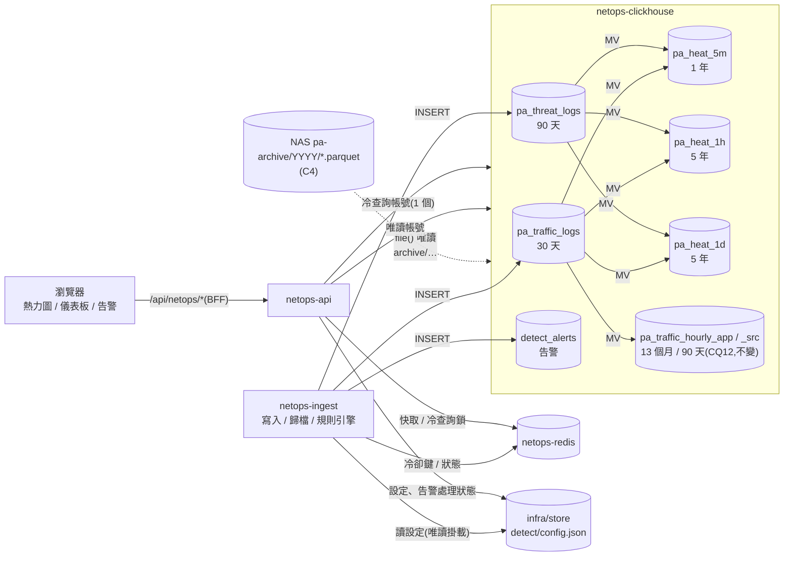

# NetOps 熱力圖、儀表板與偵測規則引擎設計(V-a–V-d)

> **狀態:規劃已合併(!70,2026-11-11);待決 X1–X16 已決定(全部照建議,§9),只剩 X11 網段清單與初始白名單待需求方提供**。需求方 2026-11-11 提出需求並做完 V1–V10 決策,本文件照那些決策寫成設計;決策記在 [ARCHITECTURE.md](ARCHITECTURE.md) D34–D41,工作項目見 [IMPL-PLAN.md](IMPL-PLAN.md) V-a–V-d,給 Gemini 的交接規格見 [HANDOFF-GEMINI-VIZ.md](HANDOFF-GEMINI-VIZ.md)。
> **API 正式定稿以 [API.md](API.md) 為準**:本文件 §4 只是設計,實作 MR 時才寫進 API.md(OpenAPI、`x-gherkin`、測試同步)。DDL 也一樣:本文件 §3 是設計,實作 MR 才進 `deploy/clickhouse/`。
> 前置:ClickHouse C2(寫入)已上測試區,C3(查詢切換)開發中;冷資料路由要等 C4(Parquet 冷歸檔)。ClickHouse 的通用設計(帳號、TTL 佔位符、去重、限流)沿用 [PA-LOG-CLICKHOUSE-GUIDE.md](PA-LOG-CLICKHOUSE-GUIDE.md),本文件只寫新增的部分。

---

## 目錄

1. [範圍與決策對照](#1-範圍與決策對照)
2. [架構總覽](#2-架構總覽)
3. [資料層(ClickHouse DDL)](#3-資料層clickhouse-ddl)
4. [API 設計](#4-api-設計)
5. [偵測規則引擎](#5-偵測規則引擎)
6. [前端:Claude / Gemini 分界與介面](#6-前端claude--gemini-分界與介面)
7. [效能與資源估算](#7-效能與資源估算)
8. [測試與驗收](#8-測試與驗收)
9. [待決事項](#9-待決事項)

---

## 1. 範圍與決策對照

### 1.1 這次做什麼

| 功能 | 第一版(PA) | 延後到 V-d(AD) |
| --- | --- | --- |
| GitHub 風格熱力圖(年 / 月 / 日三級,4 階色彩) | 指標:威脅等級、總流量、阻擋數 | 指標「AD 異常」(介面先預留) |
| 點格子:時段明細抽屜、下鑽、熱 / 冷自動路由 | PA TRAFFIC、威脅 | AD 事件 |
| 圖表儀表板(ECharts) | ① 流量總覽 ② 安全威脅 | ③ AD |
| 動畫 | 全部,支援 `prefers-reduced-motion` | — |
| 偵測規則引擎 + 告警頁 + 選單徽章 | 規則 1–7、冷卻、白名單、網段設定頁 | 規則 8、9 |
| 告警通知 Email | — | 第二版(V6,不在 V-a–V-d) |

### 1.2 需求方決策(2026-11-11)對照

| 決策 | 內容 | 本文件 | ARCHITECTURE |
| --- | --- | --- | --- |
| V1 | 每小時、每天彙總保留 5 年;每 5 分鐘保留 1 年;只存總數;Top 1 IP 用 `topK` 類聚合存進彙總 | §3.1–§3.3、§3.7 | D34 |
| V2 | 歸檔目錄維持 CQ14 `/mnt/nas-docker/giga-netops/{env}/pa-archive/YYYY/`;`file()` 只用相對 `user_files` 的路徑 | §4.3.3 | D35 |
| V3 | 冷資料一次最多 1 天;30 秒內同步,超過轉工作模式;全系統同時 1 個冷查詢,第 2 個回 429 | §4.3 | D35 |
| V4 | AD 延後,介面預留 | §4.2(`metric=ad`)、§5.8、IMPL-PLAN V-d | D36 |
| V5 | 網段與白名單做設定頁,只有 `netops-admin` 可改,存 `infra/store`;初始值由需求方提供 | §5.2 | D37 |
| V6 | 告警第一版只存紀錄 + 畫面(告警頁、選單徽章);Email 第二版;存哪裡由 Claude 設計 | §3.5、§5.6 | D38 |
| V7 | 規則 2 加 App 白名單 + IP 白名單,IT 網段預設排除 | §5.3 規則 2、§5.4 | D37 |
| V8 | 看:`netops-admin`、`netops-viewer`;改設定:只有 admin;即時連線按鈕只給 admin(依賴 C5) | §4.8 | D39 |
| V9 | 世界地圖打包進前端(國家層級簡化版),不連外部 CDN | §6.5 | D40 |
| V10 | 頁面組裝與動畫由 Gemini 負責;資料、API、規則引擎、`api/`、`composables/`、元件介面由 Claude | §6、HANDOFF-GEMINI-VIZ | D41 |

### 1.3 和需求原文不同的地方

| # | 需求原文 | 本設計 | 理由 |
| --- | --- | --- | --- |
| 1 | `GET /api/netops/heatmap?…&metric=threat\|traffic\|deny\|ad` | PA 指標用 **`GET /api/netops/pa/heatmap`**;AD 指標在 V-d 另開 `GET /api/netops/ad/heatmap`;前端 composable 依指標選 API,畫面看起來是同一個切換 | 一支路由只能有一個 `x-permission`(BACKEND-GUIDE §6.1):PA 用 `netops.pa.read`、AD 用 `netops.ad.read`,合在一起時只有 PA 權限的人也拿得到 AD 資料,或反過來;路徑也照既有 `/pa/*`、`/ad/*` 慣例 |
| 2 | `GET /api/netops/logs/slice?start=&end=` | **`GET /api/netops/pa/slice?start&end&type…`**,工作狀態 `GET /api/netops/pa/slices/{id}` | 同上:明細權限 PA `netops.pa-log.read` / AD `netops.ad-log.read` 分開 |
| 3 | 「≤ 30 天查熱表」 | TRAFFIC ≤ 29 天、威脅類 ≤ 89 天查熱表(§4.3.1);測試區依 TTL 縮短 | ClickHouse TTL:TRAFFIC 30 天、威脅類 90 天(CQ12);留 1 天緩衝避免查到正在被刪的那天 |
| 4 | 歸檔 `netops-archive` | `giga-netops/{env}/pa-archive/YYYY/` | V2(= CQ14) |
| 5 | 熱力圖以 ECharts 畫 | **熱力圖用 CSS Grid 元件**(`GHeatmap`);其他圖表用 ECharts | stagger 進場、hover 放大 1.25、毛玻璃 tooltip 用 DOM 元素做最簡單,371 格效能沒問題;ECharts heatmap 做不到逐格 CSS 動畫 |
| 6 | 前端已有 ECharts | **現在沒有**:`frontend/src/ui/charts/` 是自刻 SVG(`GAreaChart`、`GStackedBars` 等),`package.json` 沒有 `echarts` | 桑基圖、世界地圖、Treemap 自刻成本太高,新增 `echarts`(按需引入、只在儀表板路由載入,D40) |
| 7 | 規則引擎「每 1–5 分鐘聚合查詢」(沒說在哪個服務) | 放 **`netops-ingest`** | 單一實例、已有 ClickHouse 寫入帳號與 Redis;不佔 `netops-api` 的事件迴圈(D9、§5.1) |

---

## 2. 架構總覽



- 熱力圖與儀表板只讀彙總表;原始表只在「時段明細」與規則引擎用到,且範圍很小(一格最多 1 天,規則最多 15 分鐘)。
- 冷資料(超過熱表保留)只在「時段明細」用到;熱力圖本身永遠查彙總表,5 年內不會碰 NAS。

---

## 3. 資料層(ClickHouse DDL)

> 範例 DDL,實作時以 CI 整合測試(`check:ingest-int`)確認 26.3 的語法與型別。新表加在 `deploy/clickhouse/schema.sql`(`IF NOT EXISTS`、TTL 佔位符);改既有表寫 `migrations/003-*.sql`(可重複執行)。

### 3.1 熱力圖彙總表(V1:只存總數)

三張表結構相同,只有時間粒度與 TTL 不同:`pa_heat_5m`(`toStartOfFiveMinutes`)、`pa_heat_1h`(`toStartOfHour`)、`pa_heat_1d`(`toStartOfDay`,台北時區)。「只存總數」= 每個時間格一列,不分 App / 區域 / IP 維度;Top 1 IP 以 `topK` 聚合狀態存在同一列(§3.7)。

```sql
CREATE TABLE IF NOT EXISTS netops.pa_heat_5m
(
    bucket        DateTime('Asia/Taipei'),
    -- TRAFFIC
    sessions      SimpleAggregateFunction(sum, UInt64),
    bytes         SimpleAggregateFunction(sum, UInt64),
    bytes_sent    SimpleAggregateFunction(sum, UInt64),   -- 上傳(趨勢圖雙軸)
    bytes_recv    SimpleAggregateFunction(sum, UInt64),   -- 下載
    deny          SimpleAggregateFunction(sum, UInt64),   -- action != 'allow'(既有 API 的 block)
    -- 威脅(log_type = 'threat')依嚴重度
    thr_critical  SimpleAggregateFunction(sum, UInt64),
    thr_high      SimpleAggregateFunction(sum, UInt64),
    thr_medium    SimpleAggregateFunction(sum, UInt64),
    thr_low       SimpleAggregateFunction(sum, UInt64),
    thr_info      SimpleAggregateFunction(sum, UInt64),
    -- tooltip 的 Top 1 IP(近似,§3.7);各留 3 名,畫面只用第 1 名
    top_bytes_src AggregateFunction(topKWeighted(3), IPv6, UInt64),
    top_deny_src  AggregateFunction(topKIf(3), IPv6, UInt8),
    top_thr_src   AggregateFunction(topKIf(3), IPv6, UInt8)
)
ENGINE = AggregatingMergeTree
PARTITION BY toYYYYMM(bucket)
ORDER BY bucket
TTL bucket + INTERVAL {{TTL_HEAT_5M}} DELETE
SETTINGS non_replicated_deduplication_window = 1000;   -- 同 migration 002:重送去重

-- pa_heat_1h:同上,TTL {{TTL_HEAT_1H}};pa_heat_1d:同上,PARTITION BY toYear(bucket),TTL {{TTL_HEAT_1D}}
```

### 3.2 物化檢視(6 個:3 粒度 × TRAFFIC / 威脅)

每個粒度兩個 MV 寫進同一張表;沒寫到的欄位用預設值(0、空的聚合狀態),合併時加總。不串接(1h 不從 5m 來),三個粒度各自從原始表算,重建時互不相依。

```sql
CREATE MATERIALIZED VIEW IF NOT EXISTS netops.pa_heat_5m_traffic_mv TO netops.pa_heat_5m AS
SELECT
    toStartOfFiveMinutes(event_time)          AS bucket,
    count()                                   AS sessions,
    sum(bytes)                                AS bytes,
    sum(bytes_sent)                           AS bytes_sent,
    sum(bytes_recv)                           AS bytes_recv,
    countIf(action != 'allow')                AS deny,
    topKWeightedState(3)(src, bytes)          AS top_bytes_src,
    topKIfState(3)(src, action != 'allow')    AS top_deny_src
FROM netops.pa_traffic_logs
GROUP BY bucket;

CREATE MATERIALIZED VIEW IF NOT EXISTS netops.pa_heat_5m_threat_mv TO netops.pa_heat_5m AS
SELECT
    toStartOfFiveMinutes(event_time)          AS bucket,
    countIf(severity = 'critical')            AS thr_critical,
    countIf(severity = 'high')                AS thr_high,
    countIf(severity = 'medium')              AS thr_medium,
    countIf(severity = 'low')                 AS thr_low,
    countIf(severity = 'informational')       AS thr_info,
    topKIfState(3)(src, severity IN ('critical', 'high', 'medium')) AS top_thr_src
FROM netops.pa_threat_logs
WHERE log_type = 'threat'
GROUP BY bucket;
-- 1h / 1d 的 MV 只換 toStartOfHour / toStartOfDay 與目標表
```

- 威脅數算「筆數」,不乘 `repeat_count`(和安全事件頁一致;待決 X9)。
- url、data、wildfire 不算進威脅指標(安全事件頁另有各類型總覽)。
- 查詢一定要 `sum()` / `-Merge` + `GROUP BY bucket`(AggregatingMergeTree 只在背景合併),例如:

```sql
SELECT bucket, sum(bytes) AS bytes, sum(deny) AS deny, sum(thr_critical) AS c, sum(thr_high) AS h,
       topKWeightedMerge(3)(top_bytes_src) AS top_bytes, topKIfMerge(3)(top_thr_src) AS top_thr
FROM netops.pa_heat_1h
WHERE bucket >= {from:DateTime('Asia/Taipei')} AND bucket < {to:DateTime('Asia/Taipei')}
GROUP BY bucket ORDER BY bucket;
```

### 3.3 TTL 佔位符

| 佔位符 | 正式區 | 測試區(照既有慣例短 TTL) |
| --- | --- | --- |
| `{{TTL_HEAT_5M}}` | `1 YEAR`(V1) | `3 DAY` |
| `{{TTL_HEAT_1H}}` | `5 YEAR`(V1) | `3 DAY` |
| `{{TTL_HEAT_1D}}` | `5 YEAR`(V1) | `3 DAY` |
| `{{TTL_ALERT}}` | `1 YEAR`(建議,待決 X3) | `3 DAY` |

`apply-schema.sh` 加這 4 個佔位符,既有表 TTL 不同時一樣 `MODIFY TTL`。測試區 3 天只看得到日視圖與月 / 年的最後幾格;月、年視圖的版面在本機以假資料驗(§8),要不要讓測試區彙總表保留較久見待決 X4。

**和 CQ12 的差異(需求方 2026-11-11 改)**:CQ12 是「每小時彙總 13 個月、來源 IP 彙總 90 天」,對象是**分維度**的 `pa_traffic_hourly_app` / `_src`(儀表板用),這兩張表的 TTL **不變**。V1 新增的是**不分維度**的熱力圖彙總,保留 5 年(每小時、每天)與 1 年(每 5 分鐘)。分維度表要不要也延長見待決 X5。

### 3.4 既有表調整:`pa_traffic_hourly_src` 加上傳 / 下載(migration 003)

儀表板「Top 10 頻寬 IP 堆疊長條」要分上傳 / 下載,現有表只有 `bytes`:

```sql
ALTER TABLE netops.pa_traffic_hourly_src
    ADD COLUMN IF NOT EXISTS bytes_sent UInt64 DEFAULT 0 AFTER bytes,
    ADD COLUMN IF NOT EXISTS bytes_recv UInt64 DEFAULT 0 AFTER bytes_sent;
-- MV 改定義:先在整合測試確認 26.3 的 ALTER TABLE … MODIFY QUERY;不支援時改 DROP + CREATE,
-- 在 CI 停 netops-ingest 期間執行(Stream 有 1 小時緩衝,不漏)
ALTER TABLE netops.pa_traffic_hourly_src_mv MODIFY QUERY
SELECT toStartOfHour(event_time) AS hour, src, action, count() AS sessions,
       sum(bytes) AS bytes, sum(bytes_sent) AS bytes_sent, sum(bytes_recv) AS bytes_recv
FROM netops.pa_traffic_logs GROUP BY hour, src, action;
```

改之前的列上傳 / 下載為 0:實作時在原始表保留期間(30 天)內回填(§3.6),之後畫面不會有 0 的舊列。

### 3.5 告警表(V6)

```sql
CREATE TABLE IF NOT EXISTS netops.detect_alerts
(
    alert_id     UUID,
    created_at   DateTime64(3, 'Asia/Taipei'),
    rule_id      LowCardinality(String),         -- EXFIL_HIGH_UPLOAD …
    config_ver   UInt32,                         -- 觸發當時的設定版本(門檻見 metrics)
    severity     LowCardinality(String),         -- critical | high | medium | low
    window_start DateTime('Asia/Taipei'),
    window_end   DateTime('Asia/Taipei'),
    subject      String,                         -- 冷卻主體(IP 文字;規則 5 為 src|dst|threat;AD 階段為帳號)
    src          IPv6,                           -- 沒有時 '::'
    dst          IPv6,
    title        String,                         -- 中文摘要,例:10.10.112.20 15 分鐘對外上傳 1.4 GB
    metrics      String,                         -- JSON:實測值與門檻、Top 目的、App 等
    tags         Array(LowCardinality(String)),  -- 'c2-suspect'、'partial-data' …
    suppressed   UInt32                          -- 上一則告警之後,冷卻期間被略過的次數
)
ENGINE = MergeTree
PARTITION BY toYYYYMM(created_at)
ORDER BY (created_at, rule_id)
TTL toDateTime(created_at) + INTERVAL {{TTL_ALERT}} DELETE
SETTINGS non_replicated_deduplication_window = 1000;
```

**為什麼存 ClickHouse**(V6 要求說明理由):

| 選項 | 優點 | 缺點 | 結論 |
| --- | --- | --- | --- |
| **ClickHouse `detect_alerts`**(採用) | 告警是時間序列,依時間 / 規則 / IP 篩選、和原始 log 對照都在同一處;`netops-ingest` 已有寫入帳號;TTL 自動清;量小(預估每天 < 1,000 筆) | 不能改列 → 處理狀態另存 | ✅ |
| `infra/store` JSON 檔 | 不動 ClickHouse 範圍 | 規則引擎在 `netops-ingest`,兩個容器寫同一個檔要鎖;依時間範圍查詢要自己做索引 | — |
| Redis | 讀寫快 | 2 GB 上限給 log Stream 用;不是持久儲存(只開 RDB) | — |

**處理狀態**(確認 / 結案,§5.6)由 `netops-api` 存 `infra/store`(`detect/alert-state.json`,依告警 id),不給 `netops-api` ClickHouse 寫入權限(維持 D27「`netops-api` 用唯讀帳號」)。告警表是 ClickHouse 範圍的擴大(AGENT §7.2「擴大範圍先由需求方決定」):V6 已授權由 Claude 設計,仍列待決 X2 請需求方確認;實作 MR 同步改 AGENT §0、§7.2。

### 3.6 回填、補漏與去重

| 情況 | 做法 |
| --- | --- |
| 上線時 | MV 只處理建立之後的寫入;用 `INSERT INTO pa_heat_* SELECT …(-State)… FROM pa_traffic_logs / pa_threat_logs` 回填原始表還有的範圍(正式區最多 30 / 90 天)。更早的歷史要不要回填見待決 X6 |
| C3 的 FTP 補漏(手冊 §11.3) | 重建每小時彙總的步驟**加上三張熱力圖表與 `_src` 表**:`ALTER TABLE … DELETE WHERE bucket` 範圍 → 等 mutation → 從原始表 `INSERT … SELECT`(手動重建帶 `insert_deduplicate = 0`,同 migration 002 說明) |
| 超過原始表保留 | 熱力圖彙總不能再重建,以當時的值為準;畫面以 `coverage.gaps`(§4.2)標示有缺口的時段 |
| 重送 | 目標表都有去重視窗;`netops-ingest` 已帶 `deduplicate_blocks_in_dependent_materialized_views=1`(C2) |

`dedupe-day.sh` 與 C3 的補漏程式要同步列入熱力圖表(V-a 步驟)。

### 3.7 Top 1 IP 的可得性(V1 要求說明)

| 項目 | 說明 |
| --- | --- |
| 存在哪 | 每個時間格的 `top_*_src` 聚合狀態,和總數同一列 |
| 保留 | 和該粒度相同:5 分鐘格 1 年、每小時與每天格 5 年;**原始 log 刪掉(30 / 90 天)後仍然查得到** |
| 準確度 | `topK` 是近似演算法(Filtered Space-Saving),每個寫入批次各自算再合併;第 1 名通常正確,但**不保證**,畫面一律標「約」。要精確值時點格子開時段明細(熱資料精確;冷資料依歸檔) |
| 三種 Top 1 | 流量:依位元組加權(`topKWeighted`);阻擋:依阻擋筆數;威脅:依 critical / high / medium 筆數 |
| 沒有值 | 該格沒有對應事件時是空陣列,畫面顯示「—」 |

---

## 4. API 設計

> 對外路徑 `/api/netops/...`(後端 `/v1/...`);通用規則照 [API.md](API.md) §1(錯誤格式、時間 `+08:00`、工作模式、分頁)。

### 4.1 總表

| 方法 | 路徑 | 權限 | 稽核 | 逾時 | 階段 |
| --- | --- | --- | --- | --- | --- |
| GET | `/api/netops/pa/heatmap` | `netops.pa.read` | — | 預設 | V-a |
| GET | `/api/netops/pa/slice` | `netops.pa-log.read` | `meta` | **40000 ms** | V-a(冷路由:C4 後) |
| GET | `/api/netops/pa/slices/{id}` | `netops.pa-log.read` | `meta` | 預設 | V-a |
| DELETE | `/api/netops/pa/slices/{id}` | `netops.pa-log.read` | — | 預設 | V-a |
| GET | `/api/netops/pa/insight/traffic` | `netops.pa.read` | — | 預設 | V-b1 |
| GET | `/api/netops/pa/insight/threat` | `netops.pa.read` | — | 預設 | V-b1 |
| GET | `/api/netops/alerts` | `netops.alert.read` | — | 預設 | V-c |
| GET | `/api/netops/alerts/summary` | `netops.alert.read` | — | 預設 | V-c |
| GET | `/api/netops/alerts/{id}` | `netops.alert.read` | — | 預設 | V-c |
| PUT | `/api/netops/alerts/{id}/status` | `netops.alert.write` | `body` | 預設 | V-c |
| GET | `/api/netops/detect/config` | `netops.detect.read` | — | 預設 | V-c |
| PUT | `/api/netops/detect/config` | `netops.detect.write` | `body` | 預設 | V-c |
| GET | `/api/netops/detect/status` | `netops.detect.read` | — | 預設 | V-c |
| GET | `/api/netops/ad/heatmap`、`/ad/slice`、`/ad/insight` | `netops.ad.read` / `netops.ad-log.read` | — / `meta` | — | V-d(預留) |

「查詢該 IP 當下 PA 即時連線」不新增 API:呼叫 C5 的 PA 精準查詢 / Session Browser(`netops.pa-query.read`,只給 admin,CQ7)。

快取:都用 D32 的 Redis `netops:cache:*`(只經 `infra/redis`,都有 TTL),不用 BFF `x-cache-ttl`(要能在補漏後主動清除)。

### 4.2 `GET /api/netops/pa/heatmap`

| 參數 | 值 | 說明 |
| --- | --- | --- |
| `granularity` | `year` \| `month` \| `day` | 必填 |
| `metric` | `threat` \| `traffic` \| `deny` \| `ad` | 必填;`ad` 在 V-d 前回 409 `NETOPS_HEATMAP_METRIC_UNAVAILABLE`(V-d 起改用 `/ad/heatmap`) |
| `date` | `YYYY-MM-DD` | 預設今天。`year`:以該日所在週為最後一欄往前 53 週;`month`:該日所在月;`day`:該日 |

| 粒度 | 格子 | 來源 | 可查範圍 |
| --- | --- | --- | --- |
| `year` | 53 週 × 7 天(最多 371 格,今天之後的格不回) | `pa_heat_1d` | 5 年 |
| `month` | 28–31 天 × 24 小時 | `pa_heat_1h` | 5 年 |
| `day` | 24 小時 × 12 個 5 分鐘 | `pa_heat_5m` | **1 年**(V1);超過回 422 `NETOPS_HEATMAP_OUT_OF_RETENTION`,`details.earliest` 給最早可查日 |

```jsonc
{
  "granularity": "month", "metric": "traffic", "date": "2026-11-11",
  "from": "2026-11-01T00:00:00+08:00", "to": "2026-12-01T00:00:00+08:00", "bucketSeconds": 3600,
  "coverage": {                         // 資料完整度(AGENT §5:沒有資料不等於沒有發生)
    "since": "2026-11-10T15:02:00+08:00",   // 彙總表最早的資料;更早的格子 v = null(不是 0)
    "gaps": [ { "from": "2026-11-10T13:00:00+08:00", "to": "2026-11-10T14:00:00+08:00", "reason": "ingest-gap" } ]
  },
  "levels": { "method": "quantile", "thresholds": [120000000, 480000000, 1500000000] },  // level 2–4 的下限(level 1 = > 0)
  "cells": [
    {
      "t": "2026-11-11T08:00:00+08:00",
      "v": 2345678901,                  // 依 metric:traffic = bytes、deny = 筆數、threat = 加權分數;null = 沒有資料
      "level": 4,                       // 0–4
      "partial": false,                 // 落在 coverage.gaps 內
      "tip": {
        "bytes": 2345678901, "sessions": 412345, "deny": 3120,
        "threats": { "critical": 0, "high": 2, "medium": 5, "low": 11, "info": 40 },
        "topIp": { "traffic": "10.10.112.20", "deny": "10.10.113.7", "threat": "10.10.112.31" }  // 近似,畫面標「約」
      }
    }
  ],
  "generatedAt": "2026-11-11T09:12:00.000Z"
}
```

`coverage.gaps` 來源:C3 的 FTP 對帳缺口(手冊 §11.2 `pa_gap_log`)與 `netops-ingest` 的缺口偵測;C3 沒提供前回空陣列並在 `coverage.gapsKnown = false` 標示「未檢查」。

**分級規則**(4 階色彩 + 0 = 空格):

| 指標 | `v` | `level` |
| --- | --- | --- |
| `traffic` | 位元組 | 本視圖非 0 格的 25 / 50 / 75 百分位當門檻(GitHub 做法;`levels.method = quantile`) |
| `deny` | 非 allow 筆數 | 同上 |
| `threat` | 加權分數 `10×critical + 5×high + 2×medium + 1×low`(info 0) | **依最高嚴重度**:critical 4、high 3、medium 2、low / info 1(`levels.method = severity`)。權重見待決 X8 |

**快取**:`netops:cache:heat:{granularity}:{metric}:{from}`;含「現在」的視圖 60 秒,已結束的期間 1 小時;補漏重建彙總後刪除對應鍵。年視圖約 371 格 × 300 bytes ≈ 110 KB。

### 4.3 `GET /api/netops/pa/slice`(時段明細,熱 / 冷自動路由)

| 參數 | 說明 |
| --- | --- |
| `start`、`end` | ISO 8601 含時區;`end - start` ≤ **1 天**(V3,熱冷都一樣;一格最大就是 1 天),超過 400 |
| `type` | `traffic`(預設)\| `threat` |
| 篩選(選填) | `ip`(單一 IP,比對 src / dst)、`src`、`dst`、`app`、`fromZone`、`toZone`、`dport`、`action`(`allow` \| `block`)、`country`、`severity`、`threatName`;IP 只接受 IP / CIDR(不接受萬用字元,沿用手冊 §7.4 的 BETWEEN 做法) |
| `rows` | 明細列數 0–200(預設 100);全部明細請用既有 Log 明細查詢(畫面帶同樣條件開啟) |
| `sort` | `time`(預設,新到舊)\| `bytes` |

#### 4.3.1 路由規則

```text
hotFloor(type) = 今天 00:00 −(該類型原始表 TTL 天數 − 1)   // TRAFFIC 30→29 天、威脅 90→89 天;測試區 3→2 天
start ≥ hotFloor            → 熱:ClickHouse 原始表(netops_reader)
end ≤ hotFloor              → 冷:Parquet(netops_cold,file())
跨 hotFloor                 → 拆成熱的那段 + 冷的那段,合併回應(source = "mixed";冷的那段照冷查詢規則)
```

- TTL 天數由同一個設定提供給 `apply-schema.sh` 與 `netops-api`(實作時新增 `NETOPS_TTL_TRAFFIC_DAYS` / `_THREAT_DAYS`,或 `netops-api` 啟動時讀 `system.tables` 的 TTL),不在兩處各寫一次。
- 冷路由要 C4 完成,且 **CQ3 決定歸檔原始 log**。如果 CQ3 走「只歸檔每小時彙總」,冷資料沒有明細:回 409 `NETOPS_COLD_DETAIL_UNAVAILABLE`,抽屜只顯示熱力圖彙總(待決 X1)。
- 冷路由在 C4 之前(或 `NETOPS_ARCHIVE_ENABLED=0`):回 409 `NETOPS_COLD_ARCHIVE_DISABLED`(設定狀態,不用 5xx)。

#### 4.3.2 同步 30 秒,超過轉工作模式(V3、D6)

```mermaid
sequenceDiagram
    participant U as 瀏覽器
    participant A as netops-api
    participant R as Redis
    participant C as ClickHouse
    U->>A: GET /pa/slice?start&end…
    alt 冷資料且已有冷查詢
        A->>R: SET netops:cold:lock NX PX 120000
        R-->>A: 失敗
        A-->>U: 429 NETOPS_COLD_QUERY_BUSY + Retry-After
    end
    A->>C: 查詢(建立 pa-slice 工作;同一人同條件重用)
    alt 30 秒內完成
        A-->>U: 200 結果
    else 超過 30 秒
        A-->>U: 202 工作狀態(id)
        U->>A: GET /pa/slices/{id}(每 1.5 秒)
        A-->>U: done → result
    end
    A->>R: 工作結束時釋放冷查詢鎖
```

- 一律以 `infra/jobs` 建立 `pa-slice` 工作再等它:30 秒內完成直接回 200 結果;沒完成回 **202** + 工作狀態(格式同 API.md §1.1),查詢在背景繼續。路由 `x-timeout-ms: 40000`(同步等 30 秒 + 餘裕),不會撞到 BFF 逾時。
- **GET 的冪等**:同一人、同一組參數在工作保留期間(30 分鐘)重送,回同一個工作(進行中回 202、完成回 200),不重複查詢;不改任何業務資料。
- 工作:本人可查 / 取消;每人同時 2 個、全系統 6 個(和既有明細查詢分開計);執行上限 120 秒(`max_execution_time` 110 秒)。
- **冷查詢全系統同時 1 個**(V3):Redis 鎖 `netops:cold:lock`(值 = 工作 id,TTL 120 秒,工作結束釋放);拿不到回 **429** `NETOPS_COLD_QUERY_BUSY`,`Retry-After: 10`,不回 5xx(BFF 斷路器)。同一人同條件已在跑時回那個工作,不算第 2 個。C4 的冷 Log 明細查詢(手冊 §8.5)**共用同一把鎖**;每天 02:30 歸檔匯出期間冷查詢也回 429(§7.3)。
- 熱查詢不受冷查詢鎖限制;同條件 60 秒內重送直接回快取(`netops:cache:slice:*`)。

#### 4.3.3 冷查詢(V2)

```sql
-- netops_cold 帳號;路徑相對 user_files(NAS 唯讀掛在 user_files/archive);絕對路徑會被拒絕
SELECT …
FROM file({path:String}, 'Parquet')          -- path 由程式組:archive/2026/pa_traffic_2026-10-01.parquet
WHERE event_time >= {start:DateTime} AND event_time < {end:DateTime} AND …
SETTINGS max_threads = 1, max_execution_time = 110, max_memory_usage = 500000000
```

- 一格最多讀 1 個檔(日 / 月 / 年格都對齊台北時區的日界);手動輸入跨午夜的區間最多 2 個檔。檔名只由驗證過的日期組成,`archive/` 前綴寫死(V2:`file()` 只能用相對 `user_files` 的路徑)。實作時確認 `file()` 的路徑參數可用 `query_params`;不行時由程式以白名單格式(`archive/YYYY/pa_(traffic|threat)_YYYY-MM-DD.parquet`)驗證後組字串。
- 檔案不存在(還沒歸檔、超過冷保留、NAS 沒掛上):回 404 `NETOPS_ARCHIVE_NOT_FOUND`,`message` 說明哪一天沒有歸檔;不回空結果。
- 冷資料的 IP 已是文字(手冊 §8.4),條件直接比字串。

#### 4.3.4 回應

```jsonc
{
  "source": "hot",                       // hot | cold | mixed → 畫面徽章「⚡ 即時熱資料」/「🧊 歷史冷歸檔」
  "type": "traffic", "start": "…", "end": "…", "filters": { "ip": "10.10.112.20" },
  "summary": { "sessions": 41234, "bytes": 2345678901, "sent": 1234567, "recv": 2344444334, "deny": 312,
               "threats": { "critical": 0, "high": 2, "medium": 5, "low": 11, "info": 40 } },
  "top": {                                // 各 Top 10;type=threat 時為 name / severity / src / dst / srcCountry
    "src": [ { "key": "10.10.112.20", "sessions": 1200, "bytes": 1300000000 } ],
    "dst": [], "app": [], "dport": [], "dstCountry": []
  },
  "rows": [ /* 欄位同 API.md §4.3 rows */ ], "rowsLimit": 100, "rowsTruncated": true,
  "coverage": { "partial": false, "gaps": [] },
  "seconds": 0.8
}
```

### 4.4 `GET /api/netops/pa/insight/{traffic|threat}`(儀表板)

一個視角一支 API,一次回該視角全部圖表的資料(畫面一個請求,快取一份)。參數 `from`、`to`(`YYYY-MM-DD`,含當天),**最長 90 天**(來源 IP 彙總 90 天、威脅原始 90 天;超過 400)。

| 視角 | 圖表 | 欄位 | 來源 |
| --- | --- | --- | --- |
| traffic | 上傳 / 下載 + Session 雙軸趨勢 | `trend: [{ t, sent, recv, sessions }]`;≤ 2 天每 5 分鐘、≤ 31 天每小時、其他每天(`bucketSeconds`) | `pa_heat_*` |
| traffic | Zone → App → 目的區域桑基圖 | `sankey: { nodes: [{ id, name, layer }], links: [{ source, target, bytes }] }`;App 取前 15,其他併「其他」 | `pa_traffic_hourly_app` |
| traffic | Top 10 頻寬 IP 堆疊長條 | `topIp: [{ ip, sent, recv, sessions }]` | `pa_traffic_hourly_src`(§3.4) |
| traffic | Top 10 App 甜甜圈 / Treemap | `topApp: [{ app, bytes, sessions }]`(同一份資料,畫面切換) | `pa_traffic_hourly_app` |
| traffic | 每小時 Allow vs Deny 堆疊柱 | `allowDeny: [{ t, allow, deny }]`(期間 > 2 天時改每天) | `pa_heat_*` |
| threat | 嚴重度計分卡 | `score: { critical, high, medium, low, info, prev: {…} }`(`prev` = 前一個同長度期間,算增減) | `pa_heat_*` |
| threat | 威脅堆疊時序 | `timeline: [{ t, critical, high, medium, low }]` | `pa_heat_*` |
| threat | 國家 Top 10 + 地圖 | `countries: [{ country, iso2, count, critical, high }]`(全部國家給地圖,畫面取前 10) | `pa_threat_logs` |
| threat | 發起威脅最多內網 IP vs 被攻擊最多伺服器 | `topInternalSrc: [{ ip, count, high }]`、`topServerDst: [{ ip, count, high }]` | `pa_threat_logs` + 網段設定 |
| threat | Top 10 威脅名稱 | `topNames: [{ name, severity, count }]` | `pa_threat_logs` |

- 國家:PA 的 `src_country` 是英文全名(內網為 `10.0.0.0-10.255.255.255` 這類範圍字串);後端轉 ISO 3166-1 alpha-2(`iso2`),對不到的歸「未知」,內網範圍不列入。對照表放後端(`modules/pa-insight/countries.ts`)。
- 「內網 IP」「伺服器」用網段設定(§5.2);還沒設定時內網用 RFC 1918 判斷、伺服器排行回 `null` 並帶 `notes: ["尚未設定伺服器網段"]`。
- 每個回應都帶 `coverage`(同 §4.2),期間內有缺口時畫面提示。
- 快取 `netops:cache:insight:{view}:{from}:{to}`:含今天 60 秒,過去期間 10 分鐘。

### 4.5 告警 API

| 路徑 | 說明 |
| --- | --- |
| `GET /alerts?from&to&rule&severity&status&ip&page&pageSize` | 依時間新到舊;`from` / `to` 最長 92 天;`status`:`open` \| `acked` \| `closed`(省略 = 全部)。回 `{ items, total, page, pageSize }` |
| `GET /alerts/summary` | 選單徽章:`{ open, openBySeverity: { critical, high, medium, low }, last24h, latestAt }`;`open` = 最近 7 天未處理(待決 X7)。快取 15 秒,前端每 60 秒輪詢 |
| `GET /alerts/{id}` | 單筆,含 `metrics`、`tags`、處理紀錄、`evidence: { start, end, ip, type }`(畫面用來開時段明細) |
| `PUT /alerts/{id}/status` | `{ status: "acked" \| "closed" \| "open", note? }`(note ≤ 500 字);冪等;記錄 `emp`、`name`、時間 |

```jsonc
// GET /alerts 的 items[]
{ "id": "…uuid…", "createdAt": "2026-11-11T09:05:02.123+08:00", "rule": "EXFIL_HIGH_UPLOAD", "ruleName": "大量對外上傳",
  "severity": "high", "windowStart": "…", "windowEnd": "…", "src": "10.10.112.20", "dst": null,
  "title": "10.10.112.20 15 分鐘對外上傳 1.4 GB(門檻 1 GB)", "tags": [], "suppressed": 2,
  "status": "open", "statusBy": null, "statusAt": null }
```

### 4.6 偵測設定 API

- `GET /detect/config` → 設定全文(§5.2)+ `version`;`ETag: "<version>"`。
- `PUT /detect/config` → 全文取代;必須帶 `If-Match: "<version>"`,版本不同回 409 `NETOPS_DETECT_CONFIG_CONFLICT`(畫面提示重新載入);驗證失敗 400 `VALIDATION_FAILED`(`details` 指出哪一欄)。保留最近 50 個版本(`detect/history/`),稽核 `body`。
- `GET /detect/status` → 每條規則 `{ rule, enabled, state: ok|deferred|error|disabled, reason, lastRunAt, lastWindow, lastHits, lastMs }`(Redis `netops:detect:status`,`netops-ingest` 寫)。

### 4.7 新增錯誤代碼

| HTTP | 代碼 | 說明 |
| --- | --- | --- |
| 409 | `NETOPS_HEATMAP_METRIC_UNAVAILABLE` | 指標尚未開放(`ad`,V-d) |
| 422 | `NETOPS_HEATMAP_OUT_OF_RETENTION` | 日視圖超過 5 分鐘彙總保留(1 年);`details.earliest` |
| 409 | `NETOPS_COLD_ARCHIVE_DISABLED` | 冷歸檔未啟用(C4 前、測試區預設關閉) |
| 409 | `NETOPS_COLD_DETAIL_UNAVAILABLE` | 冷歸檔只有彙總、沒有明細(CQ3 走彙總時) |
| 404 | `NETOPS_ARCHIVE_NOT_FOUND` | 該日沒有歸檔檔案 |
| 429 | `NETOPS_COLD_QUERY_BUSY` | 已有冷查詢在執行(全系統 1 個)或歸檔匯出中;帶 `Retry-After` |
| 404 | `NETOPS_ALERT_NOT_FOUND` | 告警不存在或已超過保留 |
| 409 | `NETOPS_DETECT_CONFIG_CONFLICT` | 設定已被別人修改(版本不同) |
| 424 | `NETOPS_CLICKHOUSE_UNAVAILABLE` | 既有代碼(C2 / C3):ClickHouse 連不上,不用 5xx |

工作失敗沿用 `NETOPS_JOB_TIMEOUT` 等既有代碼;進行中工作超量沿用 409 `NETOPS_JOB_LIMIT_EXCEEDED`。

### 4.8 權限代碼與畫面節點(V8;要登記的清單)

**API 權限**(`netops-api` 啟動時以 OpenAPI `x-permissions` 自動註冊):

| 代碼 | 名稱 | 狀態 | admin | viewer |
| --- | --- | --- | --- | --- |
| `netops.pa.read` | PA 防火牆:查詢 | 既有 | ✅ | ✅ |
| `netops.pa-log.read` | PA Log 明細:查詢 | 既有 | ✅ | ✅ |
| `netops.pa-query.read` | PA 精準查詢 | 既有規劃(C5,CQ7) | ✅ | ❌ |
| `netops.alert.read` | 偵測告警:查詢 | **新增** | ✅ | ✅ |
| `netops.alert.write` | 偵測告警:處理(確認 / 結案) | **新增** | ✅ | ❌ |
| `netops.detect.read` | 偵測設定:查詢 | **新增** | ✅ | ✅(待決 X10) |
| `netops.detect.write` | 偵測設定:修改規則門檻 / 網段 / 白名單 | **新增** | ✅ | ❌ |

**畫面節點**(`deploy/gateway-rbac.yaml`,實作 MR 時登記;節點 → `includes` API 權限):

```text
netops.app.access
├─ netops.group.firewall                    防火牆 PA-560(既有)
│  ├─ netops.pa-heatmap.read      (menu)    活動熱力圖     includes [netops.pa.read, netops.pa-log.read]
│  │  └─ netops.pa-heatmap.query  (button)  查詢即時連線   includes [netops.pa-query.read]   ← 只給 admin,C5 後
│  └─ netops.pa-insight.read      (menu)    分析儀表板     includes [netops.pa.read, netops.pa-log.read]
│     └─ netops.pa-insight.query  (button)  查詢即時連線   includes [netops.pa-query.read]   ← 只給 admin,C5 後
└─ netops.group.detect            (group)   偵測告警(新增;icon shield-alert,已在 ui/icons.ts)
   ├─ netops.alerts.read          (menu)    告警           includes [netops.alert.read]
   │  └─ netops.alerts.manage     (button)  確認 / 結案    includes [netops.alert.write]     ← 只給 admin
   └─ netops.detect-settings.read (menu)    偵測設定       includes [netops.detect.read]
      └─ netops.detect-settings.manage (button) 修改設定   includes [netops.detect.write]    ← 只給 admin
```

- 命名照既有慣例:選單節點 `netops.<頁>.read`、按鈕 `netops.<頁>.<動作>`、API 權限 `netops.<資源>.read|write`;選單只綁 `.read`,寫入由按鈕綁定(BACKEND-GUIDE §6.1)。已查 ARCHITECTURE §5、API.md §2、`deploy/gateway-rbac.yaml`:上列新代碼都沒有出現過,不重複。
- 告警在新目錄 `netops.group.detect`:V-d 的 AD 規則也進同一頁,不放在防火牆目錄下。
- **跨 repo 待辦(本 MR 不改)**:Gateway 不需要改程式,`netops.*` 由 NetOps 的 `gateway-rbac.yaml` 與 OpenAPI 登記(D1 起的做法)。實作 MR 時確認 Gateway 的 `gw-super-admin` 是否涵蓋 `netops.*` 新代碼(D1 由 Gateway !21 補過);若要逐一列舉,另開 Gateway MR 並先取得同意。
- 「查詢即時連線」按鈕在 C5 完成前不登記(登記了也沒有 API 可用)。

---

## 5. 偵測規則引擎

### 5.1 執行位置與排程

| 項目 | 設計 |
| --- | --- |
| 服務 | `netops-ingest` 內的 `modules/detect`(同映像不同進入點,單一實例;D28) |
| 帳號 | 查詢用 `netops_reader`(唯讀、constraints 固定上限);寫告警用既有 `netops_writer`(加 `INSERT ON netops.detect_alerts`)。不新增帳號;`netops-ingest` 多掛 reader 的密碼檔(機密腳本由需求方執行) |
| 排程 | 每分鐘第 20 秒跑一輪;每條規則依自己的 `intervalMin`(1 或 5)決定這輪要不要評估;同一時間只有一輪(上一輪沒結束就跳過並記 `deferred`) |
| 時間窗 | 評估 `[we − windowMin, we)`,`we` = 對齊到 `intervalMin` 的時間 − **延遲 2 分鐘**(等 Syslog / HTTP 寫入)。每條規則記水位 `netops:detect:wm:{rule}`,漏掉的窗(重啟、ClickHouse 停機)下一輪補,每輪最多補 6 個窗、最多回補 60 分鐘 |
| 資料新鮮度 | 評估前確認 `netops-ingest` 已寫到 `we` 之後(TRAFFIC / 威脅各自的最後寫入事件時間;C2 心跳沒有時 V-c 補上);沒寫到就延後(`deferred`),延後超過 10 分鐘仍評估,告警加 `partial-data` 標記(不靜默略過,AGENT §5) |
| 每輪上限 | 每個查詢 `max_execution_time` 20 秒、`max_memory_usage` 300 MB;一輪總預算 40 秒;每條規則一窗最多產生 50 則告警(超過記在 `status.reason`) |
| 設定 | 每輪開始讀 `infra/store` 的 `detect/config.json`(版本變了才重新解析);`netops-ingest` 唯讀掛載資料目錄。設定檔不合法時沿用上一版並記 `error` |

### 5.2 設定模型(V5;`infra/store` → `detect/config.json`)

```jsonc
{
  "version": 12,
  "updatedAt": "2026-11-11T09:00:00Z", "updatedBy": { "emp": "S112009", "name": "…" },
  "networks": {                      // 初始值:待需求方提供網段清單(待決 X11);下面的值只是格式範例
    "internal": ["10.10.0.0/16"],    // 內網
    "servers":  [],                  // 伺服器群
    "itAdmin":  [],                  // IT 管理網段
    "employee": []                   // 員工網段
  },
  "whitelist": {
    "ip":  [ { "cidr": "10.10.130.124/32", "rules": ["*"], "note": "範例" } ],
    "app": [ { "app": "rustdesk", "rules": ["UNAUTH_APP_OR_BW_SPIKE"], "note": "公司正式使用(V7)" } ]
  },
  "cooldownMin": 30,
  "rules": {
    "EXFIL_HIGH_UPLOAD": { "enabled": true, "severity": "high", "intervalMin": 5, "windowMin": 15,
                           "params": { "sentBytesGt": 1073741824 } }
    // 其他規則見 §5.3;每條的 params 有上下限,超過 400
  }
}
```

- 驗證:CIDR 只接受 IPv4 / IPv6 標準寫法;每個網段清單、白名單各 ≤ 200 筆;`rules` 只接受 §5.3 的代碼或 `*`;`note` ≤ 100 字;門檻在上下限內;`intervalMin` ∈ {1, 5};`windowMin` ≤ 60;`cooldownMin` 5–1440。
- 寫入:`netops-api` 經 `infra/store` 的具名函式(`loadDetectConfig`、`saveDetectConfig`),先寫暫存檔再改名(原子),同時寫 `detect/history/{version}.json`。
- **網段沒設定時**:需要該網段的規則狀態為 `disabled`、`reason: 尚未設定 <網段>`,不用預設值硬跑(待決 X11)。

### 5.3 規則 1–7(PA)

共同條件:`src` 不在 IP 白名單(依規則範圍);網段條件由程式把 CIDR 轉成起訖位址,組成 `(src BETWEEN {n0a:IPv6} AND {n0b:IPv6} OR …)`,參數名由程式產生、值走 `query_params`(手冊 §7.4,不拼字串)。下表「條件」裡的數字是初始門檻(需求原文),之後由 admin 在設定頁改。

| # | 代碼 | 間隔 / 窗 | 條件 | 主體(冷卻鍵) | 預設嚴重度 |
| --- | --- | --- | --- | --- | --- |
| 1 | `EXFIL_HIGH_UPLOAD` | 5 / 15 分 | `src ∈ internal`、`dst ∉ internal`;`sum(bytes_sent) > 1 GB` | src | high |
| 2 | `UNAUTH_APP_OR_BW_SPIKE` | 5 / 5 分 | `src ∈ internal`,**預設排除 `itAdmin`**(V7,`params.excludeItAdmin = true`);(a)`sum(bytes) > 5 GB` 或(b)`app ∈ apps`(`bittorrent`、`tor`、`teamviewer`、`anydesk`;實際 App-ID 名稱待確認,X12),扣掉 App 白名單 | src(`bw` 與 `app:<名稱>` 分開冷卻) | (a) high、(b) medium |
| 3 | `INTERNAL_PORT_HOST_SWEEP` | 1 / 1 分 | `src`、`dst` 都 ∈ internal;`uniqExact(dst) > 30` 或任一 `dst` 的 `uniqExact(dport) > 50` | src | high |
| 4 | `SENSITIVE_PORT_PROBE` | 5 / 5 分 | `src ∉ itAdmin`、`dst ∈ servers`、`dport ∈ {22, 3389, 9443, 1433}`、`action != 'allow'`;`count() > 5` | src | medium |
| 5 | `PA_CRITICAL_HIGH_THREAT` | 1 / 1 分 | `pa_threat_logs`:`log_type = 'threat'`、`severity ∈ {critical, high}`;`src ∈ internal` 且 `dst ∉ internal` 時加標記 `c2-suspect`(畫面「疑似 C2(內→外)」) | src \| dst \| 威脅名稱 | 照 PA severity |
| 6 | `FIREWALL_DENY_SPIKE` | 5 / 5 分 | `src ∈ internal`、`action != 'allow'`;`count() > 500` | src | medium |
| 7 | `OFF_HOURS_ANOMALY` | 5 / 累計 | 台北時間 01:00–05:00(`params.from` / `to` 可改);`src ∈ employee`、`dst ∉ internal`;**當晚 01:00 起累計** `sum(bytes) > 500 MB` | src + 日期(**每晚一次**,冷卻到 06:00) | medium |
| 8 | `AD_BRUTE_FORCE_SPRAY` | — | **V-d**(§5.8) | 帳號 / 來源 IP | — |
| 9 | `AD_ACCOUNT_LOCKOUT_OR_PRIV` | — | **V-d**(§5.8) | 帳號 | — |

範例(規則 1、3):

```sql
-- 規則 1:EXFIL_HIGH_UPLOAD({INTERNAL_SRC} 等由程式依網段設定產生 BETWEEN 條件,值都是 query_params)
SELECT replaceRegexpOne(toString(src), '^::ffff:', '') AS ip,
       sum(bytes_sent) AS sent, count() AS sessions,
       topKWeighted(3)(replaceRegexpOne(toString(dst), '^::ffff:', ''), bytes_sent) AS top_dst,
       topK(3)(app) AS top_app
FROM netops.pa_traffic_logs
WHERE event_time >= {ws:DateTime('Asia/Taipei')} AND event_time < {we:DateTime('Asia/Taipei')}
  AND ({INTERNAL_SRC}) AND NOT ({INTERNAL_DST}) AND NOT ({WL_SRC})
GROUP BY src
HAVING sent > {sentBytesGt:UInt64}
ORDER BY sent DESC
LIMIT 50
SETTINGS max_execution_time = 20;

-- 規則 3:INTERNAL_PORT_HOST_SWEEP
SELECT src, uniqExact(dst) AS hosts, max(ports) AS max_ports, argMax(dst, ports) AS port_target
FROM (
    SELECT src, dst, uniqExact(dport) AS ports
    FROM netops.pa_traffic_logs
    WHERE event_time >= {ws:DateTime('Asia/Taipei')} AND event_time < {we:DateTime('Asia/Taipei')}
      AND ({INTERNAL_SRC}) AND ({INTERNAL_DST}) AND NOT ({WL_SRC})
    GROUP BY src, dst
)
GROUP BY src
HAVING hosts > {hostsGt:UInt32} OR max_ports > {portsGt:UInt32}
LIMIT 50;
```

已知限制(寫進設定頁說明):

- TRAFFIC 在 **session 結束時**才記錄,長連線的位元組全部算在結束那一刻;規則 1、2、7 可能比實際發生時間晚觸發。
- PA 時鐘與主機約差 8 秒(手冊 §11.2),2 分鐘延遲已涵蓋。
- 雜訊不過濾(CQ8):規則照原始資料算,雜訊多的規則用白名單或門檻處理。

### 5.4 冷卻與白名單

| 項目 | 設計 |
| --- | --- |
| 冷卻鍵 | `netops:detect:cool:{rule}:{subject}`,`SET NX EX {cooldownMin×60}`(預設 30 分鐘);拿到才寫告警,寫告警失敗就 `DEL` 讓下一輪重試 |
| 冷卻期間 | 不寫告警;`INCR netops:detect:supp:{rule}:{subject}`(TTL = 冷卻 × 2),下一則告警帶出 `suppressed` 次數後歸零 |
| 規則 7 | 冷卻到當天 06:00(每晚一次) |
| 寫入去重 | `insert_deduplication_token = {rule}:{subject}:{windowEnd}`,重試不重複 |
| IP 白名單 | 比對 `src`;`rules: ["*"]` 全部規則,或列出規則代碼 |
| App 白名單 | 只用在規則 2(b)(V7) |
| IT 網段 | 規則 2 預設排除(V7);規則 4 本來就排除 |
| Redis 鍵 | 都只經 `infra/redis` 具名函式、都有 TTL;實作 MR 同步寫進 PA-LIVE-PLAN §4 鍵表 |

### 5.5 規則狀態

`netops-ingest` 每輪寫 `netops:detect:status`(hash,TTL 1 天):每條規則最後一次的窗、筆數、耗時、狀態(`ok` / `deferred` / `error` / `disabled`)與原因。設定頁顯示,讓 admin 知道規則有沒有在跑(「沒有告警」≠「沒有評估」)。

### 5.6 告警資料模型與處理狀態

- 告警本體:`netops.detect_alerts`(§3.5),只新增不修改。
- 處理狀態:`netops-api` 經 `infra/store` 存 `detect/alert-state.json`:`{ [alertId]: { status, note, by: { emp, name }, at } }`;每天清掉超過告警保留期限的項目。告警列表把 ClickHouse 查到的告警和狀態合併後再依 `status` 篩選、分頁(一次最多查 92 天、5,000 筆,超過請縮短期間)。
- 選單徽章:`GET /alerts/summary` 的 `open`(最近 7 天未處理;X7)。
- Email 通知:第二版(V6),不在本規劃;屆時沿用工作區「通知逐人寄送」的做法。

### 5.7 失敗處理

| 情況 | 行為 |
| --- | --- |
| ClickHouse 連不上 | 這輪該規則 `error`,水位不前進,下一輪補(最多回補 60 分鐘;超過的窗記 `reason`,不假裝評估過) |
| Redis 連不上 | 不評估(沒有冷卻就會洗版),全部規則 `error` |
| 設定檔讀不到 / 不合法 | 用上一版;沒有上一版時全部 `disabled` |
| 單一規則查詢逾時 | 該規則 `error`,其他規則照跑 |

### 5.8 AD 規則(V-d 預留)

| # | 代碼 | 需求原文 | V-d 前要先定 |
| --- | --- | --- | --- |
| 8 | `AD_BRUTE_FORCE_SPRAY` | 單帳號 5 分鐘 4625 ≥ 10,或單來源 IP 5 分鐘 ≥ 5 個不同帳號失敗 | AD 事件進 ClickHouse 的表結構與來源(先 FTP 批次,延遲依 DC 排程 → 規則變成「事後偵測」);即時轉送另議 |
| 9 | `AD_ACCOUNT_LOCKOUT_OR_PRIV` | 4740,或管理員群組非上班時間登入 | 「管理員群組」成員從哪來(設定頁清單,或查 AD);「上班時間」定義(含假日) |

第一版的告警表(`subject` 可放帳號)、`rule_id` 列舉、告警頁篩選都已預留這兩條;`detect/config.json` 先不放它們的參數(V-d 加)。

---

## 6. 前端:Claude / Gemini 分界與介面

### 6.1 分界(V10,照 AGENT「AI 分工」)

| 範圍 | Claude | Gemini |
| --- | --- | --- |
| `api/heatmap.ts`、`api/slice.ts`、`api/insight.ts`、`api/alerts.ts`、`api/detect.ts` | ✅ 實作 | ❌ |
| `composables/`(§6.3)、`router.ts` 路由與 `meta.permission`、`api/perms.ts`、`composables/menu.ts` 徽章欄位 | ✅ 實作 | ❌ |
| `ui/charts/echarts.ts`(按需註冊、主題、地圖註冊)、`ui/charts/GEChart.vue`(基底:建立 / 更新 / resize / dispose、點擊事件正規化、reduced-motion 關動畫) | ✅ 實作 | ❌(只使用) |
| `ui/charts/viz-types.ts`(所有圖表元件的 props / 事件 / 資料型別) | ✅ 實作 | ❌(只使用) |
| 世界地圖 GeoJSON 打包與國家對照(`ui/charts/world/`) | ✅ | ❌ |
| `ui/charts/GHeatmap.vue`、各圖表元件(§6.4)、`ui/components/GDrawer.vue`、`GSourceBadge.vue` | 介面(型別)✅ | **畫面、樣式、動畫 ✅** |
| `pages/firewall/Heatmap.vue`、`Insight.vue`、`pages/detect/Alerts.vue`、`Settings.vue`、`components/SliceDrawer.vue` | 空頁(路由接好)✅ | **內容 ✅** |
| 側欄徽章樣式(`layouts/AppLayout.vue` 顯示 `badge`) | 資料 ✅ | 樣式 ✅ |
| `ui/styles/tokens.css` 新 token(§6.6) | 定名稱 ✅ | 調色值與對比 ✅ |
| `package.json` 加 `echarts` | ✅ | ❌(禁止改 `package.json`) |
| 測試 | 邏輯層、`GEChart` ✅ | 自己的頁面 / 元件的元件測試 ✅ |

### 6.2 `api/` 函式(Claude)

```ts
// api/heatmap.ts
export type HeatGranularity = 'year' | 'month' | 'day';
export type HeatMetric = 'threat' | 'traffic' | 'deny' | 'ad';
export function getPaHeatmap(q: { granularity: HeatGranularity; metric: Exclude<HeatMetric, 'ad'>; date?: string }): Promise<HeatmapResponse>;

// api/slice.ts — 200 回 SliceResult;202 回 Job<SliceResult>(由 useSlice 輪詢)
export function getPaSlice(q: SliceQuery): Promise<{ kind: 'result'; result: SliceResult } | { kind: 'job'; job: Job<SliceResult> }>;
export function getPaSliceJob(id: string): Promise<Job<SliceResult>>;
export function cancelPaSliceJob(id: string): Promise<void>;

// api/insight.ts
export function getTrafficInsight(range: DateRange): Promise<TrafficInsight>;
export function getThreatInsight(range: DateRange): Promise<ThreatInsight>;

// api/alerts.ts、api/detect.ts:對應 §4.5、§4.6
```

### 6.3 Composables(Claude;Gemini 頁面只用這些)

| Composable | 回傳(主要) | 說明 |
| --- | --- | --- |
| `useHeatmap(opts?)` | `granularity`、`metric`、`date`(可寫的 ref)、`data`、`cells`、`loading`、`error`、`retention`(`dayEarliest`)、`metricOptions`(`ad` 為 `disabled: true, hint: 'AD 階段開放'`)、`prev()`、`next()`、`drill(cell)`、`refresh()` | 切換參數自動重查;`drill` 依粒度換到下一層(年 → 日、月 → 日;日格不下鑽,只開明細) |
| `useSlice()` | `open(q)`、`close()`、`state`(`idle` \| `loading` \| `waiting-job` \| `done` \| `error` \| `busy`)、`source`、`isCold`(開查前就依時間判斷,讓畫面先放冷資料過場)、`result`、`error`、`retryAfter`、`cancel()`、`openInSearch()` | 自動處理 202 → 輪詢(`useJob`);429 時 `state = 'busy'` 與倒數 `retryAfter` |
| `useInsight(view, range)` | `data`、`loading`、`error`、`range`(預設 7 天;選項 今天 / 7 / 30 / 90 天 / 自訂 ≤ 90)、`refresh()` | 含今天時每 60 秒自動刷新(背景分頁放慢) |
| `useChartPick()` | `toSliceQuery(pick, range)` | 把圖表點擊(桑基節點、長條、國家、威脅名稱)轉成時段明細的條件,統一點擊聯動 |
| `useAlerts(filters)` | `items`、`total`、`page`、`loading`、`setStatus(id, status, note)`、`canManage` | `canManage` 依按鈕權限 `netops.alerts.manage` |
| `useAlertBadge()` | `open`、`bySeverity`、`hasCritical` | 每 60 秒輪詢 `/alerts/summary`;沒有 `netops.alert.read` 時不呼叫;選單 `badge` 由 `menu.ts` 讀這裡 |
| `useDetectConfig()` | `config`(草稿)、`dirty`、`status`(規則狀態)、`save()`、`reload()`、`conflict`、`canEdit`、`validate()` | 409 時 `conflict = true` |
| `useLivePaQuery()` | `canQuery`、`query(ip)` | C5 完成後提供;之前 `canQuery = false`,按鈕不顯示 |
| `useReducedMotion()` | `reduced`(ref,跟著 `prefers-reduced-motion` 變化) | 所有 JS 動畫(count-up 等)都要看它;CSS 動畫用 media query |
| 格式化 | `formatBytes`、`formatCount`、`formatRange` | 擴充既有 `api/format.ts`;畫面不自己寫格式化 |

### 6.4 元件介面(Claude 定型別,Gemini 實作畫面)

型別放 `ui/charts/viz-types.ts`;下面是設計摘要,實作 MR 以檔案為準。

```ts
export interface HeatCell {
  t: string;                    // 格子開始時間(+08:00)
  v: number | null;             // null = 沒有資料(和 0 不同,畫面要分得出來)
  level: 0 | 1 | 2 | 3 | 4;
  partial: boolean;
  tip: { bytes: number; sessions: number; deny: number;
         threats: { critical: number; high: number; medium: number; low: number; info: number };
         topIp: { traffic: string | null; deny: string | null; threat: string | null } };
}

// GHeatmap.vue
props: {
  granularity: 'year' | 'month' | 'day';
  metric: 'threat' | 'traffic' | 'deny' | 'ad';  // 決定色階(--heat-<metric>-1..4)
  cells: HeatCell[];
  from: string; to: string;       // 排版用(年視圖第一欄、月的天數)
  loading?: boolean;
  selected?: string | null;       // 目前選取格的 t
  weekStart?: 0 | 1;              // 預設 1(週一在第一列)
  animate?: boolean;              // 預設 true;reduced-motion 時元件自己忽略
}
emits: {
  select: (cell: HeatCell) => void;          // 點格子 / Enter → 開明細抽屜
  drill:  (cell: HeatCell) => void;          // 雙擊 / 抽屜的「下鑽」
  hover:  (cell: HeatCell | null) => void;
}
// 鍵盤:方向鍵移動、Enter 選取;每格 aria-label「2026-11-11 08:00–09:00,流量 1.2 GB,威脅 3」

// GEChart.vue(Claude 實作的基底)
props: { option: EChartsCoreOption; height?: string; loading?: boolean; ariaLabel: string }
emits: { pick: (p: ChartPick) => void }      // ChartPick = { chart: string; series?: string; name: string; value?: number; data?: unknown }

// 各圖表元件(Gemini 實作,內部用 GEChart;資料型別 = API 回應的對應欄位)
GTrendDualAxis   props { points: TrendPoint[]; bucketSeconds: number }               emits pick
GSankey          props { nodes: SankeyNode[]; links: SankeyLink[] }                   emits pick(name = 節點或連線)
GTopBars         props { items: { key: string; sent: number; recv: number }[] }     emits pick(name = IP)
GAppShare        props { items: { app: string; bytes: number; sessions: number }[]; mode: 'donut' | 'treemap' } emits pick
GAllowDeny       props { points: { t: string; allow: number; deny: number }[] }   emits pick(name = 時間)
GSeverityCards   props { score: SeverityScore }                                       emits pick(name = 嚴重度)
GThreatTimeline  props { points: ThreatPoint[] }                                      emits pick
GWorldMap        props { countries: CountryCount[]; top?: number }                    emits pick(name = iso2)
GTopCompare      props { left: TopIp[]; right: TopIp[]; leftTitle: string; rightTitle: string } emits pick
GDrawer          props { modelValue: boolean; title: string; width?: string; side?: 'right' }  emits update:modelValue
GSourceBadge     props { source: 'hot' | 'cold' | 'mixed' }
```

### 6.5 ECharts 與世界地圖(D40,V9)

| 項目 | 設計 |
| --- | --- |
| 套件 | `echarts`(實作時的最新穩定版,鎖版本),**按需引入**:`echarts/core` + `LineChart`、`BarChart`、`PieChart`、`SankeyChart`、`TreemapChart`、`MapChart` + 必要 component + `SVGRenderer`(與既有 SVG 圖表一致、文字清楚) |
| 載入 | 只在儀表板路由動態 `import()`,不進首頁 bundle;預估 gzip 約 150–200 KB(實作時以 `vite build` 實測寫進 MR) |
| 主題 | `echarts.ts` 從 CSS 變數讀 `--chart-1..8`、`--text*`、`--line`,明暗 / 風格切換時重設;頁面不自己指定顏色 |
| 地圖 | Natural Earth 1:110m 國家邊界(公有領域)轉 GeoJSON 並簡化,約 100–150 KB(gzip 約 40–60 KB),放 `ui/charts/world/`,隨前端打包;**不連外部 CDN**。國家以 ISO2 對應(後端 §4.4 已轉好) |
| 無障礙 | `GEChart` 設 `aria` 描述;每個圖表可切換「看表格」(Gemini 做畫面,資料同一份) |
| 新增套件理由(AGENT §2) | 桑基圖、世界地圖、Treemap 自刻成本高;ECharts 是 Apache 2.0,按需引入可控制大小 |

### 6.6 主題 token(Claude 定名稱,Gemini 調色值)

| Token | 用途 | 建議起點 |
| --- | --- | --- |
| `--heat-empty` | level 0、沒有資料的格子(`null` 另加斜線底紋區分) | `var(--line)` |
| `--heat-traffic-1..4` | 總流量 | 主色 `--c-primary` 由淡到深(`color-mix`) |
| `--heat-deny-1..4` | 阻擋數 | `--c-warning` 由淡到深 |
| `--heat-threat-1..4` | 威脅等級(low → critical) | `--c-info` → `--c-warning` → `--c-danger` → 深紅 |
| `--glow-critical`、`--glow-high` | 呼吸光暈 | `--c-danger`、`--c-warning` 半透明 |
| `--badge-hot`、`--badge-cold` | 熱 / 冷資料徽章 | `--c-warning`、`--c-cyan` |

四種組合(玻璃 / 扁平 × 明亮 / 黑暗)的對比依 UI-GUIDE §2:格子色塊對底色 ≥ 3:1(非文字圖形),徽章文字 ≥ 4.5:1。

---

## 7. 效能與資源估算

依 C1 實測(手冊 §4、C1 報告):TRAFFIC 平均 1,140 萬筆 / 天、尖峰 1,743 萬;Syslog 約 110–200 筆 / 秒;`netops-ingest` 每 3–5 秒一批 350–600 筆。

### 7.1 ClickHouse 寫入與磁碟

| 項目 | 估算 |
| --- | --- |
| 新 MV(6 個) | 每批多 6 次 GROUP BY,每次只處理該批幾百筆、輸出 1–2 列;CPU 與記憶體可忽略(每次 < 10 MB) |
| `pa_heat_5m` | 288 列 / 天 → 1 年 10.5 萬列;每列含 3 個 topK 狀態約 0.3–0.5 KB → **< 50 MB / 年**(壓縮前) |
| `pa_heat_1h`、`pa_heat_1d` | 5 年 4.4 萬列 + 1,826 列 → **< 30 MB** |
| `detect_alerts` | 假設每天 1,000 則 × 1 KB → 1 年 < 0.4 GB(壓縮後更少);實際量上線後量 |
| `_src` 加兩欄 | 每天約 +60 KiB |
| 合計 | 對 20 GB 磁碟規劃(手冊 §4.2)**沒有影響** |

### 7.2 查詢

| 查詢 | 估計 | 依據 |
| --- | --- | --- |
| 熱力圖(任一粒度) | < 100 ms,< 50 MB | 彙總表查詢 C1 實測 7–119 ms;熱力圖表只有幾百列 |
| 儀表板一個視角 | 5–7 個查詢,共 < 1 秒 | 彙總表;威脅原始表 90 天依 `log_type` 排序鍵裁切 |
| 時段明細(熱,1 天) | 0.3–1 秒 | C1:一天明細 30–284 ms;Top N 彙總略多 |
| 時段明細(冷,1 天) | 1–10 秒,記憶體 ≤ 500 MB(帳號上限) | C1:NAS 單檔 IP 條件 1.28 秒、一小時全部 299 ms / 150 MiB;一天全部欄位彙總估 5–10 秒,30 秒內同步回應的機會高 |
| 規則引擎一輪 | 7 條、每條 < 100 ms(1–15 分鐘窗:約 7 千–20 萬筆);每分鐘 < 1 秒 | 窗很小,排序鍵 `toStartOfHour(event_time)` 裁切 |

### 7.3 記憶體(主機 2 測試區 / 主機 3 正式區)

| 元件 | 現況(C1 / C2) | 新增 | 結論 |
| --- | --- | --- | --- |
| `netops-clickhouse` | 容器 1.5 GB(測試)/ 2 GB(正式建議);實測最高 479 MiB | 冷查詢 ≤ 500 MB(全系統 1 個)、規則 ≤ 300 MB(序列執行) | **不用加大容器**;冷查詢 + 歸檔匯出(407 MiB)+ 規則同時發生會逼近測試區伺服器上限(1.15 GB)→ 歸檔匯出期間冷查詢回 429(共用冷查詢鎖),實作時量 |
| `netops-ingest` | 256 MB | 規則引擎結果小(每窗 ≤ 50 列)、設定檔小 | 維持 256 MB,上線一週看;不夠調 384 MB |
| `netops-api` | — | 熱力圖回應 ≤ 110 KB、明細 ≤ 200 列、工作結果保留 30 分鐘(每人 2 個) | 可忽略 |
| `netops-redis` | 2 GB 上限,TRAFFIC Stream 約 250–300 MB | 快取鍵(熱力圖、儀表板、明細)約數 MB;冷卻 / 狀態鍵 KB 級 | 可忽略 |
| 主機 3 WSL | 可用約 4.2 GB;ClickHouse 2 GB + ingest 256 MB 後剩約 1.9 GB | 沒有新容器 | 和手冊 §4.6 結論相同,舊系統不受影響 |
| 瀏覽器 | — | ECharts chunk 約 150–200 KB gzip、地圖 40–60 KB;年視圖 371 個 DOM 格 | 低階筆電可接受;動畫只用 transform / opacity |

---

## 8. 測試與驗收

| 階段 | Claude 測試 | 驗收(需求方 / Gemini 報告) |
| --- | --- | --- |
| V-a | 整合測試(CI ClickHouse):MV 寫入後三張表總數與原始表 `count()` / `sum()` 一致;重送不重複;TTL 佔位符;heatmap 三粒度格數、`null` vs 0、分級門檻;slice 熱 / 冷 / 跨界路由、30 秒轉工作、冷查詢第 2 個 429、檔案不存在 404 | 測試區:日視圖今天的格子和流量總覽數字相符(誤差 < 0.5%,同 C3) |
| V-b1 | `api/`、composables 單元測試(假 API);`GEChart` 主題切換與 reduced-motion;insight API 數字和既有總覽一致 | — |
| V-b2 | — | Gemini:四種風格組合 × 1440 / 375 px、reduced-motion 開關、鍵盤操作,寫測試報告(HANDOFF-GEMINI-VIZ §8) |
| V-c | 規則 1–7 各用假資料造「剛好超過 / 剛好沒超過門檻」;冷卻、白名單、IT 網段排除、水位回補、資料延遲 `deferred`;設定版本衝突 409;viewer 改設定 403 | 測試區開規則一週,需求方看告警量與誤報,調門檻 |
| V-d | 延後 | 延後 |

月 / 年視圖在測試區只有 3 天資料(TTL),版面以本機假資料驗證(`frontend/test/` 的 fixture,Claude 提供產生器:5 年每天、31 天每小時、1 天每 5 分鐘)。

---

## 9. 待決事項

> 需求方 2026-11-11 回覆「全部照建議」(!70 合併後),結果在「決定」欄;**只剩 X11 待需求方提供**(含是否先用 RFC 1918 當內網預設)。未決定的部分實作時不自行定案(AGENT §1)。

| # | 問題 | 選項 | 建議 | 卡住 | 決定(2026-11-11) |
| --- | --- | --- | --- | --- | --- |
| X1 | **冷資料明細要靠 CQ3**:FTP 保留期限(E1)的結果若是「只歸檔每小時彙總」,超過 30 天的時段明細就沒有原始 log 可查 | A 申請 NAS 空間歸檔原始 log(E2,約 150 GB / 年)/ B 只歸檔彙總,冷格子只顯示彙總(回 `NETOPS_COLD_DETAIL_UNAVAILABLE`) | 需求原文要「> 30 天查 NAS Parquet」→ **A** | V-a 冷路由、C4 | ✅ A:申請 NAS 空間歸檔原始 log(E2) |
| X2 | 告警存 ClickHouse(§3.5)是 ClickHouse 範圍的擴大(AGENT §7.2) | 同意 / 改存 `infra/store` | 同意;實作 MR 改 AGENT §0、§7.2 | V-c | ✅ 同意;AGENT §0 / §7.2 在 V-c 實作 MR 改 |
| X3 | 告警保留期限 | 90 天 / **1 年** / 5 年 | 1 年(和 5 分鐘彙總一致;量小) | V-c | ✅ 1 年 |
| X4 | 測試區熱力圖彙總的 TTL | **3 天(照慣例)** / 35 天(資料不到 1 MB,可在測試區看真實月視圖) | 照慣例 3 天;月 / 年版面用本機假資料驗 | V-a | ✅ 3 天(照慣例) |
| X5 | 分維度的每小時彙總(`_app` 13 個月、`_src` 90 天,CQ12)要不要也延長 | 不變 / `_app` 延長到 5 年(每天約 70 KiB,5 年約 125 MB) | 不變;儀表板最長 90 天。要看「去年同期 Top App」時再延長 | — | ✅ 不變 |
| X6 | ClickHouse 之前的歷史要不要回填熱力圖 | 不回填(正式區從 C6 上線日開始有資料)/ 從 FTP 回填(只看得到約 25 天)/ 從舊版摘要檔(`palogs/summaries`,有每小時筆數與位元組,沒有威脅與 Top IP)回填 | 不回填;畫面以 `coverage.since` 標示「此日期前沒有資料」 | — | ✅ 不回填 |
| X7 | 選單徽章算什麼、告警要不要有處理狀態 | A 有確認 / 結案(admin),徽章 = 最近 7 天未處理 / B 不要狀態(V6「只存紀錄 + 畫面」),徽章 = 最近 24 小時新增數 | **A**(本文件照 A 設計;選 B 時拿掉 `PUT /status`、`netops.alert.write`、`netops.alerts.manage`) | V-c | ✅ A:有確認 / 結案,徽章 = 最近 7 天未處理 |
| X8 | 威脅等級分數權重與分級 | 本文件:分數 = 10 / 5 / 2 / 1,分級依最高嚴重度 | 照本文件 | V-a | ✅ 照本文件 |
| X9 | 威脅數要不要乘 `repeat_count` | 算筆數 / 乘 `repeat_count` | 算筆數(和安全事件頁一致) | V-a | ✅ 算筆數 |
| X10 | `netops-viewer` 能不能看偵測設定頁(唯讀) | 能(照「viewer 有全部 `.read`」)/ 不能(`netops-viewer` 排除 `netops.detect.read`,比照 CQ7) | 能:看得到門檻與白名單才知道告警怎麼來的 | V-c | ✅ viewer 可唯讀看 |
| X11 | **待需求方提供網段清單**(內網、伺服器群、IT 管理網段、員工網段)與初始白名單(IP、App,含 RustDesk 等) | 需求方提供(V5) | 沒提供前相關規則顯示「尚未設定」不執行;要不要先用 RFC 1918 當內網預設請一併決定 | V-c 上線 | ⏳ **仍待需求方提供網段清單與初始白名單**;未提供前相關規則顯示「尚未設定」不執行;是否先用 RFC 1918 當內網預設**尚未決定** |
| X12 | 規則 2 的 App 名稱:PA App-ID 實際名稱(例 `teamviewer` 或 `teamviewer-base`、`anydesk`、`tor`、`bittorrent`)與 RustDesk 的 App-ID | 請網通確認,或實作時查 ClickHouse 實際出現的 `app` 值給需求方勾 | 實作時查完給需求方確認 | V-c | ✅ 實作時查 ClickHouse 實際 `app` 值給需求方勾選 |
| X13 | 規則 7 的「離峰」要不要排除假日 / 週末另設 | 每天 01:00–05:00 / 週末全天也算 | 每天 01:00–05:00(需求原文);週末另議 | — | ✅ 每天 01:00–05:00 |
| X14 | 儀表板新頁 vs 既有「流量總覽」「安全事件」頁 | A 新增「分析儀表板」頁,既有頁不動 / B 把圖表併進既有兩頁 | **A**(本文件照 A);上線一段時間後再決定是否合併 | V-b | ✅ A:新增「分析儀表板」頁 |
| X15 | 選單位置:「活動熱力圖」「分析儀表板」在防火牆目錄的排序 | 本文件:熱力圖 sort 12、儀表板 sort 15(流量總覽 10 之後) | 照本文件;之後可在 GigaItApp「選單管理」調整 | — | ✅ 照本文件 |
| X16 | AD 階段(V-d)的資料來源與規則 9 的「管理員群組」「上班時間」 | FTP 批次 / 即時轉送;群組清單手填 / 查 AD | V-d 開工前另開規劃 | V-d | ✅ V-d 開工前另開規劃 |
